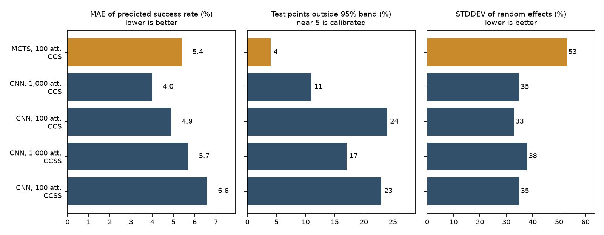
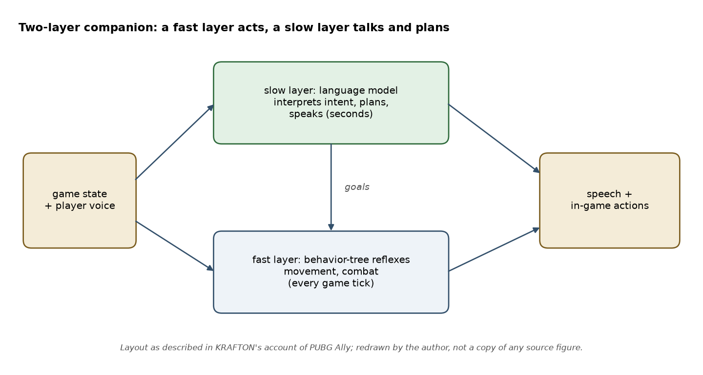

This post looks at what AI players are used for outside a tutorial series. It reads the primary sources for five systems (a conference paper, a research group's summary, a company announcement, a developer Q&A and a research lab's report) and for each says what the AI does, what was measured, who reported it, and which technique from Parts 4 to 8 it corresponds to. Every number below is the source's own, reported by the company or lab that built the system; none was reproduced here, and no Mario run was made for this post. Where a source gives a claim without a measurement, the post says so.

## 1. Testing levels: an imitation agent that predicts difficulty

Candy Crush Saga is a match-3 puzzle game with thousands of levels, and each new batch of levels has to be tuned so that it is neither trivial nor impossible. The paper [Human-Like Playtesting with Deep Learning](https://doi.org/10.1109/CIG.2018.8490442) (Gudmundsson et al., King, IEEE Conference on Computational Intelligence and Games 2018) replaces part of that human testing with an agent.

The agent is the technique of [Part 6](/posts/ai-plays-super-mario-6-learning-from-a-demonstrator/): a convolutional network trained by supervised learning on recorded moves of real players from earlier levels, then used as a policy that plays unseen levels. It is compared with a Monte Carlo Tree Search (MCTS) agent, which needs no player data but simulates future moves instead. For each level the agent plays many attempts; a regression then maps the agent's success rate to the success rate real players had.

What the paper reports, from its Table II (player success rate predicted for held-out levels):

{: w="760" }
*Table II of the paper, redrawn by the author from the printed values. CCS is Candy Crush Saga, CCSS is Candy Crush Soda Saga; "att." is attempts per level. The amber bar is the MCTS agent.*

- On Candy Crush Saga the network agent with 1,000 attempts per level has a mean absolute error of 4.0% against 5.4% for MCTS with 100 attempts, and a random-effect standard deviation of 35% against 53%.
- The picture is not one-sided: the share of test points outside the 95% prediction band is 11% for the network and 4% for MCTS (close to the 5% expected of a calibrated model), and 24% for the network at 100 attempts. The authors note this themselves.
- On Candy Crush Soda Saga the network's error is 5.7% at 1,000 attempts and 6.6% at 100; MCTS was run only on Candy Crush Saga, so there is no comparison for that game.
- Cost: the MCTS budget was 100 attempts of about 30 moves with 200 simulations per move; training one network took about 24 hours on one machine with 6 CPUs and one Tesla K80 GPU.
- The authors state that a difficulty estimate for a new level now takes under a minute, against 7 days of human playtesting for each new episode of 15 levels, and that the agent had been used for more than a year on more than 1,000 new levels.

Two cautions, both from the paper's own text: the actual player success rates are confidential and removed from the scatter plots, so only the error summaries can be read; and the evidence is one company's two sister games. The 7-day and 1,000-level statements are reported usage, not experiments.

The link to this series is direct. The agent learns the average of all players' moves, so it predicts how an average player would fare, which is the property difficulty tuning needs. A reward-trained agent like the one in [Part 7](/posts/ai-plays-super-mario-7-training-the-level-1-agent/) plays at its own skill level, which is a different quantity.

## 2. Testing coverage: rewarding curiosity

Difficulty is one thing to test. Another is whether any part of a large 3D map is broken or unreachable. In [Improving Playtesting Coverage via Curiosity Driven Reinforcement Learning Agents](https://arxiv.org/abs/2103.13798) (Electronic Arts' SEED research group, IEEE Conference on Games 2021) the agents are trained to maximise how much of the game state they cover. According to [SEED's summary of the paper](https://www.ea.com/seed/news/cog2021-curiosity-driven-rl-agents), each agent is rewarded for the novelty of its actions, in a complex 3D scenario where earlier exploration techniques performed poorly, and the paper also studies how to visualise the collected data so that designers can spot problems. Only that summary and the abstract were read for this post, not the full paper, so no results from it are quoted.

The technique is the reward design of [Part 4](/posts/ai-plays-super-mario-4-reward-design/) pointed in a different direction: Part 4's reward pays for progress to the right and a clear; this one pays for being somewhere new. The reward asks for coverage, not for bugs; the bugs are found afterwards in the data the agent leaves behind.

## 3. A shipped reinforcement-learning feature: the goalkeeper

[EA describes](https://www.ea.com/news/fc-26-goalkeepers) a reinforcement-learning goalkeeper in EA SPORTS FC 26, built by EA SPORTS, Frostbite and SEED. The agent was trained on hundreds of thousands of in-game situations to find positioning, and the training framework was built to be data-efficient, with an evaluation and fine-tuning loop for designers. Against the traditionally coded goalkeeper, EA reports a 10% improvement in ball-saving rate, training 50% faster than standard reinforcement-learning methods, training that can run overnight, and a validation suite of over 300 "unit-test" scenarios.

This is a company's own account in its own announcement, and it gives no baseline definition for the 10% (relative or absolute) or the test conditions, so the numbers show what EA chose to measure and nothing more. What it does show is the shape of production use: the learned policy is one component (goalkeeper positioning) inside a hand-built game, evaluated by a fixed set of scenarios, like the held-out evaluation in Parts 6 and 7.

## 4. A language-model teammate: PUBG Ally

[NVIDIA's Q&A with KRAFTON](https://developer.nvidia.com/blog/how-krafton-built-pubg-ally-a-co-playable-character-powered-by-nvidia-ace) describes PUBG Ally, a computer-controlled teammate for PUBG: BATTLEGROUNDS that takes the player's voice and the game state as input and outputs speech and in-game actions. The pipeline is speech recognition, a 2-billion-parameter small language model (Mistral-NeMo-Minitron-2B) and text-to-speech, running on the player's own GPU; KRAFTON says local running removed the network round trip and made response times more predictable. The language model is adapted to one map (Sanhok) and one mode (duo), and the character keeps a profile of the player and a record of earlier matches across sessions.

The structural point matches [Part 8](/posts/ai-plays-super-mario-8-language-model-players/). Part 8 showed that a model answering in seconds cannot control a real-time game decision by decision. The Q&A says the same thing by design: the language model does the deliberate work (interpreting intent, coordinating with the player, producing speech) and "reflex-level actions never have to wait for the model". NVIDIA's summary of the Q&A names the fast layer as a behavior tree running at game tick rate, which is a hand-written decision structure, not a learned one.

{: w="760" }
*The two layers as described in the KRAFTON Q&A, redrawn by the author. The "goals" arrow is the author's reading of how the layers are connected; the Q&A does not show a diagram.*

How well it works is reported only through player feedback. KRAFTON says it ran automated protocol checks, live A/B playtests and gathered feedback from over a thousand players, and quotes two anecdotes (a player's name remembered, a weapon found unprompted). The page gives no success rate, no latency figure and no comparison with a scripted teammate, so there is no number here to set beside the benchmarks of Part 8.

## 5. A research agent: SIMA 2 and generated worlds

At the research end, Google DeepMind's [SIMA 2](https://deepmind.google/blog/sima-2-an-agent-that-plays-reasons-and-learns-with-you-in-virtual-3d-worlds/) (November 2025; technical report: [arXiv 2512.04797](https://arxiv.org/abs/2512.04797)) puts a Gemini model at the core of an agent that plays several commercial 3D games from the screen with a virtual keyboard and mouse. DeepMind reports training on human demonstration videos with language labels plus Gemini-generated labels, task success closer to human level than the first SIMA on a harder evaluation set, and results on two games held out of training (ASKA and MineDojo). Its self-improvement claim is that, after learning from human demonstrations, the agent can continue in a new game from its own play, with Gemini proposing tasks and estimating rewards.

That last step connects to Part 4 in one clear way: the reward is no longer hand-written but produced by a model judging the agent's behaviour. The post by the lab lists the open problems itself: very long-horizon tasks, a short memory because of a limited context window kept small for low latency, and precise low-level actions through the keyboard-and-mouse interface.

The same post says SIMA 2 was also run in worlds generated by [Genie 3](https://deepmind.google/blog/genie-3-a-new-frontier-for-world-models), a model that, per DeepMind, generates interactive environments from a text prompt that can be navigated in real time at 24 frames per second, at 720p, with consistency kept for a few minutes. The figures are from DeepMind's own announcements; the success rates are shown as charts in the post and were not read as numbers.

## What the five have in common

- **The model is rarely the whole player.** King's network is a policy inside a prediction pipeline, EA's agent is one component of a football game, PUBG Ally pairs a language model with a reflex layer, and SIMA 2 is the one case where the model is the player, in research.
- **Evaluation decides what is believable.** The King paper reports its errors and its own weaknesses. The FC 26 and PUBG Ally pages report outcomes the company chose, with the measurement conditions missing. A claim from a launch page and a claim from a conference paper are different kinds of evidence, and a reader should treat them differently.
- **The reward is where the intent lives.** Difficulty prediction uses no reward, because it imitates people. Coverage testing rewards novelty. EA's goalkeeper page does not state its reward. SIMA 2 has a model produce it. Part 4's lesson holds in each: the agent does what is rewarded, and the design effort goes into saying what is wanted.
- **Nothing here replaces the series.** None of these sources trains an agent on level 1 of Super Mario, and none of their numbers can be placed next to the five-seed table of Part 7: the games, metrics and baselines all differ.

Part 10 closes the series: what the whole pipeline looks like in one place, what a reader can do with it next, and what to expect from the extensions.
