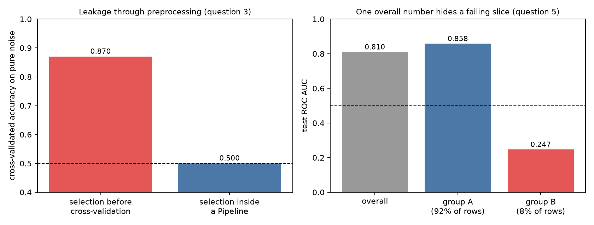

Many ML interview loops include a take-home assignment, a dataset and a brief with a few days to answer, and then a session in which the candidate presents the result and is questioned on it. This post follows the maths and statistics round of [Part 13](/posts/ml-engineer-interviews-13-maths-and-statistics/) and treats that exercise as ten questions with what each tests, a reference answer, a weak answer and a follow-up. Every number comes from code run on a 32-core CPU machine with fixed seeds, using the breast-cancer dataset bundled with scikit-learn or synthetic data, and the code is shown. Sources are limited to documents that were read: Google's [Rules of Machine Learning](https://developers.google.com/machine-learning/guides/rules-of-ml), the scikit-learn pages on [common pitfalls](https://scikit-learn.org/stable/common_pitfalls.html) and [permutation importance](https://scikit-learn.org/stable/modules/permutation_importance.html), and the paper [Model Cards for Model Reporting](https://arxiv.org/abs/1810.03993). Advice that no source supports is marked as the author's.


*Left: leakage through preprocessing (question 3). Right: an overall metric that hides a failing slice (question 5).*

## 1. "You have three days and a dataset. What do you do first?"

**What it tests.** Whether the candidate starts with a baseline and a plan, not with the most complex model.

**Reference answer.** Read the brief for the decision the model supports and the metric that is judged, then build the simplest end-to-end version before improving anything. Rule 1 of the Rules of Machine Learning says not to be afraid to launch a product without machine learning, because data-driven models can underperform basic heuristics; Rule 4 says to keep the first model simple and get the infrastructure right, since the first model gives the largest boost and the infrastructure problems will be more numerous than expected; Rule 14 says an interpretable model such as logistic regression is easier to debug. For a take-home this becomes a ladder: a trivial baseline, a heuristic, a linear model, then a stronger model only if the gain is real. Write down every rung with its score on the same validation scheme, because the gaps tell the reader what the effort bought. (Allocating the time, for example one third to data understanding and the baseline, one third to improvements and one third to the write-up, is the author's suggestion, not a source's.)

```python
import numpy as np
from sklearn.datasets import load_breast_cancer
from sklearn.dummy import DummyClassifier
from sklearn.ensemble import HistGradientBoostingClassifier
from sklearn.linear_model import LogisticRegression
from sklearn.model_selection import RepeatedStratifiedKFold, cross_val_score
from sklearn.pipeline import make_pipeline
from sklearn.preprocessing import StandardScaler
from sklearn.base import BaseEstimator, ClassifierMixin
X, y = load_breast_cancer(return_X_y=True, as_frame=True)
class OneFeature(ClassifierMixin, BaseEstimator):                 # heuristic baseline: the score is one raw column ("worst perimeter"), no learning
    def fit(self, X, y): self.classes_ = np.array([0, 1]); return self
    def predict_proba(self, X): s = -X["worst perimeter"].to_numpy(); s = (s - s.min()) / (s.max() - s.min()); return np.c_[1 - s, s]
    def predict(self, X): return (self.predict_proba(X)[:, 1] > 0.5).astype(int)
cv = RepeatedStratifiedKFold(n_splits=5, n_repeats=5, random_state=0)
models = {"majority class": DummyClassifier(strategy="prior"), "one-column heuristic": OneFeature(), "scaled logistic regression": make_pipeline(StandardScaler(), LogisticRegression(max_iter=1000)), "gradient boosting": HistGradientBoostingClassifier(random_state=0)}
print(f"{X.shape[0]} rows, {X.shape[1]} features, {y.mean():.1%} positive; ROC AUC over 5 x 5-fold cross-validation (mean +- std over 25 folds)")
for name, m in models.items(): s = cross_val_score(m, X, y, cv=cv, scoring="roc_auc"); print(f"{name:28s} {s.mean():.4f} +- {s.std():.4f}")
```

```
569 rows, 30 features, 62.7% positive; ROC AUC over 5 x 5-fold cross-validation (mean +- std over 25 folds)
majority class               0.5000 +- 0.0000
one-column heuristic         0.9761 +- 0.0107
scaled logistic regression   0.9951 +- 0.0052
gradient boosting            0.9932 +- 0.0062
```

On 569 rows, a model that always predicts the majority class scores an AUC of 0.500, a hand-written score using one raw column (the worst perimeter) already reaches 0.976, logistic regression on scaled features reaches 0.995 and gradient boosting 0.993. The heuristic gets most of the way, and the stronger model does not beat the linear one. The write-up can say exactly that, which is a more useful finding than a leaderboard number.

**Common weak answer.** Starting with a neural network or a large ensemble, with no baseline to show what it adds, and spending the budget on tuning.

**Follow-up.** "The gradient-boosting model is 0.002 better. Do you ship it?" Question 4 says how to answer: a difference that small is within the noise of the evaluation.

## 2. "How do you check the dataset for leakage?"

**What it tests.** Suspicion of results that look too good, and a method for finding the cause.

**Reference answer.** The scikit-learn pitfalls page defines data leakage as information that would not be available at prediction time being used when building the model, which gives overly optimistic performance estimates. In a take-home the commonest form is a column that is recorded after the outcome: a status field, a follow-up flag, an amount that exists only for the positive cases. The check is cheap: compute a single-column score (AUC for a classifier) for every column, sort, and read the top of the list against the data dictionary asking, for each column, whether it would exist at prediction time. A column that is far ahead of all the others, or a model near a perfect score, is a reason to stop and ask.

```python
import numpy as np, pandas as pd
from sklearn.datasets import load_breast_cancer
from sklearn.metrics import roc_auc_score
from sklearn.linear_model import LogisticRegression
from sklearn.model_selection import cross_val_score
from sklearn.pipeline import make_pipeline
from sklearn.preprocessing import StandardScaler
X, y = load_breast_cancer(return_X_y=True, as_frame=True); rng = np.random.default_rng(0)
X["followup_flag"] = y.to_numpy() * 1.0 + rng.normal(0, 0.05, len(y))        # a column recorded after the outcome: it carries the label
def scan(X):
    a = pd.Series({c: roc_auc_score(y, X[c]) for c in X.columns}); return (a - 0.5).abs().add(0.5).sort_values(ascending=False)   # direction-free AUC
s = scan(X); print("single-column AUC, top 4:"); print(s.head(4).round(4).to_string())
for name, cols in (("with the column", X.columns), ("without it", [c for c in X.columns if c != "followup_flag"])):
    m = make_pipeline(StandardScaler(), LogisticRegression(max_iter=2000)); print(f"cross-validated AUC {name:16s}: {cross_val_score(m, X[cols], y, cv=5, scoring='roc_auc').mean():.4f}")
```

```
single-column AUC, top 4:
followup_flag      1.0000
worst perimeter    0.9755
worst radius       0.9704
worst area         0.9698
cross-validated AUC with the column : 1.0000
cross-validated AUC without it      : 0.9952
```

Here a column `followup_flag` was added that carries the label plus a little noise, as a post-outcome field would. The scan puts it at 1.0000 against 0.9755 for the best genuine column, and the cross-validated AUC is 1.0000 with it against 0.9952 without. In this dataset the genuine columns are already strong, so the gap is small and a perfect AUC is the clearer alarm; in a weaker problem the gap is larger. The scan finds columns that leak the label directly; it does not find leakage through time (a feature computed with data from after the prediction date) or through duplicated rows, which need a check of the split design.

**Common weak answer.** Reporting an AUC of 1.000 as a success, or removing the suspicious column without saying why or telling the interviewer.

**Follow-up.** "The column is genuinely useful but arrives a day late. What now?" Either find the earlier proxy for it, or retrain with only what exists at prediction time and report the lower number.

## 3. "How can preprocessing leak, even with cross-validation?"

**What it tests.** Understanding that every fitted step belongs inside the cross-validation loop.

**Reference answer.** Anything learned from data (a scaler's mean, an imputer's median, a selected set of features, a target encoding) must be fitted on the training part of each fold only. If it is fitted on all rows first, the validation rows have influenced the model and the score is optimistic. The scikit-learn pitfalls page notes that pipelines help avoid leaking the test data into the training data; the fix is to put every fitted step in a `Pipeline` and cross-validate the pipeline. The size of the effect depends on how much the step uses the labels: scaling leaks little, feature selection leaks a lot.

```python
import numpy as np
from sklearn.feature_selection import SelectKBest, f_classif
from sklearn.linear_model import LogisticRegression
from sklearn.model_selection import cross_val_score, StratifiedKFold
from sklearn.pipeline import make_pipeline
rng = np.random.default_rng(0); X = rng.normal(size=(100, 5000)); y = rng.integers(0, 2, 100)            # pure noise: no feature relates to the label
cv = StratifiedKFold(5, shuffle=True, random_state=0)
Xs = SelectKBest(f_classif, k=20).fit_transform(X, y)                                                    # selection on ALL rows, then cross-validate
print(f"selection before cross-validation : accuracy {cross_val_score(LogisticRegression(), Xs, y, cv=cv).mean():.3f}")
p = make_pipeline(SelectKBest(f_classif, k=20), LogisticRegression())
print(f"selection inside a Pipeline        : accuracy {cross_val_score(p, X, y, cv=cv).mean():.3f}   (chance is 0.5)")
```

```
selection before cross-validation : accuracy 0.870
selection inside a Pipeline        : accuracy 0.500   (chance is 0.5)
```

The data are 100 rows of 5,000 pure-noise features and random labels, so the honest accuracy is 0.5. Selecting the 20 best features on all rows and then cross-validating gives 0.870, an apparently strong model built from nothing. The same selection inside a Pipeline gives 0.500. The wide, small-sample shape is the dangerous one, and it is the usual shape of a take-home with hundreds of columns and a few hundred rows.

**Common weak answer.** Scaling or selecting on the full dataset "for convenience" and then splitting.

**Follow-up.** "Does the same apply to hyperparameter tuning?" Yes: the score used to choose the hyperparameters is optimistic for the chosen model, so a final estimate needs data that were not used for the choice, either a holdout or an outer cross-validation loop.

## 4. "Your model scores 0.993. How much do you trust that number?"

**What it tests.** Evaluation noise, and honest comparison of two models.

**Reference answer.** A test score is an estimate with its own uncertainty, from the choice of split, from the finite size of the test set (Part 13, question 5) and from the training randomness. Three habits follow. Report a spread, for example from repeated cross-validation, not a single number. Compare two models on the same splits and look at the paired differences, not at two separate means. Fix the random seeds so that the result can be reproduced, and know how much the seed alone moves the score.

```python
import numpy as np
from sklearn.datasets import load_breast_cancer
from sklearn.ensemble import RandomForestClassifier
from sklearn.linear_model import LogisticRegression
from sklearn.model_selection import train_test_split, cross_val_score
from sklearn.pipeline import make_pipeline
from sklearn.preprocessing import StandardScaler
from sklearn.metrics import roc_auc_score
X, y = load_breast_cancer(return_X_y=True)
lr = lambda: make_pipeline(StandardScaler(), LogisticRegression(max_iter=1000)); rf = lambda s: RandomForestClassifier(100, random_state=s, n_jobs=8)
a = []; b = []
for seed in range(30):
    Xtr, Xte, ytr, yte = train_test_split(X, y, test_size=0.2, random_state=seed, stratify=y)
    a.append(roc_auc_score(yte, lr().fit(Xtr, ytr).predict_proba(Xte)[:, 1])); b.append(roc_auc_score(yte, rf(0).fit(Xtr, ytr).predict_proba(Xte)[:, 1]))
a, b = np.array(a), np.array(b)
print(f"30 different 80/20 splits ({len(yte)} test rows): logistic AUC min {a.min():.3f} max {a.max():.3f}; forest AUC min {b.min():.3f} max {b.max():.3f}")
print(f"forest better than logistic on {int((b > a).sum())} of 30 splits; mean difference {np.mean(b - a):+.4f}, std of the difference {np.std(b - a):.4f}")
s = [cross_val_score(rf(k), X, y, cv=5, scoring="roc_auc").mean() for k in range(20)]; print(f"same forest, 20 random seeds, 5-fold CV AUC: min {min(s):.4f} max {max(s):.4f}")
s0 = [cross_val_score(rf(0), X, y, cv=5, scoring="roc_auc").mean() for _ in range(3)]; print("same seed repeated three times:", [round(float(v), 6) for v in s0])
```

```
30 different 80/20 splits (114 test rows): logistic AUC min 0.987 max 1.000; forest AUC min 0.973 max 0.999
forest better than logistic on 4 of 30 splits; mean difference -0.0069, std of the difference 0.0077
same forest, 20 random seeds, 5-fold CV AUC: min 0.9880 max 0.9925
same seed repeated three times: [0.990675, 0.990675, 0.990675]
```

On 30 different 80/20 splits of 569 rows (114 test rows), the logistic regression's AUC ranges from 0.987 to 1.000 and the forest's from 0.973 to 0.999; the forest beats the logistic model on only 4 of the 30 splits, with a mean difference of -0.0069 and a standard deviation of the difference of 0.0077. The same forest with 20 different seeds ranges from 0.9880 to 0.9925 in cross-validated AUC, a spread of 0.0045 from the seed alone, while repeating one seed three times gives the identical 0.990675. A single split, then, can make either model look better, and a 0.002 difference is below the seed noise.

**Common weak answer.** "My model reached 0.993, and the baseline got 0.991, so mine is better."

**Follow-up.** "How would you show that one model is really better?" More repeats with paired differences, a test designed for the comparison, and a statement of the smallest difference that would matter to the decision.

## 5. "How do you analyse errors?"

**What it tests.** Evaluation by slice, not only in aggregate.

**Reference answer.** Break the metric down by the groups that matter: customer segments, regions, device types, time periods, and for people-facing systems demographic groups. The Model Cards paper makes this a reporting requirement, with the keyword "disaggregated evaluation" and a quantitative-analysis section for unitary and intersectional results. An aggregate dominated by a large group hides a small one. Then read the worst individual errors by hand, which finds label noise, missing features and data bugs faster than any metric.

```python
import numpy as np
from sklearn.ensemble import HistGradientBoostingClassifier
from sklearn.metrics import roc_auc_score
rng = np.random.default_rng(0); n = 20000
g = rng.random(n) < 0.08                                                                              # group B: 8% of the rows
x = rng.normal(size=(n, 3)); logit = np.where(g, -1.5 * x[:, 0] + 0.2 * x[:, 1], 2.0 * x[:, 0] + 0.5 * x[:, 1]); y = rng.random(n) < 1 / (1 + np.exp(-logit))   # a different relation in group B
X = np.c_[x, np.zeros(n)]                                                                             # the model is not given the group
tr, te = np.arange(n) < 14000, np.arange(n) >= 14000
m = HistGradientBoostingClassifier(random_state=0).fit(X[tr], y[tr]); p = m.predict_proba(X[te])[:, 1]; yt, gt = y[te], g[te]
print(f"overall test AUC {roc_auc_score(yt, p):.3f}; group A ({(~gt).sum()} rows) {roc_auc_score(yt[~gt], p[~gt]):.3f}; group B ({gt.sum()} rows) {roc_auc_score(yt[gt], p[gt]):.3f}")
```

```
overall test AUC 0.810; group A (5533 rows) 0.858; group B (467 rows) 0.247
```

The synthetic data have a group B that is 8% of rows and follows a different relation between the features and the label than group A (the model is not told the group). The overall test AUC is 0.810 and group A scores 0.858, but group B scores 0.247, worse than a coin because the model has learned the majority's relation. The headline number gives no sign of that; only the slice does. The cause is chosen to be visible, a reversed relation; real failures are usually partial, which is why the slices need to be defined before the results are seen.

**Common weak answer.** Reporting a single AUC and a feature-importance chart, with no slice results and no examples of failures.

**Follow-up.** "Group B is small. What can you do?" Collect or reweight data for it, fit a separate model or add the group's features, or constrain the use of the model to the population where it works, and say so in the limitations.

## 6. "The classes are 98 to 2. What do you do?"

**What it tests.** Metric choice, and the difference between ranking and a decision threshold (the sampling side was covered in Part 5, the metrics in Part 4).

**Reference answer.** First, accuracy is useless: always predicting the majority class is right 97.5% of the time here. Use a threshold-free ranking metric and one that reflects the rare class: precision and recall, and average precision, whose reference for a random scorer is the prevalence, not 0.5. Second, separate the ranking from the decision. Reweighting classes changes where the default 0.5 threshold falls but not necessarily the ranking quality, and the decision threshold should be chosen on a validation set from the cost of each kind of error.

```python
import numpy as np
from sklearn.datasets import make_classification
from sklearn.linear_model import LogisticRegression
from sklearn.metrics import accuracy_score, average_precision_score, precision_score, recall_score, roc_auc_score, f1_score
from sklearn.model_selection import train_test_split
X, y = make_classification(40000, 20, n_informative=5, weights=[0.98], flip_y=0.01, class_sep=0.8, random_state=0)
Xtr, Xte, ytr, yte = train_test_split(X, y, test_size=0.5, random_state=0, stratify=y); Xa, Xv, ya, yv = train_test_split(Xte, yte, test_size=0.5, random_state=1, stratify=yte)
print(f"positives {y.mean():.1%}; accuracy of always predicting the majority class {1 - yte.mean():.3f}; average precision of a random scorer = prevalence {yte.mean():.3f}")
for cw in (None, "balanced"):
    m = LogisticRegression(max_iter=1000, class_weight=cw).fit(Xtr, ytr); pv, pa = m.predict_proba(Xv)[:, 1], m.predict_proba(Xa)[:, 1]
    ths = np.linspace(0.02, 0.95, 94); t = ths[np.argmax([f1_score(yv, pv > h) for h in ths])]
    lab = pa > 0.5; print(f"class_weight={str(cw):8s} AUC {roc_auc_score(ya, pa):.3f} AP {average_precision_score(ya, pa):.3f} | at 0.5: acc {accuracy_score(ya, lab):.3f} precision {precision_score(ya, lab, zero_division=0):.3f} recall {recall_score(ya, lab):.3f} | threshold tuned on validation ({t:.2f}): precision {precision_score(ya, pa > t):.3f} recall {recall_score(ya, pa > t):.3f}")
```

```
positives 2.5%; accuracy of always predicting the majority class 0.975; average precision of a random scorer = prevalence 0.025
class_weight=None     AUC 0.780 AP 0.201 | at 0.5: acc 0.976 precision 0.700 recall 0.028 | threshold tuned on validation (0.11): precision 0.202 recall 0.305
class_weight=balanced AUC 0.795 AP 0.103 | at 0.5: acc 0.756 precision 0.070 recall 0.719 | threshold tuned on validation (0.78): precision 0.132 recall 0.333
```

On a synthetic problem with 2.5% positives, the default logistic regression has an accuracy of 0.976, above the majority baseline of 0.975, but recovers only 2.8% of the positives at the 0.5 threshold. With `class_weight="balanced"` the recall at 0.5 is 0.719 but the precision is 0.070 and the accuracy falls to 0.756. Tuning the threshold on a separate validation set gives the unweighted model a precision of 0.202 and a recall of 0.305 and the weighted model 0.132 and 0.333. The AUC is similar (0.780 against 0.795) and the average precision is higher for the unweighted model (0.201 against 0.103), so the weights did not improve the ranking here. The reweighting was a way to move the threshold, which can be done directly; this is one dataset, and the effect varies with the model and the data.

**Common weak answer.** Reporting accuracy, or oversampling the whole dataset before the split, which is leakage (question 3).

**Follow-up.** "How do you choose the threshold?" From the costs of a false positive and a false negative, or from a capacity limit such as how many cases the team can review per day.

## 7. "Which features matter most? Explain the model to a non-specialist."

**What it tests.** Whether the importance chart can be trusted, and whether the candidate can explain without overclaiming.

**Reference answer.** The default feature importance of tree ensembles is computed from the training process (impurity decrease). The scikit-learn documentation states that this importance is strongly biased and favours high-cardinality features, typically numerical ones, over low-cardinality features such as binary ones, and that permutation importance does not show that bias. Permutation importance shuffles one column at a time and measures how much a chosen score drops, and it can be computed on a held-out set, which highlights what contributes to generalisation; a feature that is important on the training set but not on the held-out set may be causing overfitting. Say what the number means in words: "shuffling this column costs this much accuracy for this model". It describes the model, not the world; it does not say that changing the feature would change the outcome (the author's caveat, as correlated features also share or hide importance).

```python
import numpy as np
from sklearn.datasets import load_breast_cancer
from sklearn.ensemble import RandomForestClassifier
from sklearn.inspection import permutation_importance
from sklearn.model_selection import train_test_split
X, y = load_breast_cancer(return_X_y=True, as_frame=True); rng = np.random.default_rng(0)
X["row_id_like_noise"] = rng.normal(size=len(X)); X["binary_noise"] = rng.integers(0, 2, len(X))        # two columns unrelated to the target
Xtr, Xte, ytr, yte = train_test_split(X, y, test_size=0.3, random_state=0, stratify=y)
m = RandomForestClassifier(300, random_state=0, n_jobs=8).fit(Xtr, ytr); print(f"test accuracy {m.score(Xte, yte):.3f}")
imp = dict(zip(X.columns, m.feature_importances_)); pi = permutation_importance(m, Xte, yte, n_repeats=30, random_state=0, n_jobs=8); pm = dict(zip(X.columns, pi.importances_mean))
rank = lambda d, c: sorted(d, key=d.get, reverse=True).index(c) + 1
for c in ("row_id_like_noise", "binary_noise"): print(f"{c:18s} impurity importance {imp[c]:.4f} (rank {rank(imp, c)} of {len(imp)}); permutation importance on test data {pm[c]:+.4f} (rank {rank(pm, c)})")
print("top 3 by permutation importance:", sorted(pm, key=pm.get, reverse=True)[:3])
```

```
test accuracy 0.942
row_id_like_noise  impurity importance 0.0027 (rank 31 of 32); permutation importance on test data -0.0049 (rank 28)
binary_noise       impurity importance 0.0003 (rank 32 of 32); permutation importance on test data -0.0029 (rank 21)
top 3 by permutation importance: ['worst area', 'mean concave points', 'worst concave points']
```

Two columns unrelated to the target were added to the dataset: a continuous random column and a random binary column. The forest's impurity importance gives the continuous noise column 0.0027 and the binary one 0.0003, a ninefold difference between two columns with no signal at all (their ranks, 31 and 32 of 32, are low here only because the real features are strong). The permutation importance on the held-out data gives both columns a value at or below zero (-0.0049 and -0.0029), correctly, and its top three (worst area, mean concave points, worst concave points) are real features. The negative values mean shuffling happened to improve the score slightly, which is what noise looks like.

**Common weak answer.** Presenting the impurity importance chart as "the drivers of the outcome", with no mention of its bias or that it describes correlation.

**Follow-up.** "Two features are nearly duplicates. What does the importance show?" Often the importance is split or hidden between them; the usual approach is to group them and shuffle them together.

## 8. "How would you make this code something a team could run in production?"

**What it tests.** Engineering maturity, and the training-serving skew problem from [Part 11](/posts/ml-engineer-interviews-11-deployment-and-mlops/).

**Reference answer.** The Rules of Machine Learning put the infrastructure first: Rule 4 lists what to settle before anyone can use the model, and Rule 37 is about measuring the gap between training and serving, with the advice to have tests for the code that creates examples in training and serving and to be able to load and use a fixed model in serving. In a take-home this becomes a few concrete things. All preprocessing and the model sit in one pipeline object, so that the same transformations run at training and prediction. Columns are referred to by name, not by position. Unseen categories and missing values have defined behaviour. The saved model reloads and gives identical predictions, and a short test says so. A README gives the environment and one command that reproduces the reported numbers.

```python
import io, joblib, numpy as np, pandas as pd
from sklearn.compose import ColumnTransformer
from sklearn.ensemble import HistGradientBoostingClassifier
from sklearn.impute import SimpleImputer
from sklearn.pipeline import make_pipeline
from sklearn.preprocessing import OneHotEncoder
rng = np.random.default_rng(0); n = 3000
df = pd.DataFrame({"age": rng.integers(18, 80, n).astype(float), "income": rng.lognormal(10, 0.5, n), "plan": rng.choice(["a", "b", "c"], n)})
df.loc[rng.random(n) < 0.1, "income"] = np.nan; y = ((df.age > 50) ^ (df.plan == "b")).astype(int)
pre = ColumnTransformer([("num", SimpleImputer(strategy="median"), ["age", "income"]), ("cat", OneHotEncoder(handle_unknown="ignore"), ["plan"])])
model = make_pipeline(pre, HistGradientBoostingClassifier(random_state=0)).fit(df, y)
buf = io.BytesIO(); joblib.dump(model, buf); buf.seek(0); loaded = joblib.load(buf)
print("saved and reloaded pipeline gives identical predictions:", np.array_equal(model.predict_proba(df), loaded.predict_proba(df)))
shuffled = df[["plan", "income", "age"]]; print("columns in a different order, DataFrame in:", np.allclose(model.predict_proba(df), loaded.predict_proba(shuffled)))
new = df.iloc[:5].copy(); new.loc[new.index[0], "plan"] = "z"; print("unseen category handled without error; predictions for the 5 rows:", np.round(loaded.predict_proba(new)[:, 1], 3))
manual = HistGradientBoostingClassifier(random_state=0).fit(np.c_[df.age, df.income.fillna(df.income.median()), (df.plan == "a"), (df.plan == "b"), (df.plan == "c")], y)
x = np.c_[df.age, df.income.fillna(df.income.median()), (df.plan == "a"), (df.plan == "b"), (df.plan == "c")]; swapped = x[:, [1, 0, 2, 3, 4]]
print(f"hand-built numpy features: accuracy {np.mean(manual.predict(x) == y):.3f}; same rows with two columns swapped by mistake {np.mean(manual.predict(swapped) == y):.3f}")
```

```
saved and reloaded pipeline gives identical predictions: True
columns in a different order, DataFrame in: True
unseen category handled without error; predictions for the 5 rows: [1. 1. 0. 0. 1.]
hand-built numpy features: accuracy 1.000; same rows with two columns swapped by mistake 0.487
```

The pipeline (median imputation, one-hot encoding with `handle_unknown="ignore"`, gradient boosting) is saved and reloaded with identical predictions. Giving the reloaded model a DataFrame with the columns in a different order changes nothing, because the columns are selected by name, and a row with an unseen plan "z" produces a prediction without an error. The contrast is a model hand-fitted on a NumPy array: it has an accuracy of 1.000 on its own data, and with two columns swapped by mistake it drops to 0.487 with no warning, which is the silent kind of skew.

**Common weak answer.** A notebook with state that depends on cell order, preprocessing done by hand before the split and again, slightly differently, for prediction, and no way to reproduce the numbers.

**Follow-up.** "What do you log in production?" The inputs the model actually received, so that they can be compared with the training distribution (Rule 29 suggests saving the features used at serving time); drift monitoring is covered in Part 11.

## 9. "Present your solution in ten minutes."

**What it tests.** Communication: structure, prioritisation and honesty about what the numbers support.

**Reference answer.** The model-card paper gives a ready checklist of what a reader needs: model details (who built it, when, which version and type, what was trained on what), intended use (primary uses, primary users, out-of-scope uses), the factors that matter (groups, conditions) and which were evaluated, the metrics (measures, decision thresholds and how variation is approached), the evaluation data and training data, quantitative analyses (overall and by slice), ethical considerations, and caveats and recommendations. A take-home presentation is a compressed version of the same list. A structure that fits ten minutes (the author's suggestion): the problem and the decision in one slide; the data and what was checked (leakage, split, slices); the baseline ladder from question 1; the chosen model with its validation score and spread; where it fails; what was not done and what would come next; and the question the candidate would ask the business. Put the conclusion first and the evidence after, use the same metric throughout and give the uncertainty with every number.

**Common weak answer.** A tour of the notebook in the order the work was done, ending on the best score, with no statement of limits.

**Follow-up.** "Who should not use this model?" The out-of-scope section of a model card exists for this question: the populations, time ranges and input types that were not evaluated.

## 10. "Your result looks great. What could be wrong with it?"

**What it tests.** Self-criticism, and whether the candidate has already looked for the failure modes.

**Reference answer.** The strongest presentation answers this before it is asked, using the checks of questions 2 to 5: the single-column scan found no leaking column; every fitted step is inside the pipeline; the spread over repeated splits is reported and the difference between the top two models is within it; the worst slice and its score are shown. Then the open risks are named: the test set is small, so the interval is wide (Part 13, question 5); the training period and the deployment period may differ; the labels may be noisy or delayed; and the metric may not match the business cost. Say what would change the conclusion and what test would show it.

Concretely, using the numbers above: a gap of 0.002 in AUC between two models is smaller than the 0.0045 spread caused by the seed alone, and the honest conclusion is that the two are indistinguishable on this data, which makes the simpler one the better choice (Rule 4).

**Common weak answer.** Defending the number: "the cross-validation score is high, so it generalises".

**Follow-up.** "If you had another week?" Rank the options by what they would change in the decision: more labelled data for the weakest slice, a check on time-based splits, a calibrated threshold from the real costs, and monitoring.

## Takeaways

- Build the ladder first: majority class 0.500, one-column heuristic 0.976, logistic regression 0.995, gradient boosting 0.993 AUC; the heuristic nearly matched the best model.
- A column that leaks the label scored a single-column AUC of 1.0000 against 0.9755 for the best real column.
- Feature selection before cross-validation gave 0.870 accuracy on pure noise; inside a Pipeline it gave 0.500.
- A 0.002 gap is below the 0.0045 spread from the random seed alone; the forest beat the logistic model on only 4 of 30 splits.
- An overall AUC of 0.810 hid a group at 0.247.
- With 2.5% positives, accuracy 0.976 came with 2.8% recall at the default threshold; choose the threshold on validation data.
- Impurity importance gave a pure-noise continuous column nine times the value of a pure-noise binary column; permutation importance on held-out data did not.
- A saved pipeline reloads to identical predictions; a hand-built array pipeline with two swapped columns dropped from 1.000 to 0.487 accuracy without a warning.
- Present as a model card does: intended use, data, metrics with thresholds, slices, caveats.

## Limits

- All experiments use one bundled dataset or synthetic data with fixed seeds. They show that each failure mode exists and how large it can be, not how large it will be on a given assignment. The slice example is built to be visible, and the leaking column was added by hand.
- Source claims are limited to passages read in the Rules of Machine Learning, the scikit-learn pitfalls and permutation-importance pages, and the Model Cards paper. The time split of the three days, the ten-minute outline, the grouping of correlated features and the interpretation of negative permutation values are the author's.
- Take-home formats vary: some forbid outside help or limit the time, some ask for a notebook and others for a repository. The brief of the actual assignment takes precedence over this list.
- Not covered: assignments with text, images or time series in detail, and presentations to a panel with a live coding component.
- The candidates in the examples are hypothetical, and the reference answers are one reasonable answer among several.

Next: [Part 15, the project deep-dive](/posts/ml-engineer-interviews-15-project-deep-dive/).
