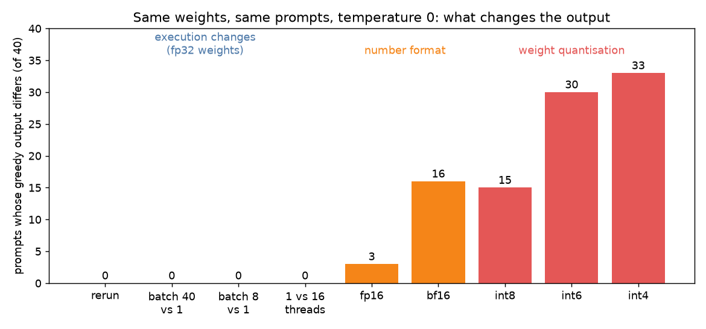

This series is about running language-model systems in production: serving, evaluation, release, cost and drift. Part 1 sets the frame from the MLOps literature, then measures one thing every later part depends on: how much a model's output changes when nothing about the model is meant to change.

## What MLOps already says

[Sculley et al. (2015)](https://papers.nips.cc/paper/5656-hidden-technical-debt-in-machine-learning-systems) argue, using the software-engineering notion of technical debt, that quick wins in ML systems carry large ongoing maintenance costs. Their list of ML-specific risks includes boundary erosion, entanglement, hidden feedback loops, undeclared consumers, data dependencies, configuration issues and changes in the external world.

Google's [MLOps architecture guide](https://docs.cloud.google.com/architecture/mlops-continuous-delivery-and-automation-pipelines-in-machine-learning) defines MLOps as unifying ML system development and operation, with automation and monitoring at every step. It separates three levels:

- **Level 0:** a manual, script-driven process; new versions are released a couple of times a year; no CI or CD; no monitoring of predictions.
- **Level 1:** an automated ML pipeline, giving continuous training (CT) on new data.
- **Level 2:** CI/CD around that pipeline, so new pipeline implementations are tested and deployed automatically.

The guide states that it applies primarily to predictive AI systems. That scoping matters here: CT assumes the team trains the model. A team that calls a hosted model, or downloads open weights, usually does not.

## What an LLM system changes

The following is the author's reading of where the MLOps frame stops fitting, not a sourced claim:

- **The trained artefact is often not yours.** The weights may change without a commit in your repository.
- **The release unit is larger than the model.** Behaviour depends on weights, number format, prompt template, retrieved context and sampling parameters.
- **There is no single metric.** Part 3 deals with this.
- **Inference is the recurring cost.** Parts 2 and 5 deal with this.

One published measurement shows the first point. [Chen, Zaharia and Zou (2023)](https://arxiv.org/abs/2307.09009) evaluated the March and June 2023 versions of GPT-3.5 and GPT-4 and found that performance and behaviour can vary greatly over time; GPT-4 identified primes versus composites with 84% accuracy in March and 51% in June, partly explained by a drop in following chain-of-thought prompting. Part 6 returns to this.

The thread of the series: what the system does is set by several things that can each change, so the operational job is to pin what can be pinned, and to measure the rest.

## The measurement

A common first step is to pin everything and set temperature to 0. This experiment asks how much that buys. The model is a 3-layer, 128-wide character transformer (618,496 parameters) trained for 3,000 steps on a public-domain text (validation 2.07 bits per character). It is small, which limits what the result shows (see Limits). The test takes 40 prompts of 32 characters, generates 96 characters greedily, and counts how many prompts produce a different output from the reference run (fp32, batch size 1, 16 threads). Each variant changes one thing.


*Greedy outputs that differ from the fp32 reference, out of 40 prompts. Execution changes leave the output alone; number format and quantisation do not.*

```python
from base import *
import copy, sys
torch.manual_seed(0)
m=LM(128,L=3,h=4); opt=torch.optim.AdamW(m.parameters(),3e-3)
for s in range(3000):
    x,y=batch(tr); l=F.cross_entropy(m(x).reshape(-1,V),y.reshape(-1)); opt.zero_grad(); l.backward(); opt.step()
print("params",sum(p.numel() for p in m.parameters()),"val bpc %.3f"%bpc(m,va),flush=True)
m.eval()
prompts=[text[i:i+32] for i in range(1000,1000+40*997,997)]
def greedy(model,ps,n=96,dtype=torch.float32,pad_to=None):
    # returns list of generated id lists; prompts are equal length so batching is exact in shape
    x=torch.tensor([[ix[c] for c in p] for p in ps])
    out=[]
    with torch.no_grad():
        for _ in range(n):
            ctx=x[:,-CTX:]
            lg=model(ctx).float()[:,-1]
            x=torch.cat([x,lg.argmax(-1,keepdim=True)],1)
    return x[:,len(ps[0]):].tolist()
def div(a,b):
    r=[]
    for u,v in zip(a,b):
        k=next((i for i,(p,q) in enumerate(zip(u,v)) if p!=q),None); r.append(k)
    return r
def summ(name,a,b):
    d=div(a,b); n=sum(k is not None for k in d); ks=sorted(k for k in d if k is not None)
    print(f"{name:34s} diverged {n:2d}/40  median first-diff pos {ks[len(ks)//2] if ks else '-'}",flush=True)
base=[greedy(m,[p])[0] for p in prompts]            # batch=1, fp32, 16 threads
# repeat run
summ("rerun same config",base,[greedy(m,[p])[0] for p in prompts])
b40=greedy(m,prompts)
summ("batch 40 vs batch 1",base,b40)
b8=[r for i in range(0,40,8) for r in greedy(m,prompts[i:i+8])]
summ("batch 8 vs batch 1",base,b8)
torch.set_num_threads(1); t1=[greedy(m,[p])[0] for p in prompts]; torch.set_num_threads(16)
summ("1 thread vs 16 threads",base,t1)
mb=copy.deepcopy(m).to(torch.bfloat16)
bf=[greedy(mb,[p])[0] for p in prompts]
summ("bf16 weights vs fp32",base,bf)
mh=copy.deepcopy(m).to(torch.float16); fh=[greedy(mh,[p])[0] for p in prompts]
summ("fp16 weights vs fp32",base,fh)
for bits in (8,6,4):
    q=copy.deepcopy(m); quant_(q,bits); qq=[greedy(q,[p])[0] for p in prompts]
    summ(f"int{bits} weight quant vs fp32",base,qq)
# logit diffs on one batch
x=torch.tensor([[ix[c] for c in p] for p in prompts])
with torch.no_grad():
    l1=torch.cat([m(x[i:i+1]) for i in range(40)]); l40=m(x)
    print("max |logit diff| batch1 vs batch40: %.2e"%(l1-l40).abs().max().item())
    torch.set_num_threads(1); l_t1=m(x); torch.set_num_threads(16); l_t16=m(x)
    print("max |logit diff| 1 vs 16 threads : %.2e"%(l_t1-l_t16).abs().max().item())
    print("max |logit diff| bf16 vs fp32    : %.2e"%(mb(x).float()-l40).abs().max().item())
    print("logit scale (max abs)            : %.2f"%l40.abs().max().item())
# temperature sampling with fixed seed, batch 1 vs 40: same seed
def samp(model,ps,seed,n=96):
    g=torch.Generator().manual_seed(seed); x=torch.tensor([[ix[c] for c in p] for p in ps])
    with torch.no_grad():
        for _ in range(n):
            pr=F.softmax(model(x[:,-CTX:]).float()[:,-1],-1)
            x=torch.cat([x,torch.multinomial(pr,1,generator=g)],1)
    return x[:,len(ps[0]):].tolist()
a=samp(m,prompts[:1],7)[0]; b=samp(m,prompts[:1],7)[0]; print("seeded sample, same config rerun identical:",a==b)
c=samp(m,prompts[:2],7)[0]; print("seeded sample, prompt alone vs in batch of 2 identical:",a==c)
print("sample text:",repr(''.join(chars[i] for i in a[:60])))
```

Output:

```
params 618496 val bpc 2.071
rerun same config                  diverged  0/40  median first-diff pos -
batch 40 vs batch 1                diverged  0/40  median first-diff pos -
batch 8 vs batch 1                 diverged  0/40  median first-diff pos -
1 thread vs 16 threads             diverged  0/40  median first-diff pos -
bf16 weights vs fp32               diverged 16/40  median first-diff pos 47
fp16 weights vs fp32               diverged  3/40  median first-diff pos 38
int8 weight quant vs fp32          diverged 15/40  median first-diff pos 43
int6 weight quant vs fp32          diverged 30/40  median first-diff pos 21
int4 weight quant vs fp32          diverged 33/40  median first-diff pos 5
max |logit diff| batch1 vs batch40: 0.00e+00
max |logit diff| 1 vs 16 threads : 5.72e-06
max |logit diff| bf16 vs fp32    : 1.62e-01
logit scale (max abs)            : 15.38
seeded sample, same config rerun identical: True
seeded sample, prompt alone vs in batch of 2 identical: False
sample text: '         chuckinson. coining her understood name.\n\n\n\n\n\n[illu'
```

Reading the numbers:

- **Execution changes did nothing here.** Rerunning, changing the batch size to 8 or 40, and moving from 16 threads to 1 gave 0 of 40 differing outputs. The batch-1 versus batch-40 logits were bit-identical; 1 versus 16 threads differed by at most 5.7e-06, too small to flip any argmax in these 40 prompts.
- **Number format did.** Casting the weights to fp16 changed 3 prompts; bf16 changed 16, with a maximum logit difference of 0.16 against a logit scale of about 15. A difference that small still flips outputs, because generation compounds: after the first changed character, every later step conditions on a different prefix. The median first difference was at position 47 for bf16.
- **Quantisation did more.** Round-to-nearest per-row weight quantisation (simulated in fp32) changed 15 prompts at 8 bits, 30 at 6 bits and 33 at 4 bits, with the first difference arriving earlier as the bit width fell (median position 43, 21 and 5).
- **Seeded sampling is reproducible only per call shape.** Re-running a seeded sample gave the same text. The same prompt in a batch of 2 did not; the likely reason (not isolated here) is that one random generator is shared across the batch rows, so each row's draws depend on the batch shape. That is a property of this code, not of the model, but it is a real way for a replay to fail in a batched server.

## What to take from it

- A change of number format or quantisation is a release, not a deployment detail. Its effect on the output is large, even when the logits move by about 1% of their scale.
- On this CPU and this model, reruns and batching are not the main risk. On GPUs, with different kernels and non-deterministic reductions, that conclusion may not hold; this experiment does not test it.
- Replay requires recording the whole call: weights hash, number format, template, sampling parameters, seed and batch shape. Part 4 builds that record.

Next: Part 2, serving: latency, throughput and the memory a KV cache takes.

## Limits

- One model of 618K parameters, trained on one text. Production models differ in size, depth and numerics; the sizes of the effects here are not transferable, only the direction.
- CPU only, one machine. No GPU kernels were tested, and only one thread count pair (1 and 16).
- 40 prompts, one run each. The counts are single measurements; a rerun of the training could shift them.
- Quantisation is simulated round-to-nearest on weight matrices, in fp32 arithmetic. It is not the scheme of any particular inference engine.
- The reading of where MLOps stops fitting is the author's; the Google guide covers predictive AI and says so.
