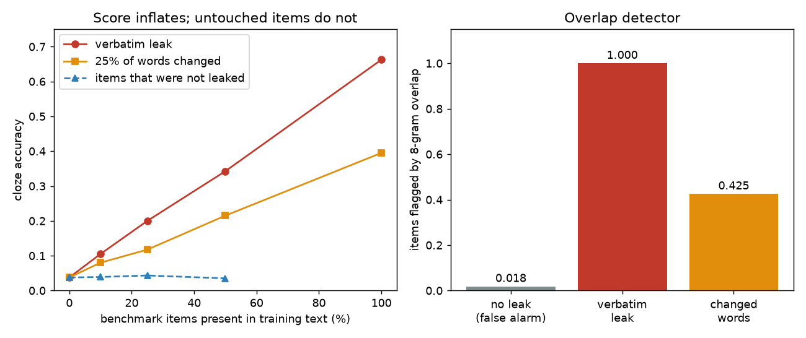

This is the first of seven posts on how language models are evaluated and how companies use those evaluations. Parts 1 to 5 cover the methods (benchmarks, human preference, model judges, execution-based and agent tests, safety testing); Parts 6 and 7 cover published evidence from industry. Everything rests on papers and public documents, and the numbers in code blocks come from runs on a 16-core CPU. This part defines what a benchmark score is, summarizes the published evidence that scores leak, and reproduces the mechanism with a small experiment.

## What a benchmark score is

A static benchmark is a fixed list of questions with known answers. The score is the fraction answered correctly. Two early designs set the pattern:

- [MMLU](https://arxiv.org/abs/2009.03300) covers 57 tasks, from elementary mathematics to law. When it was published, most models were near random chance, and the largest GPT-3 model was about 20 percentage points above it. The paper also reported near-random accuracy on morality and law.
- [HELM](https://arxiv.org/abs/2211.09110) argued that accuracy alone is too narrow. It measures 7 metrics (accuracy, calibration, robustness, fairness, bias, toxicity, efficiency) over 16 core scenarios, and evaluates 30 models on 42 scenarios in total. Before HELM, models on average had been evaluated on 17.9% of the core scenarios; HELM raised that to 96.0%, so that models could be compared on the same ground.

A score is therefore a statement about one item set, one prompt format and one metric. The rest of this post is about the first of those: what happens when the item set is not unseen.

## How scores leak

Benchmark questions are published, and training corpora are crawled from the web. The overlap is called contamination. The [survey on benchmark data contamination](https://arxiv.org/abs/2406.04244) reviews the problem and the alternatives to static benchmarks. Two empirical studies give a sense of size:

- [Investigating Data Contamination in Modern Benchmarks](https://arxiv.org/abs/2311.09783) masks a wrong answer option in a multiple-choice question and asks the model to fill in the gap. On MMLU, ChatGPT and GPT-4 reproduced the missing option exactly in 52% and 57% of cases, respectively, which is hard to explain without having seen the text.
- [A Careful Examination of LLM Performance on Grade School Arithmetic](https://arxiv.org/abs/2405.00332) commissioned GSM1k, a new set matched to the popular GSM8k in style and difficulty. Accuracy dropped by up to 8% for some model families, and the models' probability of generating a GSM8k example correlated with the size of the drop (Spearman r² = 0.36). The authors also report that many frontier models show minimal signs of overfitting, so the effect is uneven across models.

The second design is the useful one: compare the same model on public items and on fresh items written to the same recipe.

## The mechanism in 100 lines

A language model is not a lookup table, but the mechanism of leakage can be shown with one. The experiment below uses text this blog already contains as the corpus, so it needs no download.

- The posts are split: 80% form the training text, 20% supply the benchmark sentences (400 cloze items: one word of 5+ letters is masked, and the model must return it).
- The "model" counts which word follows each pair of preceding words and which word precedes each pair of following words, then guesses the most frequent word for the context.
- A fraction of the benchmark items is then added to the training text, either verbatim or with 25% of their other words replaced at random.
- A detector flags a benchmark item if any 8-word sequence from it appears in the training text.

```python
import re, glob, random, collections
random.seed(0)
files = sorted(glob.glob('/home/fzhang2/fang-zhang.github.io/_posts/*.md'))
def clean(t):
    t = re.sub(r'^---.*?---', '', t, flags=re.S)
    t = re.sub(r'```.*?```', ' ', t, flags=re.S)
    t = re.sub(r'\[([^\]]*)\]\([^)]*\)', r'\1', t)
    t = re.sub(r'[`*#|>_]', ' ', t)
    return t
docs = []
for f in files:
    t = clean(open(f, encoding='utf-8').read())
    if re.search(r'[\u4e00-\u9fff]', t): continue
    docs.append(t)
random.shuffle(docs)
nb = len(docs)//5
bench_docs, train_docs = docs[:nb], docs[nb:]
def sents(t):
    out = []
    for s in re.split(r'(?<=[.!?])\s+', t):
        w = re.findall(r"[A-Za-z']+", s.lower())
        if 12 <= len(w) <= 30: out.append(w)
    return out
train_s = [s for d in train_docs for s in sents(d)]
bench_s = [s for d in bench_docs for s in sents(d)]
random.shuffle(bench_s); bench_s = bench_s[:400]
print('posts', len(docs), 'train docs', len(train_docs), 'bench docs', len(bench_docs))
print('train sentences', len(train_s), 'benchmark items', len(bench_s))
# cloze items: mask one word (len>=5) in the middle
items = []
for s in bench_s:
    c = [i for i in range(2, len(s)-2) if len(s[i]) >= 5]
    if not c: continue
    items.append((s, random.choice(c)))
print('cloze items', len(items))
# index by context for speed
def build2(corpus):
    left = collections.defaultdict(collections.Counter)
    right = collections.defaultdict(collections.Counter)
    uni = collections.Counter()
    for s in corpus:
        for i, w in enumerate(s):
            uni[w] += 1
            if i >= 2: left[(s[i-2], s[i-1])][w] += 1
            if i+2 < len(s): right[(s[i+1], s[i+2])][w] += 1
    return left, right, uni
def guess(m, s, i):
    left, right, uni = m
    sc = collections.Counter()
    for w, c in left.get((s[i-2], s[i-1]), {}).items(): sc[w] += c
    for w, c in right.get((s[i+1], s[i+2]), {}).items(): sc[w] += c
    if sc:
        return sc.most_common(1)[0][0]
    return uni.most_common(1)[0][0]
def acc(m, its):
    return sum(guess(m, s, i) == s[i] for s, i in its) / len(its)
def paraphrase(s, i, rate=0.25):
    s2 = list(s)
    vocab = list({w for t in train_s[:3000] for w in t})
    for j in range(len(s2)):
        if j != i and random.random() < rate: s2[j] = random.choice(vocab)
    return s2
def ngrams(s, n=8): return {tuple(s[k:k+n]) for k in range(len(s)-n+1)}
print('\nleak fraction | verbatim-leak cloze acc | paraphrased-leak cloze acc')
res = {}
for f in [0, 0.1, 0.25, 0.5, 1.0]:
    k = int(f*len(items)); leaked = items[:k]
    cv = train_s + [s for s, i in leaked]
    cp = train_s + [paraphrase(s, i) for s, i in leaked]
    av = acc(build2(cv), items); ap = acc(build2(cp), items)
    # accuracy split on the leaked vs unleaked halves
    mv = build2(cv)
    al = acc(mv, leaked) if leaked else float('nan'); au = acc(mv, items[k:]) if items[k:] else float('nan')
    res[f] = (av, ap, al, au)
    print(f'{f:>5.0%}  {av:.3f}  {ap:.3f}   (verbatim: leaked items {al:.3f}, unleaked items {au:.3f})')
# detection by 8-gram overlap
print('\n8-gram overlap detector (flag item if any 8-gram appears in the training corpus)')
def index(corpus):
    S = set()
    for s in corpus: S |= ngrams(s)
    return S
clean_idx = index(train_s)
lk = items[:len(items)//2]
vidx = index(train_s + [s for s, i in lk])
random.seed(1)
pidx = index(train_s + [paraphrase(s, i) for s, i in lk])
def rate(idx, its): return sum(bool(ngrams(s) & idx) for s, i in its) / len(its)
print(f'clean corpus, all items flagged (false alarm): {rate(clean_idx, items):.3f}')
print(f'verbatim leak, leaked items flagged:           {rate(vidx, lk):.3f}')
print(f'25%-word paraphrase, leaked items flagged:     {rate(pidx, lk):.3f}')
import json; json.dump({str(k): v for k, v in res.items()}, open('res.json', 'w'))
```

Output:

```
posts 131 train docs 105 bench docs 26
train sentences 4012 benchmark items 400
cloze items 400

leak fraction | verbatim-leak cloze acc | paraphrased-leak cloze acc
   0%  0.037  0.037   (verbatim: leaked items nan, unleaked items 0.037)
  10%  0.105  0.080   (verbatim: leaked items 0.700, unleaked items 0.039)
  25%  0.200  0.117   (verbatim: leaked items 0.670, unleaked items 0.043)
  50%  0.343  0.215   (verbatim: leaked items 0.650, unleaked items 0.035)
 100%  0.662  0.395   (verbatim: leaked items 0.662, unleaked items nan)

8-gram overlap detector (flag item if any 8-gram appears in the training corpus)
clean corpus, all items flagged (false alarm): 0.018
verbatim leak, leaked items flagged:           1.000
25%-word paraphrase, leaked items flagged:     0.425
```


*Left: the benchmark score climbs with the leaked fraction, while items that were not leaked stay at about 4%. Right: the 8-gram check catches every verbatim leak and fewer than half of the lightly changed ones.*

What the numbers show:

1. **The score is a mixture.** With 50% of items leaked, accuracy is 0.343, but it is made of leaked items at 0.650 and untouched items at 0.035. A benchmark average cannot tell you which regime you are in; a split of the items can.
2. **Leakage is item-specific.** The untouched items stay between 0.035 and 0.043 as the leaked fraction grows. This is why a freshly written matched set, as in GSM1k, works as a control.
3. **A detector has a blind spot.** The 8-gram check flagged all verbatim leaks and 1.8% of clean items, but only 42.5% of the changed-word leaks, even though those leaks still lifted accuracy from 0.037 to 0.395 at full leakage. Exact-overlap checks measure copying, not exposure to the same content in other words.

## Reading a benchmark score

These points are the author's reading of the evidence above, not published rules:

- Treat a public-benchmark number as an upper bound for the model's ability on that task, since exposure can only raise it.
- Prefer comparisons on items the model cannot have seen: new sets matched to the old ones, or items created after the training cutoff.
- Report the per-item or per-slice results next to the average, and use several metrics, as HELM does.
- Keep a private test set for any decision that matters, and do not publish it.

[Part 2](/posts/llm-eval-2-human-preference-and-bradley-terry/) moves from fixed questions to people choosing between two answers.

## Limits

- The experiment uses a count-based predictor on this blog's own prose. It demonstrates how leakage inflates a score and how an overlap check can miss it; it does not estimate how much contamination affects any real model.
- The paraphrase is random word replacement, which is cruder than a human or model paraphrase. A fluent paraphrase would probably be harder to detect, but this experiment does not test that.
- The corpus is 131 posts, with 26 of them used for benchmark sentences. The script reads whatever posts exist when it runs, so the figures change with the random split (seed 0) and with every new post added to the blog.
- Figures from MMLU, HELM, TS-Guessing and GSM1k are quoted from the papers' abstracts; they describe the models available when each paper was written.

Next: [LLM Evaluation (2/7): Human Preference and the Bradley-Terry Ranking](/posts/llm-eval-2-human-preference-and-bradley-terry/).
