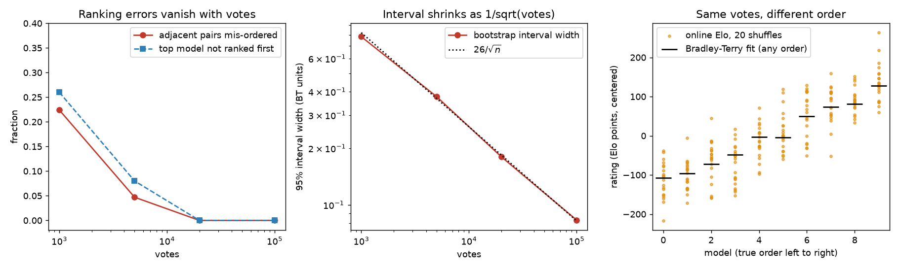

[Part 1](/posts/llm-eval-1-benchmarks-and-how-their-scores-leak/) ended with a limit of fixed questions: the questions get stale or leak. Human preference evaluation replaces them with live comparisons. This part explains the statistical model under the best-known example, [Chatbot Arena](https://arxiv.org/abs/2403.04132), and tests with simulated votes how many votes a ranking needs, how wide its uncertainty is, and why the rating method matters.

## What Chatbot Arena does

A user asks any question and receives answers from two anonymous models. The user votes for the better answer, and only then are the model names shown. Pairwise voting avoids asking people for absolute scores, which differ between raters. According to the paper, the platform had gathered over 240K votes when it was written, the crowdsourced questions were diverse and discriminating, and the crowd's votes agreed well with expert raters.

Votes become scores through the Bradley-Terry model (Bradley and Terry, 1952). Each model $m$ gets a coefficient $\xi_m$, and the probability that $m$ beats $m'$ is

$$P(m \text{ beats } m') = \frac{1}{1 + e^{\,\xi_{m'} - \xi_m}}$$

The coefficients are fitted by logistic regression: each vote is a row with +1 for the first model, −1 for the second and a label for who won. The paper reports that earlier versions of the interface showed Elo ratings, and that it switched to Bradley-Terry coefficients because they are better for statistical estimation. It gives confidence intervals from robust ("sandwich") standard errors, and it samples pairs non-uniformly, concentrating votes on pairs with similar performance, because those are the uncertain ones.

## Three questions, answered with simulation

The experiment simulates 10 models with true coefficients spaced 0.15 apart, so the next model up wins 53.7% of its votes against the one below. This is a hard setting: neighbouring models are hard to tell apart. Votes are drawn from the Bradley-Terry model itself, with uniform random pairs.

1. **Ranking quality.** How many votes until the fitted order matches the true order?
2. **Uncertainty.** How wide is the 95% bootstrap interval for the gap between the best and worst model, and how does it shrink?
3. **Rating method.** Do the same votes, shuffled, give the same rating under online Elo (K = 32) and under the fitted Bradley-Terry model?

```python
import numpy as np
from sklearn.linear_model import LogisticRegression
from scipy.stats import kendalltau
M = 10
xi = np.linspace(0, 1.35, M)           # true Bradley-Terry coefficients, adjacent gap 0.15
print('true P(model k+1 beats model k) =', round(1/(1+np.exp(-0.15)), 3))

def simulate(n, rng):
    a = rng.integers(0, M, n); b = rng.integers(0, M-1, n); b = b + (b >= a)   # uniform random pair, a != b
    p = 1/(1+np.exp(xi[b]-xi[a]))                                           # P(a wins), the BT model
    return a, b, (rng.random(n) < p).astype(int)

def fit_bt(a, b, w):
    X = np.zeros((len(a), M)); X[np.arange(len(a)), a] = 1; X[np.arange(len(a)), b] = -1
    # each vote is a row: +1 for the first model, -1 for the second; label 1 if the first won
    m = LogisticRegression(fit_intercept=False, C=1e6, max_iter=500).fit(X, w)
    c = m.coef_[0]; return c - c.mean()

def elo(a, b, w, K=32):
    r = np.zeros(M)
    for i, j, y in zip(a, b, w):
        e = 1/(1+10**((r[j]-r[i])/400)); r[i] += K*(y-e); r[j] -= K*(y-e)
    return r

rng = np.random.default_rng(0)
print('\nA. ranking quality vs number of votes (uniform pairs, 10 models, BT fit)')
print('votes   reps  Kendall tau  top-1 correct  adjacent pairs mis-ordered')
for n, reps in [(1000, 100), (5000, 100), (20000, 60), (100000, 30)]:
    taus, top, adj = [], [], []
    for _ in range(reps):
        c = fit_bt(*simulate(n, rng))
        taus.append(kendalltau(c, xi)[0]); top.append(np.argmax(c) == M-1)
        adj.append(np.mean(np.diff(c) < 0))
    print(f'{n:>6}  {reps:>4}   {np.mean(taus):.3f}        {np.mean(top):.2f}           {np.mean(adj):.3f}')

print('\nB. 95% bootstrap interval width for the top model minus the bottom model (true gap 1.35)')
for n in [1000, 5000, 20000, 100000]:
    a, b, w = simulate(n, rng); ds = []
    for _ in range(200):
        i = rng.integers(0, n, n); c = fit_bt(a[i], b[i], w[i]); ds.append(c[-1]-c[0])
    lo, hi = np.percentile(ds, [2.5, 97.5]); print(f'{n:>6} votes: gap {np.mean(ds):.3f}, interval width {hi-lo:.3f}, width*sqrt(n) {(hi-lo)*np.sqrt(n):.1f}')

print('\nC. order dependence: the same 5000 votes, shuffled 20 times')
a, b, w = simulate(5000, rng); R = []
for _ in range(20):
    p = rng.permutation(len(a)); R.append(elo(a[p], b[p], w[p]))
R = np.array(R); sd_elo = R.std(axis=0).mean()
bt = [fit_bt(a[p], b[p], w[p]) for p in [rng.permutation(len(a)) for _ in range(20)]]
print(f'online Elo (K=32): mean std of a rating across shuffles = {sd_elo:.1f} points')
print(f'Bradley-Terry fit: mean std of a coefficient across shuffles = {np.array(bt).std(axis=0).mean():.6f}')
ranks = {tuple(np.argsort(-r)) for r in R}; print(f'distinct Elo rankings over 20 shuffles: {len(ranks)}; BT rankings: {len({tuple(np.argsort(-c)) for c in bt})}')
```

Output:

```
true P(model k+1 beats model k) = 0.537

A. ranking quality vs number of votes (uniform pairs, 10 models, BT fit)
votes   reps  Kendall tau  top-1 correct  adjacent pairs mis-ordered
  1000   100   0.879        0.74           0.224
  5000   100   0.981        0.92           0.047
 20000    60   1.000        1.00           0.000
100000    30   1.000        1.00           0.000

B. 95% bootstrap interval width for the top model minus the bottom model (true gap 1.35)
  1000 votes: gap 1.285, interval width 0.783, width*sqrt(n) 24.8
  5000 votes: gap 1.383, interval width 0.376, width*sqrt(n) 26.6
 20000 votes: gap 1.386, interval width 0.180, width*sqrt(n) 25.5
100000 votes: gap 1.359, interval width 0.083, width*sqrt(n) 26.3

C. order dependence: the same 5000 votes, shuffled 20 times
online Elo (K=32): mean std of a rating across shuffles = 49.6 points
Bradley-Terry fit: mean std of a coefficient across shuffles = 0.000000
distinct Elo rankings over 20 shuffles: 20; BT rankings: 1
```


*Left and middle: values from the output above. Right: a separate 5,000-vote sample (seed 5); each orange dot is one shuffle of the same votes, and the black bars are the Bradley-Terry fit, which does not change with the order.*

## What the numbers say

- **Votes needed.** With a 0.15 gap between neighbours, 1,000 votes mis-order 22.4% of adjacent pairs and rank the best model first 74% of the time. At 5,000 votes the figures are 4.7% and 92%. At 20,000 votes, none of the 60 repetitions made an error. Real models are not equally spaced, and real votes are not drawn from the model; these counts describe this setting only.
- **Uncertainty shrinks as 1/√n.** The interval width multiplied by √n stays near 25 to 27 across a 100-fold range of votes (24.8, 26.6, 25.5, 26.3). Halving the interval costs four times the votes. This is why the paper's adaptive pair sampling matters: it spends votes where the intervals overlap.
- **The rating method matters.** The same 5,000 votes in 20 random orders give 20 different Elo rankings, with a typical rating spread of 49.6 points for one model, while the fitted Bradley-Terry coefficients are identical in every order. The true span of the 10 models is about 234 Elo points (1.35 × 400 / ln 10), so the shuffle noise is large next to the signal. A smaller K would reduce it at the cost of reacting slowly; K = 32 was chosen here without tuning. The result agrees with the paper's reason for the switch: a fitted model is a statistical estimate with an interval, while an online update is a path-dependent number.

## What a preference ranking measures

The ranking says which answer a crowd prefers on the questions the crowd asked, under the Bradley-Terry assumption. The following are the author's reading, with the relevant source in each case:

- It is a measurement of preference, not of correctness. A confident, fluent wrong answer can win a vote, which is one reason the judge-model paper in Part 3 studies verbosity and style biases.
- The question set is whatever users type, which shifts with who visits the site. The paper's claim is that the questions are diverse; it is not a claim that they represent any one company's use.
- The ranking compares models on one scale. If voters prefer model A on coding questions and model B on writing questions, a single coefficient hides that. The paper's appendix includes a nonparametric extension of the model, and slicing the votes by question type is the direct remedy.

[Part 3](/posts/llm-eval-3-model-judges-measured-on-a-local-model/) replaces the human voter with a model.

## Limits

- All numbers come from simulated votes drawn from the model being fitted, so there is no model misfit, no voter bias and no ties. Real votes are noisier, and real intervals need the paper's methods.
- Pairs are sampled uniformly; the production system samples non-uniformly, which this experiment does not reproduce.
- The right panel uses a fresh 5,000-vote sample and its Elo figures differ slightly from the printed 49.6 points; the printed values are the ones that belong to the table.
- The Elo variant is the textbook online update at one K. Other Elo implementations (batch, shuffled, averaged) behave differently.
- Statements about Chatbot Arena come from the paper; the platform and its method have changed since.

Next: [LLM Evaluation (3/7): Model Judges, Measured on a Local Model](/posts/llm-eval-3-model-judges-measured-on-a-local-model/).
