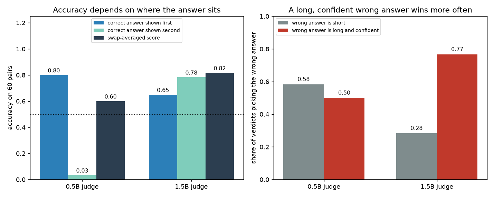

[Part 2](/posts/llm-eval-2-human-preference-and-bradley-terry/) used human votes, which cost money and time. A model judge reads two answers (or one answer and some context) and returns a verdict. This part summarizes three published designs, quotes what their authors measured about judge bias, and then measures position and style bias directly on two small models that run on a CPU.

## Three designs from the literature

- **Pairwise judge ([MT-bench and Chatbot Arena](https://arxiv.org/abs/2306.05685)).** A strong model is shown a question and two answers and picks one. The paper reports that a GPT-4 judge agreed with human preferences more than 80% of the time, the same level as human-human agreement. It names four weaknesses: position bias, verbosity bias, self-enhancement bias and limited reasoning ability.
- **Rubric scoring ([G-Eval](https://arxiv.org/abs/2303.16634)).** The judge model follows a chain of thought and fills in a form to score one output. The paper compares this with reference-based metrics such as BLEU and ROUGE, which correlate poorly with human judgments on creative tasks. With GPT-4, G-Eval reached a Spearman correlation of 0.514 with humans on summarization. The authors also flag a bias of such judges toward text written by language models.
- **Reference-free RAG metrics ([Ragas](https://arxiv.org/abs/2309.15217)).** A retrieval-augmented system has a retriever and a generator, so one score is not enough. Ragas scores faithfulness (are the claims in the answer inferable from the retrieved context), answer relevance and context relevance without human-written reference answers. For faithfulness, a model first splits the answer into short statements and then checks each against the context. The paper checks the metrics by counting how often they pick the same answer as human annotators on a small dataset it built (WikiEval).

The MT-bench paper measures the biases directly. Its Table 2 gives, for the default prompt, the share of cases in which a judge keeps the same verdict after the two answers are swapped: 23.8% for Claude-v1, 46.2% for GPT-3.5 and 65.0% for GPT-4. Its "repetitive list" attack, which pads an answer with a rephrased copy of its own list, fooled Claude-v1 and GPT-3.5 in 91.3% of 23 cases and GPT-4 in 8.7%. For math, giving the judge a reference answer cut GPT-4's failure count on 10 questions (asked in both orders) from 14 of 20 to 3 of 20. Its conservative remedy for position bias is to ask twice with the order swapped and to declare a win only when both verdicts agree; otherwise the result is a tie.

## Measuring it on a small local judge

The experiment runs the same two checks on two small models, Qwen2.5-0.5B-Instruct and Qwen2.5-1.5B-Instruct (4-bit GGUF, served with llama.cpp on CPU; see the [Raspberry Pi guide](/posts/raspberry-pi-llama-cpp-guide/) for the setup). The task is deliberately easy to grade: 60 questions, each with one correct and one plausible wrong answer (30 two-digit multiplications, 20 capitals, 10 chemical symbols). The judge sees both answers and replies with one letter; the code reads the log-probabilities of "A" and "B" with greedy decoding, so the run is deterministic.

1. **Position:** each pair is asked twice, with the correct answer first and second.
2. **Style:** the wrong answer is replaced by a padded version ("After thinking about the question carefully ... the answer is X. I am confident that this is correct."), and the correct one stays short. The padding adds length and a confident tone but no information, so it tests a mix of verbosity and confidence, which this post calls style.

```python
import json, random, subprocess, time, math, urllib.request, os
B = os.path.expanduser('~/.hermes/profiles/blog-writer/cache/scratch/pi/')
BIN = B + 'llama.cpp/build/bin/'
SCHEME = 'http'
random.seed(0)
# --- 60 questions, each with a correct and a plausible wrong answer
items = []
for _ in range(30):
    a, b = random.randint(12, 49), random.randint(12, 49); c = a*b
    w = c + random.choice([-20, -10, -2, 2, 10, 20]); items.append((f'What is {a} x {b}?', str(c), str(w)))
caps = {'France':'Paris','Japan':'Tokyo','Canada':'Ottawa','Australia':'Canberra','Brazil':'Brasilia','Egypt':'Cairo','Kenya':'Nairobi','Norway':'Oslo','Peru':'Lima','Turkey':'Ankara',
        'India':'New Delhi','Spain':'Madrid','Thailand':'Bangkok','Chile':'Santiago','Poland':'Warsaw','Vietnam':'Hanoi','Argentina':'Buenos Aires','Sweden':'Stockholm','Portugal':'Lisbon','Ireland':'Dublin'}
names = list(caps)
for k, v in caps.items():
    other = caps[random.choice([n for n in names if n != k])]; items.append((f'What is the capital of {k}?', v, other))
sym = {'gold':'Au','silver':'Ag','iron':'Fe','sodium':'Na','potassium':'K','lead':'Pb','copper':'Cu','tin':'Sn','mercury':'Hg','helium':'He'}
syms = list(sym.values())
for k, v in sym.items():
    items.append((f'What is the chemical symbol for {k}?', v, random.choice([s for s in syms if s != v])))
print('items', len(items))
FILL = 'After thinking about the question carefully from several angles and checking the reasoning step by step, the answer is {x}. I am confident that this is correct.'
def prompt(q, a, b):
    return (f'You are grading two answers to a question.\n\nQuestion: {q}\n\nAnswer A: {a}\n\nAnswer B: {b}\n\n'
            'Which answer is correct? Reply with a single letter: A or B.')
def ask(port, text):
    body = json.dumps({'messages': [{'role': 'user', 'content': text}], 'max_tokens': 1, 'temperature': 0, 'logprobs': True, 'top_logprobs': 10}).encode()
    r = urllib.request.Request(f'{SCHEME}://127.0.0.1:{port}/v1/chat/completions', body, {'Content-Type': 'application/json'})
    d = json.load(urllib.request.urlopen(r, timeout=60))
    lp = {t['token'].strip(): t['logprob'] for t in d['choices'][0]['logprobs']['content'][0]['top_logprobs']}
    return lp.get('A', -30.0) - lp.get('B', -30.0)      # >0: prefers A
def wilson(k, n, z=1.96):
    p = k/n; d = 1 + z*z/n; c = p + z*z/(2*n); s = z*math.sqrt(p*(1-p)/n + z*z/(4*n*n))
    return (c - s)/d, (c + s)/d
def run(model, port):
    srv = subprocess.Popen([BIN + 'llama-server', '-m', B + model, '-t', '8', '-c', '1024', '--host', '127.0.0.1', '--port', str(port)],
                           stdout=subprocess.DEVNULL, stderr=subprocess.DEVNULL, env={**os.environ, 'LD_LIBRARY_PATH': BIN})
    try:
        for _ in range(120):
            try:
                if b'ok' in urllib.request.urlopen(f'{SCHEME}://127.0.0.1:{port}/health', timeout=2).read(): break
            except Exception: time.sleep(1)
        S = []; V = []                      # S: short vs short, V: long wrong vs short correct
        for q, c, w in items:
            S.append((ask(port, prompt(q, c, w)), ask(port, prompt(q, w, c))))                      # (correct in A, correct in B)
            lw = FILL.format(x=w)
            V.append((ask(port, prompt(q, c, lw)), ask(port, prompt(q, lw, c))))
        return S, V
    finally:
        srv.terminate(); srv.wait()
def report(name, S, V):
    n = len(S)
    accA = sum(s[0] > 0 for s in S); accB = sum(s[1] < 0 for s in S)
    pickA = sum(s[0] > 0 for s in S) + sum(s[1] > 0 for s in S)
    consistent = sum((s[0] > 0) == (s[1] < 0) for s in S)
    swapavg = sum((s[0] - s[1]) > 0 for s in S)
    wrongA = sum(v[1] > 0 for v in V); wrongB = sum(v[0] < 0 for v in V)       # long wrong answer chosen
    print(f'\n{name}  (n = {n} questions, each asked in both orders)')
    print(f'  accuracy, correct answer shown first : {accA}/{n} = {accA/n:.2f}')
    print(f'  accuracy, correct answer shown second: {accB}/{n} = {accB/n:.2f}')
    print(f'  chose position A in {pickA} of {2*n} verdicts = {pickA/(2*n):.2f}  (95% interval {wilson(pickA, 2*n)[0]:.2f}-{wilson(pickA, 2*n)[1]:.2f}; 0.50 means no position preference)')
    print(f'  same answer chosen after swapping order: {consistent}/{n} = {consistent/n:.2f}')
    print(f'  accuracy of swap-averaged score       : {swapavg}/{n} = {swapavg/n:.2f}')
    print(f'  short wrong answer chosen over short correct one: {2*n-accA-accB}/{2*n} = {(2*n-accA-accB)/(2*n):.2f}')
    print(f'  long wrong answer chosen over short correct one : shown first {wrongA}/{n}, shown second {wrongB}/{n}; total {wrongA+wrongB}/{2*n} = {(wrongA+wrongB)/(2*n):.2f}')
    return dict(name=name, accA=accA/n, accB=accB/n, pickA=pickA/(2*n), cons=consistent/n, swap=swapavg/n, wrongA=wrongA/n, wrongB=wrongB/n)
out = []
for name, f, port in [('Qwen2.5-0.5B-Instruct Q4_K_M', 'q05.gguf', 18081), ('Qwen2.5-1.5B-Instruct Q4_K_M', 'q15.gguf', 18082)]:
    S, V = run(f, port); out.append(report(name, S, V))
json.dump(out, open('res.json', 'w'))
```

Output:

```
items 60

Qwen2.5-0.5B-Instruct Q4_K_M  (n = 60 questions, each asked in both orders)
  accuracy, correct answer shown first : 48/60 = 0.80
  accuracy, correct answer shown second: 2/60 = 0.03
  chose position A in 106 of 120 verdicts = 0.88  (95% interval 0.81-0.93; 0.50 means no position preference)
  same answer chosen after swapping order: 10/60 = 0.17
  accuracy of swap-averaged score       : 36/60 = 0.60
  short wrong answer chosen over short correct one: 70/120 = 0.58
  long wrong answer chosen over short correct one : shown first 60/60, shown second 0/60; total 60/120 = 0.50

Qwen2.5-1.5B-Instruct Q4_K_M  (n = 60 questions, each asked in both orders)
  accuracy, correct answer shown first : 39/60 = 0.65
  accuracy, correct answer shown second: 47/60 = 0.78
  chose position A in 52 of 120 verdicts = 0.43  (95% interval 0.35-0.52; 0.50 means no position preference)
  same answer chosen after swapping order: 34/60 = 0.57
  accuracy of swap-averaged score       : 49/60 = 0.82
  short wrong answer chosen over short correct one: 34/120 = 0.28
  long wrong answer chosen over short correct one : shown first 32/60, shown second 60/60; total 92/120 = 0.77
```


*Left: accuracy by position of the correct answer; the dotted line is chance. Right: how often the wrong answer is chosen when it is short or when it is long and confident.*

## What the numbers say

- **The 0.5B model is not a judge.** It chose position A in 106 of 120 verdicts (88%). It scored 0.80 when the correct answer was first and 0.03 when it was second, and kept its verdict after a swap on only 10 of 60 pairs (17%), which is the pattern of a judge that mostly reads the position. Its swap-averaged accuracy of 0.60 is better than chance, but the average hides a signal that is mostly the order.
- **The 1.5B model is a weak judge with a different bias.** It chose A in 43% of verdicts (interval 0.35 to 0.52, so no clear position preference), was consistent after a swap on 34 of 60 pairs (57%), and reached 0.82 with swap-averaged scores. Its position-dependent accuracy was still uneven (0.65 first, 0.78 second).
- **Style moved the 1.5B judge a lot.** It picked the wrong answer in 28% of verdicts when the wrong answer was short, and in 77% (92 of 120) when the wrong answer was padded. The padding added no facts. For the 0.5B model the comparison says nothing, because it was mostly choosing A (the rate went from 58% to 50% with the same position bias).
- **Swapping and combining orders helps but does not remove the problem.** For both models the swap-averaged score was more accurate than the worse of the two single orders. It is not a cure: the style effect above is the same in both orders.

These results are the same kind of finding the MT-bench paper reports for larger judges: consistency under a swap rises with judge strength (their GPT-4 reached 65.0% on open-ended questions; here the 0.5B model reached 17% and the 1.5B model 57% on a different, much easier task, so the numbers are not comparable, only the direction).

## Using a judge in practice

The following points are the author's reading of the evidence above:

- Run every pairwise judgement in both orders and treat disagreement as a tie, as the MT-bench paper does, or average the scores.
- Check a judge against a small human-labelled set from your own task before trusting its average. The agreement rate on someone else's data is not yours.
- Give the judge a reference answer or a rubric where one exists; the math result in the MT-bench paper is the evidence for this.
- Keep length and confident tone out of what the judge can reward, or measure the effect as above.
- Record the judge model and prompt with each score. A change in either is a change in the measurement.

Part 4 moves to tests that need no judge: code that runs, and agents whose end state can be checked.

## Limits

- Both judges are small 4-bit models, run once at temperature 0 on 60 questions with exact answers. The 1.5B model's rates have wide intervals (for example 0.43 with 0.35 to 0.52).
- The task is arithmetic and short facts. Judging open-ended text, where there is no exact answer, is harder and is where the published studies focus.
- The padding combines length and a claim of confidence, so the 77% figure cannot be assigned to length alone.
- Only one prompt wording was tried. The MT-bench paper shows that prompt wording changes position bias a great deal (its "rename" prompt changed Claude-v1's consistency from 23.8% to 56.2%).
- The swap-averaged score adds the two log-probability differences; the paper's conservative rule (tie if the two orders disagree) is different and was not run here.
- Results for Ragas and G-Eval are the papers' own, measured on their datasets with their judge models; none were re-run.

Next: LLM Evaluation (4/7): execution-based and agent evaluation, pass@k and pass^k.
