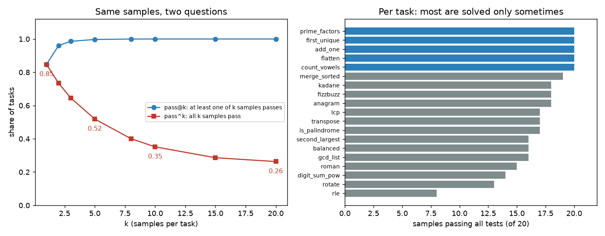

[Part 3](/posts/llm-eval-3-model-judges-measured-on-a-local-model/) showed how unreliable a small judge is. When the task allows it, a program can replace the judge: run the code, check the database, compare the end state. This part covers three published designs of that kind, then runs the first metric family on 380 code samples from a local model and shows that the same samples give opposite pictures under two metrics.

## Three designs from the literature

- **HumanEval and pass@k ([Codex paper](https://arxiv.org/abs/2107.03374)).** Each problem is a function signature and a docstring; a sample counts as correct if it passes the unit tests. For a problem with n samples of which c pass, the paper's estimator for pass@k (the chance that at least one of k samples passes) is 1 − C(n−c, k) / C(n, k), and it uses n = 200 samples per problem. Reported results include 28.8% of problems solved with one sample, 70.2% with 100 samples, and, in the paper's Figure 1, 77.5% when the sample that passes the unit tests is selected among 100 (an oracle choice that uses the tests themselves), against 44.5% when it is selected by mean log-probability. The paper also describes the sandbox used to run model-written code.
- **SWE-bench ([paper](https://arxiv.org/abs/2310.06770)).** 2,294 software engineering problems from real GitHub issues and pull requests in 12 Python repositories. The model receives a codebase and an issue and must edit the code; the check is the repository's tests. At publication the best model, Claude 2, solved 1.96% of the issues.
- **τ-bench ([paper](https://arxiv.org/abs/2406.12045)).** An agent talks to a user simulated by a language model, with domain tools (APIs) and a written policy to follow. The check compares the database state at the end of the conversation with the annotated goal state, so many different conversations can be correct. The paper adds a metric, pass^k, the probability that the agent succeeds in all of k independent trials of the same task. Its reported results: even gpt-4o succeeded on under 50% of tasks, with about 61% (retail) and 35% (airline) for a single trial, and pass^8 below 25% in retail.

The two metrics answer different questions. pass@k fits a setting where a person or a test suite can pick the good sample from several. pass^k fits a setting where one run must be right and each run counts.

## An experiment: 19 functions, 20 samples each

The experiment gives Qwen2.5-1.5B-Instruct (4-bit GGUF on CPU; temperature 0.8, as in the Codex paper) 19 small tasks written for this post, each with 2 to 5 hidden asserts, and draws 20 samples per task. The code that was generated is run against the tests in a subprocess with a 5-second CPU limit and 1 GB memory limit. That limit is a convenience, not a security boundary; run untrusted code in a container or virtual machine.

The estimator for pass@k is the paper's. For pass^k the script uses the same combinatorial form for "all k": C(c, k) / C(n, k). The τ-bench definition is success over k independent trials; this estimator from n = 20 samples is the author's choice. The last column pools all tasks into one success rate p and computes 1 − (1 − p)^k, to show what is lost by ignoring task-to-task differences.

`tasks.py` (19 tasks, hidden tests included):

```python
# 20 small tasks written for this post: (name, prompt, tests). Tests are hidden from the model.
T = []
def add(name, sig, doc, tests): T.append((name, f'def {sig}:\n    """{doc}"""\n', tests))
add('add_one', 'add_one(xs)', 'Return a new list with 1 added to every element of xs.',
    ['add_one([1,2,3])==[2,3,4]', 'add_one([])==[]', 'add_one([-1,0])==[0,1]'])
add('count_vowels', 'count_vowels(s)', 'Return the number of vowels (a, e, i, o, u, either case) in s.',
    ['count_vowels("Hello")==2', 'count_vowels("")==0', 'count_vowels("AEIOU xyz")==5'])
add('is_palindrome', 'is_palindrome(s)', 'Return True if s reads the same forwards and backwards, ignoring case and any character that is not a letter or digit.',
    ['is_palindrome("A man, a plan, a canal: Panama")==True', 'is_palindrome("abc")==False', 'is_palindrome("")==True', 'is_palindrome("No lemon, no melon")==True'])
add('fizzbuzz', 'fizzbuzz(n)', 'Return a list of strings for the numbers 1..n: "Fizz" for multiples of 3, "Buzz" for multiples of 5, "FizzBuzz" for both, otherwise the number as a string.',
    ['fizzbuzz(5)==["1","2","Fizz","4","Buzz"]', 'fizzbuzz(15)[-1]=="FizzBuzz"', 'fizzbuzz(0)==[]'])
add('second_largest', 'second_largest(xs)', 'Return the second largest distinct value in xs, or None if there are fewer than two distinct values.',
    ['second_largest([1,2,3])==2', 'second_largest([5,5,5]) is None', 'second_largest([3,1,3,2])==2', 'second_largest([7]) is None'])
add('merge_sorted', 'merge_sorted(a, b)', 'Merge two sorted lists into one sorted list without using sorted() or list.sort().',
    ['merge_sorted([1,3,5],[2,4])==[1,2,3,4,5]', 'merge_sorted([],[1])==[1]', 'merge_sorted([1,1],[1])==[1,1,1]'])
add('rle', 'rle(s)', 'Run-length encode s: each run of the same character becomes the character followed by the run length, for example "aaabcc" becomes "a3b1c2".',
    ['rle("aaabcc")=="a3b1c2"', 'rle("")==""', 'rle("z")=="z1"', 'rle("aabbaa")=="a2b2a2"'])
add('flatten', 'flatten(xs)', 'Flatten an arbitrarily nested list of integers into a single list, keeping the order.',
    ['flatten([1,[2,[3,4]],5])==[1,2,3,4,5]', 'flatten([])==[]', 'flatten([[[]]])==[]'])
add('gcd_list', 'gcd_list(xs)', 'Return the greatest common divisor of all positive integers in the non-empty list xs.',
    ['gcd_list([12,18,24])==6', 'gcd_list([7])==7', 'gcd_list([5,7])==1'])
add('balanced', 'balanced(s)', 'Return True if the brackets ()[]{} in s are balanced and correctly nested, ignoring all other characters.',
    ['balanced("([]{})")==True', 'balanced("(]")==False', 'balanced("")==True', 'balanced("((")==False', 'balanced("a(b)c")==True'])
add('roman', 'roman_to_int(s)', 'Convert a Roman numeral (I, V, X, L, C, D, M with subtractive pairs such as IV and CM) to an integer.',
    ['roman_to_int("III")==3', 'roman_to_int("IV")==4', 'roman_to_int("MCMXCIV")==1994', 'roman_to_int("LVIII")==58'])
add('anagram', 'is_anagram(a, b)', 'Return True if a and b contain the same letters with the same counts, ignoring case and spaces.',
    ['is_anagram("Listen","Silent")==True', 'is_anagram("a b","ab")==True', 'is_anagram("abc","abd")==False', 'is_anagram("aab","ab")==False'])
add('kadane', 'max_subarray(xs)', 'Return the largest sum of any non-empty contiguous sub-list of xs.',
    ['max_subarray([1,-2,3,4,-1])==7', 'max_subarray([-3,-1,-2])==-1', 'max_subarray([5])==5'])
add('transpose', 'transpose(m)', 'Transpose a non-empty rectangular matrix given as a list of lists.',
    ['transpose([[1,2,3],[4,5,6]])==[[1,4],[2,5],[3,6]]', 'transpose([[1]])==[[1]]'])
add('digit_sum_pow', 'digit_sum_pow(b, e)', 'Return the sum of the decimal digits of b raised to the power e.',
    ['digit_sum_pow(2,10)==7', 'digit_sum_pow(10,5)==1', 'digit_sum_pow(3,3)==9'])
add('lcp', 'longest_common_prefix(words)', 'Return the longest common prefix of a list of strings (empty string if the list is empty or there is none).',
    ['longest_common_prefix(["flower","flow","flight"])=="fl"', 'longest_common_prefix([])==""', 'longest_common_prefix(["a"])=="a"', 'longest_common_prefix(["ab","cd"])==""'])
add('rotate', 'rotate(xs, k)', 'Rotate the list xs to the right by k positions (k may be larger than len(xs)); return a new list.',
    ['rotate([1,2,3,4,5],2)==[4,5,1,2,3]', 'rotate([1,2,3],4)==[3,1,2]', 'rotate([],3)==[]', 'rotate([1,2],0)==[1,2]'])
add('first_unique', 'first_unique(s)', 'Return the index of the first character of s that appears exactly once, or -1 if there is none.',
    ['first_unique("leetcode")==0', 'first_unique("loveleetcode")==2', 'first_unique("aabb")==-1', 'first_unique("")==-1'])
add('prime_factors', 'prime_factors(n)', 'Return the prime factors of the integer n >= 2 in ascending order, with repetition, as a list.',
    ['prime_factors(12)==[2,2,3]', 'prime_factors(13)==[13]', 'prime_factors(360)==[2,2,2,3,3,5]'])
```

`gen.py` (generation through a local llama.cpp server):

```python
import json, os, re, subprocess, time, urllib.request
from concurrent.futures import ThreadPoolExecutor
from tasks import T
SCHEME = 'http'
B = os.path.expanduser('~/.hermes/profiles/blog-writer/cache/scratch/pi/'); BIN = B + 'llama.cpp/build/bin/'
PORT, N = 18083, 20
def ask(args):
    ti, i = args
    name, prompt, _ = T[ti]
    text = ('Complete the following Python function. Reply with the complete function in one ```python code block and nothing else.\n\n' + prompt)
    body = json.dumps({'messages': [{'role': 'user', 'content': text}], 'max_tokens': 260, 'temperature': 0.8, 'top_p': 1.0, 'top_k': 0, 'seed': 1000*ti + i}).encode()
    r = urllib.request.Request(f'{SCHEME}://127.0.0.1:{PORT}/v1/chat/completions', body, {'Content-Type': 'application/json'})
    out = json.load(urllib.request.urlopen(r, timeout=300))['choices'][0]['message']['content']
    return dict(task=ti, sample=i, text=out)
srv = subprocess.Popen([BIN + 'llama-server', '-m', B + 'q15.gguf', '-t', '8', '-c', '4096', '--parallel', '4', '--host', '127.0.0.1', '--port', str(PORT)],
                       stdout=subprocess.DEVNULL, stderr=subprocess.DEVNULL, env={**os.environ, 'LD_LIBRARY_PATH': BIN})
try:
    for _ in range(120):
        try:
            if b'ok' in urllib.request.urlopen(f'{SCHEME}://127.0.0.1:{PORT}/health', timeout=2).read(): break
        except Exception: time.sleep(1)
    jobs = [(ti, i) for ti in range(len(T)) for i in range(N)]
    t0 = time.time()
    with ThreadPoolExecutor(4) as ex, open('samples.jsonl', 'w') as f:
        for k, r in enumerate(ex.map(ask, jobs)):
            f.write(json.dumps(r) + '\n'); f.flush()
            if k % 40 == 0: print(k, 'of', len(jobs), f'{time.time()-t0:.0f}s', flush=True)
    print('done', f'{time.time()-t0:.0f}s')
finally:
    srv.terminate(); srv.wait()
```

`evalrun.py` (run the tests, compute the metrics):

```python
import json, re, subprocess, sys, tempfile, os, resource
import numpy as np
from math import comb
from tasks import T
N = 20
def code_of(text):
    m = re.search(r'```(?:python)?\n(.*?)```', text, re.S)
    return m.group(1) if m else text
def limits():
    resource.setrlimit(resource.RLIMIT_AS, (1 << 30, 1 << 30)); resource.setrlimit(resource.RLIMIT_CPU, (5, 5))
def passes(ti, text):
    name, prompt, tests = T[ti]
    src = code_of(text) + '\n\n' + '\n'.join(f'assert {t}' for t in tests) + '\n'
    with tempfile.NamedTemporaryFile('w', suffix='.py', delete=False, dir=os.environ.get('TMPDIR')) as f: f.write(src)
    try:
        r = subprocess.run([sys.executable, '-I', f.name], capture_output=True, timeout=10, preexec_fn=limits)
        return r.returncode == 0
    except subprocess.TimeoutExpired:
        return False
    finally:
        os.unlink(f.name)
rows = [json.loads(l) for l in open('samples.jsonl')]
c = np.zeros(len(T), dtype=int); n = np.zeros(len(T), dtype=int); nocode = 0
for r in rows:
    n[r['task']] += 1; ok = passes(r['task'], r['text']); c[r['task']] += ok
    nocode += '```' not in r['text']
print('samples', len(rows), 'tasks', len(T), 'samples per task', set(n.tolist()), 'replies without a code block', nocode)
print('\ntask             passed/20')
for (name, _, tests), ci in zip(T, c): print(f'{name:<16} {ci:>2}/20')
def pass_at_k(n, c, k):               # Codex paper, eq. 1: 1 - C(n-c, k) / C(n, k)
    return 1.0 if n - c < k else 1.0 - np.prod(1.0 - k / np.arange(n - c + 1, n + 1))
def pass_hat_k(n, c, k):              # all k draws (without replacement) succeed: C(c, k) / C(n, k)
    return comb(int(c), k) / comb(int(n), k)
print('\n k   pass@k (any of k works)   pass^k (all k work)   pooled 1-(1-p)^k')
res = []
for k in [1, 2, 3, 5, 8, 10, 15, 20]:
    a = np.mean([pass_at_k(N, ci, k) for ci in c]); b = np.mean([pass_hat_k(N, ci, k) for ci in c]); p = c.mean() / N
    res.append((k, a, b)); print(f'{k:>2}   {a:.3f}                     {b:.3f}                 {1-(1-p)**k:.3f}')
print(f'\ntasks never solved: {(c == 0).sum()}, solved in every sample: {(c == N).sum()}, sometimes solved: {((c > 0) & (c < N)).sum()}')
json.dump(dict(c=c.tolist(), res=res, names=[t[0] for t in T]), open('res.json', 'w'))
```

Output:

```
samples 380 tasks 19 samples per task {20} replies without a code block 0

task             passed/20
add_one          20/20
count_vowels     20/20
is_palindrome    17/20
fizzbuzz         18/20
second_largest   16/20
merge_sorted     19/20
rle               8/20
flatten          20/20
gcd_list         16/20
balanced         16/20
roman            15/20
anagram          18/20
kadane           18/20
transpose        17/20
digit_sum_pow    14/20
lcp              17/20
rotate           13/20
first_unique     20/20
prime_factors    20/20

 k   pass@k (any of k works)   pass^k (all k work)   pooled 1-(1-p)^k
 1   0.847                     0.847                 0.847
 2   0.961                     0.734                 0.977
 3   0.986                     0.646                 0.996
 5   0.997                     0.519                 1.000
 8   1.000                     0.401                 1.000
10   1.000                     0.352                 1.000
15   1.000                     0.286                 1.000
20   1.000                     0.263                 1.000

tasks never solved: 0, solved in every sample: 5, sometimes solved: 14
```


*Left: the same samples, scored two ways. Right: five tasks pass in every sample (blue); the other 14 pass only some of the time.*

## What the numbers say

- **One metric, two stories.** pass@1 is 0.847. With 5 samples pass@5 is 0.997: every task has a good sample among a few. pass^5 is 0.519 and pass^10 is 0.352: only about a third of the tasks are solved in each of ten tries. At k = 20, pass^20 is 0.263, which is 5 of 19, the number of tasks that passed all 20 samples.
- **Few tasks are fully reliable.** No task failed in every sample, 5 passed in every sample, and 14 passed some of the time. The hardest, `rle`, passed 8 of 20.
- **Pooling misleads.** With one pooled success rate, k = 2 predicts 0.977 against the measured 0.961, and k = 3 gives 0.996 against 0.986. Tasks differ in difficulty, and the formula for equal tasks overstates the gain from extra samples.
- **The three published designs differ in what the check sees.** HumanEval-style tests see the function's return values; SWE-bench sees the repository's tests after a multi-file edit; τ-bench sees the end state of a database. The checks can all be fooled in the same way: if the tests are thin, wrong output passes.

## Choosing between them

These points are the author's reading of the sources above:

- If a person or a test suite will pick among several outputs, report pass@k at the k that matches the product's retry budget, and say how the best sample would be selected.
- If the system must act correctly on every run (an agent that edits a customer's record), report pass^k at the number of repeats the customer will see, not pass@1. A single-run success rate hides the inconsistency τ-bench measures.
- Report n, the sampling temperature and the test count. A pass rate from three asserts and a pass rate from a full test suite are different quantities.
- For agents, define the end state to be checked and keep the check separate from how the agent got there, as τ-bench does.

Part 5 is about measuring what a model should not do.

## Limits

- One 1.5B model, one prompt wording, 19 short tasks written for this post, and 20 samples each. The interval around any single task's rate is wide. The tasks are far easier than HumanEval or SWE-bench; the experiment shows how the metrics behave, not how any model ranks.
- Each task has 2 to 5 asserts, so a wrong function can pass. The pass rates are upper bounds on correctness.
- The pass^k estimator is the author's; τ-bench's own evaluation uses its own trials and tasks.
- The Codex, SWE-bench and τ-bench numbers are those in the abstracts, introductions and figure captions of the papers, for the models tested at the time, and were not re-run here.
- The subprocess limits are resource limits, not a sandbox.

Next: LLM Evaluation (5/7): safety evaluation and red teaming.
