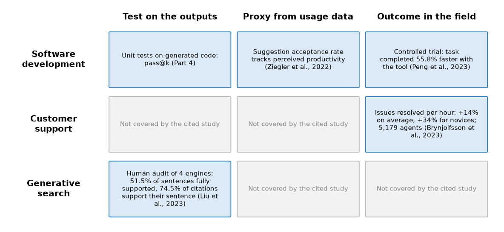

Parts 1 to 5 covered methods. Parts 6 and 7 look at how they appear in practice, using only what has been published. Companies' internal evaluation pipelines are mostly not public, so what follows is what research papers measured on deployed or deployable systems, not a description of any company's process.

Each study below sits at a different distance from the output. Sorting them by that distance gives one frame for all three industries:

- **Test on the outputs.** A fixed check on what the model produced (unit tests, a citation audit).
- **Proxy from usage data.** A number the product already logs, such as how often a suggestion is accepted.
- **Outcome in the field.** What changed for the people or the work: time per task, issues resolved per hour.

*What each cited study measured. Grey cells are not covered by the study cited here, not necessarily empty in the field.*

## Software development

- **Test on the outputs.** Execution against unit tests is the established check, with pass@k as the metric ([Part 4](/posts/llm-eval-4-execution-based-and-agent-tests/); [Codex paper](https://arxiv.org/abs/2107.03374)). [SWE-bench](https://arxiv.org/abs/2310.06770) moves the same idea to real repository issues.
- **Proxy from usage data.** [Ziegler et al.](https://arxiv.org/abs/2205.06537) asked GitHub Copilot users about their productivity and compared the answers with logged usage. They find that the rate at which shown suggestions are accepted, rather than metrics about how long completions persist in the code, drives developers' perceived productivity. The measured quantity there is perception, which the paper relates to a usage metric; it is not time saved.
- **Outcome in the field.** [Peng et al.](https://arxiv.org/abs/2302.06590) ran a controlled experiment: recruited developers implemented an HTTP server in JavaScript as fast as possible, and the group with Copilot finished 55.8% faster than the control group. It is one task, chosen so that it could be timed.

## Customer support

[Brynjolfsson, Li and Raymond](https://www.nber.org/papers/w31161) study the staggered introduction of a generative-AI conversational assistant to 5,179 customer support agents. The outcome is issues resolved per hour: up 14% on average, and up 34% for novice and low-skilled workers with minimal impact on experienced, highly skilled workers. The authors also report improved customer sentiment and higher employee retention, and offer suggestive evidence that the model spreads the practices of more able workers. The staggered rollout is what makes the comparison possible: some agents had the tool earlier than others. This study shows an outcome-level evaluation; the abstract does not describe the output-level tests the vendor ran before rollout.

## Generative search

[Liu et al.](https://arxiv.org/abs/2304.09848) audit four generative search engines (Bing Chat, NeevaAI, Perplexity and YouChat) by human evaluation on a range of queries. They define verifiability through two quantities, written here for $S$ generated statements and $C$ citations:

$$\text{citation recall}=\frac{\#\{\text{statements fully supported by their citations}\}}{S},\qquad \text{citation precision}=\frac{\#\{\text{citations that support their statement}\}}{C}$$

On average, 51.5% of generated sentences were fully supported by citations and 74.5% of citations supported their associated sentence. The authors call these results concerningly low for systems that may serve as a primary tool for information seeking, noting that the responses are fluent and appear informative. This is the method of [Part 3](/posts/llm-eval-3-model-judges-measured-on-a-local-model/) (reference-free judgement of support) carried out by human raters on shipped products. The audit tests outputs; it says nothing about whether users search better or worse.

## What the three have in common

These points are the author's reading of the cited work:

- **Only software has all three levels in the cited papers.** Even there, the levels measure different things: unit-test pass rate for the model, perception for the proxy, time on one task for the outcome. A good number at one level does not transfer to the next.
- **The check follows what can be verified.** Code can be run, support work can be counted per hour, search answers can be traced to sources. Domains where neither exists fall back on human judgement (Part 7 returns to this).
- **The averages hide the spread.** The support study's 14% average is 34% for novices and close to nothing for experts. A single mean over all users is a weak basis for rollout decisions.
- **Pair a quality metric with a use metric.** A citation audit and an acceptance rate each miss what the other catches.

Part 7 covers health, law, finance and regulation, where the cost of an error is higher and the checks differ.

## Limits

- Each number comes from the abstract or text of one paper, for one product or a set of products at the time of the study. Tools have changed since, and the numbers were not re-measured here.
- Peng et al. is a single timed task; Brynjolfsson et al. is one firm's support operation; Liu et al. audited four engines on their query sets. None of them is a general statement about all code assistants, support tools or search engines.
- The grid shows what the cited studies reported. Other studies, and internal evaluations that are not published, may cover the grey cells.
- This part has no code or new measurement; it is a reading of published work.
