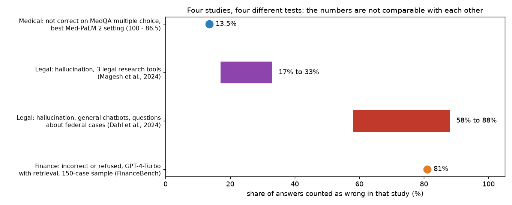

[Part 6](/posts/llm-eval-6-industry-practice-software-support-search/) covered fields where output can be run, counted or traced to a source. This part covers fields where an error is expensive and the check usually needs an expert: medicine, law and finance, then the rules that regulators have written about measurement. As before, everything below comes from published papers and official texts; nothing describes any company's internal process.

## Medicine: a benchmark plus a human rubric

[Singhal et al. (Med-PaLM)](https://arxiv.org/abs/2212.13138) start from the complaint that clinical knowledge is usually assessed by automated evaluation on limited benchmarks, with no standard for judging answers and reasoning across a breadth of tasks. They build MultiMedQA, which combines six existing open question-answering datasets (professional exams, research, consumer questions) with a new free-response set of medical questions searched online, and a framework for human evaluation along several axes, including factuality, precision, possible harm and bias. Flan-PaLM reached 67.6% on MedQA (US medical licensing exam style questions), yet human evaluation revealed key gaps, which led the authors to the prompt-tuning method behind Med-PaLM.

[The follow-up (Med-PaLM 2)](https://arxiv.org/abs/2305.09617) scored up to 86.5% on MedQA. On long-form answers to 1066 consumer medical questions, physicians preferred Med-PaLM 2 answers to physician-written answers on eight of nine axes related to clinical utility. The two layers of the design match the earlier parts: a multiple-choice benchmark ([Part 1](/posts/llm-eval-1-benchmarks-and-how-their-scores-leak/)) for a number that is cheap to repeat, and pairwise expert preference ([Part 2](/posts/llm-eval-2-human-preference-and-bradley-terry/)) for the questions an answer key cannot grade.

## Law: expert-built benchmarks, then audits of vendor claims

- **A benchmark built by the profession.** [LegalBench](https://arxiv.org/abs/2308.11462) has 162 tasks covering six types of legal reasoning, collected from legal professionals, and ties them to frameworks lawyers already use to describe reasoning. The paper evaluates 20 open-source and commercial models.
- **Measuring hallucination directly.** [Dahl et al.](https://arxiv.org/abs/2401.01301) ask specific, verifiable questions about random federal court cases and find hallucinations in 58% of answers with ChatGPT 4 up to 88% with Llama 2. They also find that models often fail to correct a user's incorrect legal assumption, and cannot always tell when they are hallucinating.
- **Testing the vendors' own claims.** Several providers described retrieval-augmented generation as eliminating or avoiding hallucination. [Magesh et al.](https://arxiv.org/abs/2405.20362) report the first preregistered evaluation of such tools and find the claims overstated: hallucinations are reduced relative to GPT-4, but Lexis+ AI and Thomson Reuters' Westlaw AI-Assisted Research and Ask Practical Law AI each hallucinate between 17% and 33% of the time. Because the systems are closed, an outside, preregistered test was the only way to check.

## Finance: open-book questions with evidence

[FinanceBench](https://arxiv.org/abs/2311.11944) has 10,231 questions about publicly traded companies, each with an answer and an evidence string. The authors test 16 model configurations on a 150-case sample and manually review their answers (n = 2,400). GPT-4-Turbo with a retrieval system answered incorrectly or refused on 81% of questions. Longer context windows help but, they argue, are unrealistic for enterprise settings because of latency and document size. The design is the RAG evaluation of Part 3 with a fixed answer key and the source passage attached, so that a reviewer can check the evidence as well as the answer.

*The headline error figures from the four studies above, each from its own test. They measure different things and are not comparable; the chart shows the spread of what is reported, not a ranking of fields. The medical point is derived as 100 minus the best reported accuracy.*

## Regulation: what the texts say about measurement

- **[NIST AI Risk Management Framework](https://www.nist.gov/itl/ai-risk-management-framework).** A voluntary framework released on January 26, 2023, intended to improve the incorporation of trustworthiness considerations into the design, development, use and evaluation of AI products, services and systems. On July 26, 2024, NIST released the [Generative AI Profile (NIST AI 600-1)](https://doi.org/10.6028/NIST.AI.600-1), which proposes actions for managing the risks that are specific to generative AI.
- **[EU AI Act, Article 15](https://artificialintelligenceact.eu/article/15/).** High-risk systems must reach an appropriate level of accuracy, robustness and cybersecurity and perform consistently throughout their lifecycle; the levels of accuracy and the relevant accuracy metrics must be declared in the instructions of use; the Commission is to encourage benchmarks and measurement methodologies. Which metric to declare, on which test set, is left to the provider, which is the reading problem of Parts 1 to 5.
- **[EU AI Act, Article 55](https://artificialintelligenceact.eu/article/55/).** Providers of general-purpose models with systemic risk must perform model evaluation with standardised protocols and tools reflecting the state of the art, including conducting and documenting adversarial testing, the subject of [Part 5](/posts/llm-eval-5-safety-tests-and-red-teaming/). Application dates differ by provision and have been amended; check the current text before relying on a date.

## What seven parts add up to

These points are the author's synthesis of this series:

- **The method follows what can be checked cheaply.** Run the code, count the tickets, trace the citation, and where none of these exists, ask an expert. Costs rise in that order, and so does the pressure to rely on a model judge (Part 3), which needs its own measurement.
- **A single number hides its design.** Test set, sample size, decoding, classifier, number of tries and who judged all move the result (Parts 1 to 5). A report that omits them cannot be compared with another.
- **Different levels answer different questions.** A model test, a usage proxy and a field outcome (Part 6) can disagree, and the regulators' texts ask for declared metrics rather than a particular one.
- **Claims need outside tests.** The preregistered legal audit shows why: a vendor's description of its own system and an independent measurement are different kinds of evidence.

The series in order: [1 Benchmarks](/posts/llm-eval-1-benchmarks-and-how-their-scores-leak/), [2 Human preference](/posts/llm-eval-2-human-preference-and-bradley-terry/), [3 Model judges](/posts/llm-eval-3-model-judges-measured-on-a-local-model/), [4 Execution and agents](/posts/llm-eval-4-execution-based-and-agent-tests/), [5 Safety](/posts/llm-eval-5-safety-tests-and-red-teaming/), [6 Software, support, search](/posts/llm-eval-6-industry-practice-software-support-search/), 7 this part.

## Limits

- Every number is from an abstract or official text, for the models and tools studied at the time; none was re-run. Newer systems may score differently, and Med-PaLM, GPT-4-Turbo and the legal tools named are specific versions.
- The chart combines rates from four different tests (multiple choice, hallucination on case questions, hallucination on research tools, open-book finance questions). Its only message is the spread, and the medical point is derived by subtraction.
- FinanceBench's 81% is from a 150-case sample of the 10,231 questions, and the legal-hallucination figures depend on the question sets used in those studies.
- This part is a reading of public literature and statutes. It is not legal, medical or compliance advice, and it does not describe how any particular firm evaluates its models.
