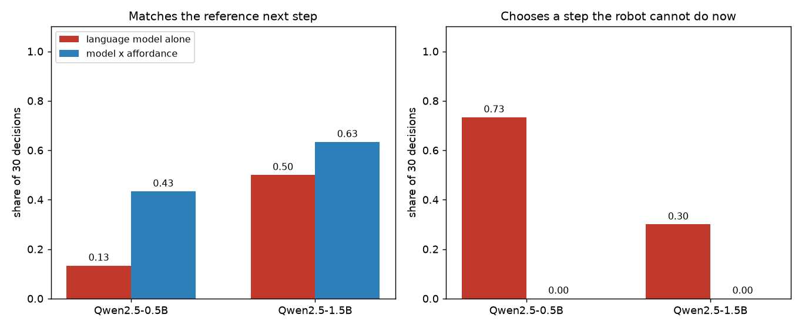

Humanoid robots are often described as having a language model for a brain. The literature shows a more layered picture: a language model supplies knowledge about tasks, and other components supply what the body can actually do. This series follows that stack from the top down, using papers and official reports. This part covers the top layer, the language model as a planner, and measures one idea from it on a small local model.

The series: (1) language as planner, (2) actions as tokens, (3) continuous actions, (4) two speeds of thinking, (5) legs and balance, (6) evaluating robot policies. The papers in this part use a mobile manipulator with an arm, not a humanoid; the planning problem is the same.

## The problem: words are not grounded

[SayCan](https://arxiv.org/abs/2204.01691) (Ahn et al., 2022) states the issue directly. Language models encode a wealth of semantic knowledge useful for high-level instructions, but they lack real-world experience: asked how to clean a spill, a model may give a reasonable narrative that does not apply to a particular robot in a particular room. SayCan's answer is to constrain the model with pretrained skills, so that it proposes natural-language actions that are both feasible and contextually appropriate. The paper's summary is that the language model provides high-level knowledge about the procedure, while value functions associated with the skills provide the grounding that connects it to the physical environment.

In the author's notation, at each step the robot picks the skill $\pi$ that maximizes

$$\underbrace{p\big(\text{skill text}_\pi \mid \text{instruction, steps so far}\big)}_{\text{language model: is it useful?}}\;\times\;\underbrace{p\big(\text{success}_\pi \mid \text{state}\big)}_{\text{value function: can I do it now?}}$$

and repeats until the model chooses a termination step. The project page reports that PaLM-SayCan chose the correct sequence of skills 84% of the time and executed them successfully 74% of the time, and that moving from an earlier language model (FLAN) to PaLM cut errors by half. The page states this as the first time an improvement in the language model was seen to carry over to robot performance.

[PaLM-E](https://arxiv.org/abs/2303.03378) (Driess et al., 2023) takes a different route: instead of scoring text, it builds an embodied language model whose input interleaves visual, continuous state-estimation and text encodings, trained end-to-end with a pretrained language model on tasks including sequential manipulation planning, visual question answering and captioning. The grounding then sits inside the model. Parts 2 and 3 follow that route to the point where the model outputs motor commands.

## A toy SayCan on a local model

The experiment below keeps SayCan's structure at a small scale. A symbolic household world has 10 skills (go to the counter, table or sink; pick up the sponge, apple or cup; put down what is held; wipe the table; wash the cup; done). Each skill has a precondition, for example that the robot is at the counter and has an empty hand to pick something up. Six requests have reference plans of 5 steps each, so 30 decision points.

- **Language model score.** The prompt lists the options as letters, and the score of a skill is the model's next-token probability for its letter, renormalized over the options and averaged over three random option orders (option order is a known source of bias when a model chooses among listed answers). This is a cheaper proxy for the full-text likelihood SayCan uses.
- **Affordance.** A hand-set stand-in for a learned value function: 0.9 if the precondition holds, 0.02 if not. This is a rule written by the author; it is not a measurement of any robot.
- **Two measurements.** (a) Teacher-forced: at each prefix of the reference plan, does the top choice match the reference step, and is the chosen step infeasible in the current state? (b) Closed loop: the robot follows its own choices for up to 8 steps, and the task counts as solved when the goal holds and the model has chosen "done".

`saycan.py`:

```python
import json, math, os, subprocess, time, urllib.request
from itertools import permutations
import random
SCHEME = 'http'
B = os.path.expanduser('~/.hermes/profiles/blog-writer/cache/scratch/pi/'); BIN = B + 'llama.cpp/build/bin/'
PORT = 18085
# ---- toy world: skills have preconditions (what a learned affordance value would capture) ----
# state: (location, holding, table_clean, placed) ; placed = frozenset of (item, location)
SKILLS = {
 'go to the counter': dict(pre=lambda s: s['at'] != 'counter', eff=lambda s: s.update(at='counter')),
 'go to the table':   dict(pre=lambda s: s['at'] != 'table',   eff=lambda s: s.update(at='table')),
 'go to the sink':    dict(pre=lambda s: s['at'] != 'sink',    eff=lambda s: s.update(at='sink')),
 'pick up the sponge': dict(pre=lambda s: s['at'] == 'counter' and s['hold'] is None, eff=lambda s: s.update(hold='sponge')),
 'pick up the apple':  dict(pre=lambda s: s['at'] == 'counter' and s['hold'] is None, eff=lambda s: s.update(hold='apple')),
 'pick up the cup':    dict(pre=lambda s: s['at'] == 'table' and s['hold'] is None,   eff=lambda s: s.update(hold='cup')),
 'put down what you are holding': dict(pre=lambda s: s['hold'] is not None, eff=lambda s: (s['placed'].add((s['hold'], s['at'])), s.update(hold=None))),
 'wipe the table': dict(pre=lambda s: s['at'] == 'table' and s['hold'] == 'sponge', eff=lambda s: s.update(clean=True)),
 'wash the cup':   dict(pre=lambda s: s['at'] == 'sink' and s['hold'] == 'cup',     eff=lambda s: s.update(washed=True)),
 'done': dict(pre=lambda s: True, eff=lambda s: None),
}
NAMES = list(SKILLS)
TASKS = [  # instruction, reference plan, goal check
 ('Please clean the table.', ['go to the counter', 'pick up the sponge', 'go to the table', 'wipe the table', 'done'], lambda s: s.get('clean', False)),
 ('Bring me the apple at the table.', ['go to the counter', 'pick up the apple', 'go to the table', 'put down what you are holding', 'done'], lambda s: ('apple', 'table') in s['placed']),
 ('Wash the cup in the sink.', ['go to the table', 'pick up the cup', 'go to the sink', 'wash the cup', 'done'], lambda s: s.get('washed', False)),
 ('Put the sponge on the table.', ['go to the counter', 'pick up the sponge', 'go to the table', 'put down what you are holding', 'done'], lambda s: ('sponge', 'table') in s['placed']),
 ('Bring the cup to the counter.', ['go to the table', 'pick up the cup', 'go to the counter', 'put down what you are holding', 'done'], lambda s: ('cup', 'counter') in s['placed']),
 ('Take the apple to the sink.', ['go to the counter', 'pick up the apple', 'go to the sink', 'put down what you are holding', 'done'], lambda s: ('apple', 'sink') in s['placed']),
]
def new_state(): return dict(at='sink', hold=None, placed=set())   # the robot starts at the sink
def affordance(s, name): return 0.9 if SKILLS[name]['pre'](s) else 0.02   # stand-in for a learned value function
LETTERS = 'ABCDEFGHIJ'
def llm_scores(instruction, history, perm_seeds=(0, 1, 2)):
    """Probability of each skill, from the model's next-token distribution over option letters, averaged over option orders."""
    tot = {n: 0.0 for n in NAMES}
    for seed in perm_seeds:
        order = NAMES[:]; random.Random(seed).shuffle(order)
        opts = '\n'.join(f'{LETTERS[i]}. {n}' for i, n in enumerate(order))
        done = '\n'.join(f'{i+1}. {h}' for i, h in enumerate(history)) or '(nothing yet)'
        prompt = (f'A household robot must carry out a request by choosing one step at a time.\nRequest: {instruction}\nSteps already done:\n{done}\n'
                  f'Options for the next step:\n{opts}\nAnswer with the letter of the best next step.\nAnswer:')
        body = json.dumps({'prompt': prompt, 'n_predict': 1, 'temperature': 0, 'n_probs': 30}).encode()
        r = urllib.request.Request(f'{SCHEME}://127.0.0.1:{PORT}/completion', body, {'Content-Type': 'application/json'})
        top = json.load(urllib.request.urlopen(r, timeout=120))['completion_probabilities'][0]['top_logprobs']
        p = {}
        for t in top:
            k = t['token'].strip()
            if k in LETTERS[:len(order)]: p[k] = max(p.get(k, 0), math.exp(t['logprob']))
        z = sum(p.values()) or 1.0
        for i, n in enumerate(order): tot[n] += p.get(LETTERS[i], 0.0) / z / len(perm_seeds)
    return tot
def pick(instruction, history, s, use_aff):
    sc = llm_scores(instruction, history)
    return max(NAMES, key=lambda n: sc[n] * (affordance(s, n) if use_aff else 1.0)), sc
def teacher_forced(model_tag):
    rows = dict(llm=[0, 0, 0], saycan=[0, 0, 0]); steps = 0   # [matches reference, infeasible, total]
    for instr, plan, goal in TASKS:
        s = new_state(); hist = []
        for ref in plan:
            for key, use in (('llm', False), ('saycan', True)):
                ch, sc = pick(instr, hist, s, use)
                rows[key][0] += ch == ref; rows[key][1] += not SKILLS[ch]['pre'](s); rows[key][2] += 1
            SKILLS[ref]['eff'](s); hist.append(ref)
    return rows
def closed_loop(use_aff, max_steps=8):
    wins = 0; detail = []
    for instr, plan, goal in TASKS:
        s = new_state(); hist = []
        for _ in range(max_steps):
            ch, _ = pick(instr, hist, s, use_aff)
            if ch == 'done': break
            if SKILLS[ch]['pre'](s): SKILLS[ch]['eff'](s)   # a skill whose precondition fails does nothing (the robot cannot do it)
            hist.append(ch)
        ok = goal(s) and ch == 'done'; wins += ok; detail.append((instr, ok, list(hist)))
    return wins, detail
if __name__ == '__main__':
    out = {}
    for tag, gguf in (('Qwen2.5-0.5B', 'q05.gguf'), ('Qwen2.5-1.5B', 'q15.gguf')):
        srv = subprocess.Popen([BIN + 'llama-server', '-m', B + gguf, '-t', '8', '-c', '2048', '--host', '127.0.0.1', '--port', str(PORT)],
                               stdout=subprocess.DEVNULL, stderr=subprocess.DEVNULL, env={**os.environ, 'LD_LIBRARY_PATH': BIN})
        try:
            for _ in range(120):
                try:
                    if b'ok' in urllib.request.urlopen(f'{SCHEME}://127.0.0.1:{PORT}/health', timeout=2).read(): break
                except Exception: time.sleep(1)
            tf = teacher_forced(tag); wl, dl = closed_loop(False); ws, ds = closed_loop(True)
        finally:
            srv.terminate(); srv.wait()
        n = tf['llm'][2]
        print(f'== {tag} ==')
        print(f'teacher-forced next-step choice over {n} decisions (reference plan prefixes):')
        for k in ('llm', 'saycan'):
            print(f'  {"language model alone" if k == "llm" else "model x affordance   "}: matches reference {tf[k][0]:>2}/{n}   infeasible choice {tf[k][1]:>2}/{n}')
        print(f'closed loop, {len(TASKS)} tasks, max 8 steps: language model alone {wl}/{len(TASKS)}, model x affordance {ws}/{len(TASKS)}')
        print('model x affordance, closed-loop trajectories (steps before the model said done or 8 steps ran out):')
        for (instr, ok, h), _ in zip(ds, TASKS): print(f'  {"OK  " if ok else "FAIL"} {instr:<34} {" > ".join(x.replace("go to the ", "->").replace("pick up the ", "pick ") for x in h)}')
        out[tag] = dict(tf=tf, closed=[wl, ws], n=n)
    json.dump(out, open('res.json', 'w'))
```

Output:

```
== Qwen2.5-0.5B ==
teacher-forced next-step choice over 30 decisions (reference plan prefixes):
  language model alone: matches reference  4/30   infeasible choice 22/30
  model x affordance   : matches reference 13/30   infeasible choice  0/30
closed loop, 6 tasks, max 8 steps: language model alone 0/6, model x affordance 0/6
model x affordance, closed-loop trajectories (steps before the model said done or 8 steps ran out):
  FAIL Please clean the table.            ->counter > ->table
  FAIL Bring me the apple at the table.   ->counter > ->table > pick cup
  FAIL Wash the cup in the sink.          ->counter > pick apple
  FAIL Put the sponge on the table.       
  FAIL Bring the cup to the counter.      ->table > pick cup
  FAIL Take the apple to the sink.        
== Qwen2.5-1.5B ==
teacher-forced next-step choice over 30 decisions (reference plan prefixes):
  language model alone: matches reference 15/30   infeasible choice  9/30
  model x affordance   : matches reference 19/30   infeasible choice  0/30
closed loop, 6 tasks, max 8 steps: language model alone 0/6, model x affordance 1/6
model x affordance, closed-loop trajectories (steps before the model said done or 8 steps ran out):
  FAIL Please clean the table.            
  FAIL Bring me the apple at the table.   ->table > pick cup > ->counter > pick apple > put down what you are holding
  FAIL Wash the cup in the sink.          ->table > ->sink > wash the cup
  FAIL Put the sponge on the table.       
  OK   Bring the cup to the counter.      ->table > pick cup > ->counter > put down what you are holding
  FAIL Take the apple to the sink.        ->table > ->sink > ->table > ->sink > ->counter > pick apple
```


*The language-model score alone against the score times the affordance, on two Qwen2.5 models.*

## What the numbers say

- **Without grounding, infeasible choices are common.** The 0.5B model picks a step whose precondition fails in 22 of 30 decisions, the 1.5B model in 9 of 30.
- **The affordance factor removes infeasible choices and raises agreement.** Infeasible choices fall to 0 of 30 for both models, and agreement with the reference rises from 4 to 13 (0.5B) and from 15 to 19 (1.5B) of 30. The gate rules out impossible steps; it does not pick the right feasible one.
- **Neither factor is enough on its own.** In closed loop, the language model alone solved 0 of 6 tasks for both models; with affordance, 0 of 6 (0.5B) and 1 of 6 (1.5B). The trajectories in the output show two causes: the model says "done" immediately (the done step is always feasible, so only the model's own score counts against it), and it wanders between locations without picking anything up.
- **The product is soft.** In the 1.5B run, "wash the cup" was chosen with nothing in the hand: an infeasible step scaled by 0.02 still won when every feasible option had a lower language-model score. A hard mask would prevent it, and so would a sharper value function; SayCan's value functions are learned, not constants.
- **This matches the paper's division of labour.** Knowledge of the procedure comes from the model, applicability comes from the skills, and the quality of each limits the whole. SayCan's own result of 84% correct sequences against 74% successful executions shows the same two failure sources on a real robot.

Part 2 turns to models that output the action itself, as tokens.

## Limits

- Six tasks, 30 decisions, two small models, one prompt format, and a symbolic world with hand-set affordances. The numbers describe how the two factors interact; they are not SayCan's results and say nothing about any robot.
- Letter probabilities replace full-text likelihoods, and the averaging over three orders reduces but does not remove position effects.
- The closed-loop result (0 and 1 of 6) is too small to rank the models; the teacher-forced counts are the more informative part.
- The SayCan figures (84% and 74%, the halving of errors) come from the project page and the abstract of the paper, for the robot and tasks of that study, and were not re-measured.
