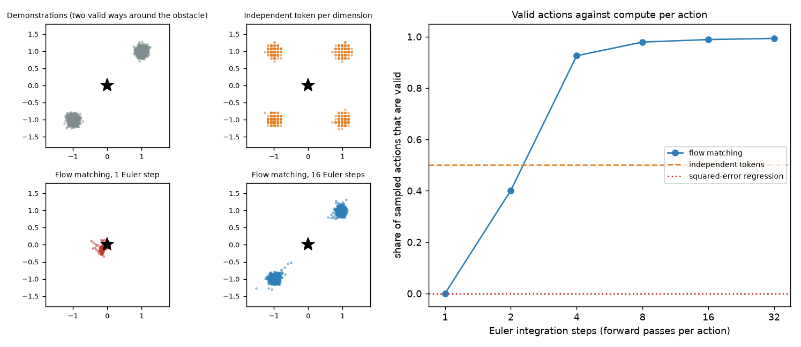

[Part 2](/posts/robot-2-actions-as-tokens/) ended with action tokens decoded one at a time at 1 to 6 Hz. This part covers the alternative that recent robot foundation models use: a generative model that outputs a whole chunk of continuous actions. It describes two papers and reproduces their central argument, multimodal demonstrations, on a toy problem, including the cost of the method in forward passes.

## Two papers

[Diffusion Policy](https://arxiv.org/abs/2303.04137) (Chi et al., 2023) represents a visuomotor policy as a conditional denoising diffusion process over actions. It was benchmarked on 15 tasks from 4 manipulation benchmarks, with an average improvement of 46.9% over the existing methods compared. The authors name three advantages of the formulation: it handles multimodal action distributions gracefully, suits high-dimensional action spaces and trains stably. The technical contributions that made it work on physical robots include receding-horizon control, visual conditioning and a time-series diffusion transformer. In plain terms, the policy predicts a sequence of future actions, executes the first part and predicts again.

[π0](https://arxiv.org/abs/2410.24164) (Black et al., 2024) fine-tunes a vision-language model to produce actions by flow matching, a variant of diffusion. The paper says this allows high-frequency action chunks, up to 50 Hz, and highly dexterous tasks, which it describes as a major challenge for prior autoregressive vision-language-action models. The model has a larger backbone initialised from PaliGemma and a smaller action expert of 300M parameters trained from scratch, 3.3 billion parameters in total. At inference time the model starts from random noise and integrates a learned vector field from $\tau=0$ to $\tau=1$ to produce the chunk.

## The argument in two dimensions

A policy is trained on human demonstrations, and humans disagree: an obstacle can be passed on the left or on the right. The toy below puts two valid action modes at $(-1,-1)$ and $(1,1)$ with an obstacle at $(0,0)$. Three policies are fitted to 20,000 demonstrations and 5,000 actions are sampled from each; an action is valid if it lies within 0.3 of a mode.

- **Squared-error regression.** The best constant prediction is the mean of the demonstrations, which sits on the obstacle.
- **Independent tokens.** One categorical token per dimension (32 bins), each sampled from its own marginal. This is the factorisation of a model that emits dimensions without conditioning one on another; it keeps both modes in each marginal and loses the correlation between them.
- **Flow matching.** A small network (3 hidden layers of 128 units) is trained on the velocity $a-\varepsilon$ along the path $x_t=(1-t)\varepsilon+t\,a$ with 4,000 steps, then sampled with $N$ Euler steps: $x \leftarrow x + v_\theta(x,t)/N$.

`flow.py`:

```python
import json, numpy as np, torch, torch.nn as nn
torch.manual_seed(0); np.random.seed(0); torch.set_num_threads(8)
MODES = np.array([[-1.0, -1.0], [1.0, 1.0]]); SIG = 0.08      # two valid ways to pass an obstacle that sits at (0, 0)
def demos(n):
    k = np.random.randint(0, 2, n); return (MODES[k] + SIG * np.random.randn(n, 2)).astype(np.float32)
def score(a):   # valid = within 0.3 of a mode; also the share of valid samples that went to mode 0
    d = np.linalg.norm(a[:, None, :] - MODES[None], axis=2); near = d.min(1) < 0.3
    return near.mean(), (d.argmin(1)[near] == 0).mean() if near.any() else float('nan')
train = demos(20000); res = {}
# 1. regression with squared error: the best constant prediction is the mean of the demonstrations
res['squared-error regression'] = score(np.tile(train.mean(0), (5000, 1)))
# 2. one categorical token per dimension (32 bins over [-1.5, 1.5]), dimensions sampled independently
edges = np.linspace(-1.5, 1.5, 33); idx = np.clip(np.digitize(train, edges) - 1, 0, 31)
samp = np.stack([np.random.choice(32, 5000, p=np.bincount(idx[:, d], minlength=32) / len(idx)) for d in range(2)], 1)
tok = ((edges[:-1] + edges[1:]) / 2)[samp]; np.save('tok.npy', tok[:2000]); res['independent tokens per dimension'] = score(tok)
# 3. flow matching: x_t = (1-t) noise + t action, regress the velocity (action - noise); sample by Euler integration
net = nn.Sequential(nn.Linear(3, 128), nn.SiLU(), nn.Linear(128, 128), nn.SiLU(), nn.Linear(128, 128), nn.SiLU(), nn.Linear(128, 2))
opt = torch.optim.Adam(net.parameters(), 2e-3); X = torch.tensor(train)
for step in range(4000):
    a = X[torch.randint(0, len(X), (512,))]; e = torch.randn_like(a); t = torch.rand(512, 1)
    loss = ((net(torch.cat([(1 - t) * e + t * a, t], 1)) - (a - e)) ** 2).mean(); opt.zero_grad(); loss.backward(); opt.step()
print(f'flow-matching net trained, final loss {loss.item():.3f}')
def sample(n, steps):
    x = torch.randn(n, 2)
    with torch.no_grad():
        for i in range(steps): x = x + net(torch.cat([x, torch.full((n, 1), i / steps)], 1)) / steps
    return x.numpy()
steps_list = [1, 2, 4, 8, 16, 32]
for s in steps_list: res[f'flow matching, {s} Euler steps'] = score(sample(5000, s))
print(f'{"policy":<40}{"valid actions":>14}{"share to mode 0":>18}')
for k, (v, b) in res.items(): print(f'{k:<40}{v:>14.3f}{b:>18.2f}')
json.dump({k: list(v) for k, v in res.items()}, open('res.json', 'w'))
np.save('s1.npy', sample(2000, 1)); np.save('s16.npy', sample(2000, 16)); np.save('train.npy', train[:2000])
```

Output:

```
flow-matching net trained, final loss 0.838
policy                                   valid actions   share to mode 0
squared-error regression                         0.000               nan
independent tokens per dimension                 0.500              0.49
flow matching, 1 Euler steps                     0.000               nan
flow matching, 2 Euler steps                     0.402              0.62
flow matching, 4 Euler steps                     0.926              0.52
flow matching, 8 Euler steps                     0.979              0.51
flow matching, 16 Euler steps                    0.989              0.51
flow matching, 32 Euler steps                    0.993              0.52
```


*The star is the obstacle. Regression predicts it exactly, independent tokens put half of the samples on invalid corners, and flow matching recovers the two modes once it has enough integration steps.*

## What the numbers say

- **Averaging fails completely when demonstrations disagree.** Regression produces 0 valid actions of 5,000, because the mean is the one action nobody demonstrated.
- **Factorising dimensions loses the joint structure.** Independent tokens give exactly half valid (0.500), with the two modes balanced; the other half are the mixed corners. A model that conditions each token on the previous ones, as an autoregressive decoder does, does not have this particular failure, and this toy did not test it.
- **Flow matching represents both modes, at a compute price.** With 1 Euler step the sampler outputs the mean again (0.000 valid), the same failure as regression; 2 steps give 0.402, 4 steps 0.926, 16 steps 0.989 and 32 steps 0.993, with the modes close to balanced (0.51 to 0.52 for mode 0). Each step is one forward pass of the network.
- **The step count is the latency knob.** A chunk costs a handful of passes of the action network rather than one pass per token, and one chunk covers many control ticks. This is why the 50 Hz figure in the π0 paper is a chunk rate and not a per-step decoding rate.

Part 4 looks at how the two layers, a slow reasoning model and a fast action model, are combined in one system.

## Limits

- Two dimensions, two modes of equal weight, an assumed obstacle and a small network. The toy reproduces the argument for multimodality; it does not reproduce any benchmark and says nothing about visual conditioning, chunk length or training on real data.
- The Euler step counts are for this network on this problem. Real action experts use their own schedules; the reported figures of the papers (46.9% average improvement, up to 50 Hz, 3.3 billion parameters) come from the papers and were not re-measured.
- The independent-token baseline stands for a factorised output, not for RT-2 or OpenVLA, whose decoders condition each token on the previous ones.
