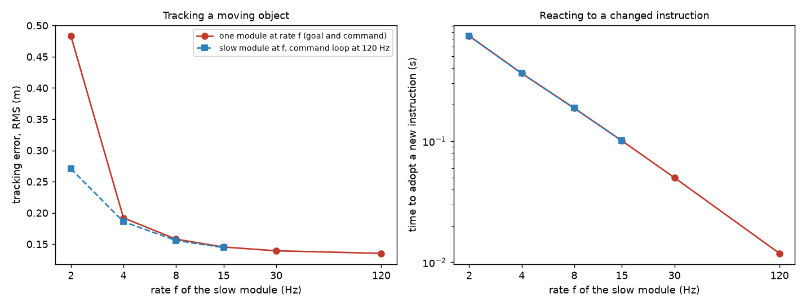

[Part 2](/posts/robot-2-actions-as-tokens/) showed that a large model decoding actions token by token runs at a few hertz, and [Part 3](/posts/robot-3-continuous-actions-diffusion-flow-matching/) showed how an action network outputs chunks. This part covers the architecture that combines the two: a slow vision-language module for understanding and a fast module for motion. It states the published design, simulates the trade on a toy tracking task, and reports where the split helps and where it does not.

## The published design

[GR00T N1](https://arxiv.org/abs/2503.14734) (NVIDIA, 2025) is described as a vision-language-action model with a dual-system architecture for humanoid robots. The System 2 module is a pre-trained vision-language model that interprets the scene and the language instruction and, according to the paper, runs at 10 Hz on an NVIDIA L40 GPU. The System 1 module is a diffusion transformer trained with action flow matching; it cross-attends to the output tokens of the vision-language model and generates closed-loop motor actions at 120 Hz. The two modules are jointly trained end to end, and the paper names the architecture as inspired by Kahneman's fast and slow thinking. The reported deployment is on the Fourier GR-1 humanoid for language-conditioned bimanual manipulation.

Figure's [Helix](https://www.figure.ai/news/helix) announcement (a company post, not a peer-reviewed paper) describes the same split for the upper body of a humanoid. System 2 is an onboard internet-pretrained vision-language model operating at 7 to 9 Hz for scene understanding and language; System 1 is a fast reactive visuomotor policy that turns the latent representations produced by System 2 into continuous actions at 200 Hz. The post's stated reason is a trade-off: vision-language backbones are general but not fast, and visuomotor policies are fast but not general. Rates and claims here are the company's own and were not independently checked.

Both designs have the same shape: the slow module hands a representation of the goal to the fast module, and the fast module closes the loop against fresh observations.

## What the split buys: a toy simulation

The simulation has two objects that change velocity about once per second. A robot hand (a point with a velocity command and a first-order lag of 0.15 s) must follow the object named by an instruction. At a random time between 3 and 6 s the instruction switches from the first object to the second. Two designs are compared over 300 episodes of 10 s at a 1 ms time step:

- **One module.** A single model chooses the goal and recomputes the velocity command at rate $f$; its latency is one period $1/f$, and the command is held between updates.
- **Two speeds.** A slow module chooses the goal at rate $f$ with the same latency, and a fast loop recomputes the command at 120 Hz toward the chosen object's current position.

Tracking error is measured on the steady parts of the episode (before the switch and from 3 s after it, so that the transit to the new object is excluded); the adoption time is the delay from the instruction change until the new goal is in force.

`speeds.py`:

```python
import json, numpy as np
rng = np.random.default_rng(0)
E, DT, T = 300, 0.001, 10.0; STEPS = int(T / DT)
# world: two objects moving with velocity jerks (a partner or a conveyor), robot hand = a point with velocity command.
def world():
    pos = rng.normal(0, 1, (E, 2, 2)); vel = np.zeros((E, 2, 2)); out = np.empty((STEPS, E, 2, 2), np.float32)
    for k in range(STEPS):
        jerk = rng.random((E, 2, 1)) < DT * 1.0                       # a velocity change about once per second per object
        vel = np.where(jerk, rng.normal(0, 0.6, (E, 2, 2)), vel); pos = pos + vel * DT; out[k] = pos
    return out
obj = world(); t_sw = rng.uniform(3, 6, E)                           # at t_sw the instruction switches from object 0 to object 1
def run(f_vis, f_ctl, lat):
    """f_vis: rate at which the slow module picks the goal object (with latency lat); f_ctl: rate at which velocity commands are recomputed."""
    x = obj[0, np.arange(E), 0].copy(); u = np.zeros((E, 2)); goal = np.zeros(E, int); pend = np.full(E, -1); pend_t = np.zeros(E)
    err = []; adopt = np.full(E, np.nan)
    ds, dc = max(1, round(1 / f_vis / DT)), max(1, round(1 / f_ctl / DT)); L = round(lat / DT)
    for k in range(STEPS):
        t = k * DT; want = (t >= t_sw).astype(int)
        arrive = (k >= pend_t) & (pend >= 0); goal = np.where(arrive, pend, goal); pend = np.where(arrive, -1, pend)
        if k % ds == 0 and (pend < 0).all(): pend = want.copy(); pend_t = np.full(E, k + L)   # slow module reads the instruction, answers after its latency
        if k % dc == 0: u = np.clip((obj[k][np.arange(E), goal] - x) / 0.15, -2, 2)   # command from the fresh position of the chosen object
        x = x + u * DT
        sw = (goal == 1) & np.isnan(adopt) & (t >= t_sw); adopt[sw] = t - t_sw[sw]
        steady = (t < t_sw) | (t > t_sw + 3.0)
        if k % 10 == 0: err.append(np.where(steady, np.linalg.norm(obj[k][np.arange(E), want] - x, axis=1), np.nan))
    return np.sqrt(np.nanmean(np.array(err) ** 2)), np.nanmean(adopt)
res = {}
print('monolithic model: one module sets goal and command at the same rate f; latency = one period')
print(f'{"f (Hz)":>8}{"tracking error RMS (m)":>26}{"time to adopt new goal (s)":>30}')
for f in (2, 4, 8, 15, 30, 120):
    e, a = run(f, f, 1 / f); res[f'mono|{f}'] = (float(e), float(a)); print(f'{f:>8}{e:>26.3f}{a:>30.3f}')
print('\ntwo speeds: slow module picks the goal at f_slow (latency = one period), fast loop recomputes the command at 120 Hz')
print(f'{"f_slow (Hz)":>12}{"tracking error RMS (m)":>26}{"time to adopt new goal (s)":>30}')
for f in (2, 4, 8, 15):
    e, a = run(f, 120, 1 / f); res[f'two|{f}'] = (float(e), float(a)); print(f'{f:>12}{e:>26.3f}{a:>30.3f}')
json.dump(res, open('res.json', 'w'))
```

Output:

```
monolithic model: one module sets goal and command at the same rate f; latency = one period
  f (Hz)    tracking error RMS (m)    time to adopt new goal (s)
       2                     0.483                         0.739
       4                     0.192                         0.363
       8                     0.158                         0.187
      15                     0.145                         0.101
      30                     0.139                         0.050
     120                     0.135                         0.012

two speeds: slow module picks the goal at f_slow (latency = one period), fast loop recomputes the command at 120 Hz
 f_slow (Hz)    tracking error RMS (m)    time to adopt new goal (s)
           2                     0.271                         0.739
           4                     0.186                         0.363
           8                     0.156                         0.187
          15                     0.144                         0.101
```


*Two designs in a toy tracking task: the fast loop decouples the tracking error from the slow module, but not the reaction to a new instruction.*

## What the numbers say

- **The fast loop removes the dependence on the slow rate where the slow rate is low.** At 2 Hz, the single module tracks with an RMS error of 0.483 m and the two-speed design with 0.271 m; at 4 Hz the numbers are 0.192 and 0.186 m.
- **At moderate rates the two designs are nearly the same.** From 8 Hz upward the single module is within 0.002 m of the two-speed design (0.158 and 0.156 m at 8 Hz, 0.145 and 0.144 m at 15 Hz). In this world the objects move slowly enough for 8 Hz to be adequate, which is also why the toy cannot show why a humanoid needs 120 to 200 Hz. The need comes from contact, balance and disturbances much faster than 1 Hz velocity changes.
- **The split does not speed up instruction changes.** The adoption time is the same in both designs (0.739 s at 2 Hz, 0.187 s at 8 Hz, 0.101 s at 15 Hz), because the new goal reaches the system through the slow module. A command such as "stop" or "hand it to me" is limited by the slow module's period and latency; any faster reaction must come from the fast module itself or from a separate safety layer.
- **The tracking error has a floor.** It settles near 0.135 m even at 120 Hz, set by the 0.15 s lag of the hand and the velocity changes of the objects, not by the control rate.

Part 5 moves to the legs, where the control loop is faster and the learning method is different.

## Limits

- A two-dimensional point robot with a hand-set lag, objects with random velocity changes, and an instruction switch with a fixed latency equal to one period. It shows how the two rates enter the error and the reaction time; it contains no vision, no language model, no contact and no balance.
- The published rates (10 Hz and 120 Hz for GR00T N1, 7 to 9 Hz and 200 Hz for Helix) are quoted from the paper and the company post and were not measured. Helix is a company announcement; the architecture of its two systems is described in less detail than in the paper.
- The error threshold, the 3 s exclusion window and the use of the same latency for both designs are choices of the author; a different window changes the 2 Hz row in particular.
