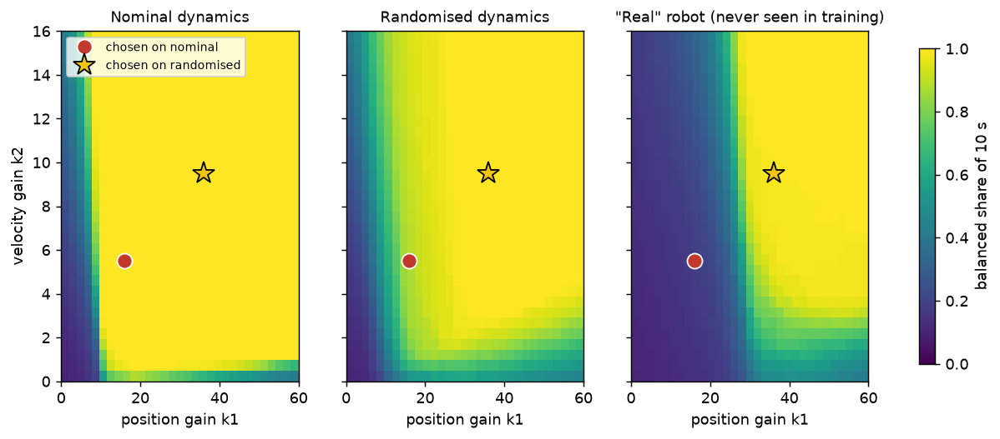

The language and vision-language models of the previous parts do not balance a humanoid. The legs are controlled by a separate policy, and the method used for it in the literature is reinforcement learning in simulation. This part describes three papers on that method, shows the mechanism behind its central trick in a balance toy, and says what the toy does and does not show.

## Three papers

[Domain randomization](https://arxiv.org/abs/1703.06907) (Tobin et al., 2017) is the idea behind the trick. The paper studies it for images: with enough variability in the simulator, the real world may appear to the model as just another variation. It trains an object detector on simulated images with non-realistic random textures that is accurate to 1.5 cm on real images, and reports, to the authors' knowledge, the first successful transfer of a deep network trained only on simulated RGB images to the real world for robotic control.

[Real-world humanoid locomotion with reinforcement learning](https://arxiv.org/abs/2303.03381) (Radosavovic et al., 2023) trains a causal Transformer on the history of observations and actions by large-scale model-free reinforcement learning, on an ensemble of randomized environments in simulation, and deploys it zero-shot on a full-sized Digit robot. The authors hypothesise that the history carries information about the world which the Transformer uses to adapt in context, without updating weights, and the method uses no state estimation, dynamics models, trajectory optimisation, reference trajectories or gait libraries. They describe it as the first fully learning-based method for real-world full-sized humanoid locomotion.

[Humanoid-Gym](https://arxiv.org/abs/2404.05695) (2024) is an open framework on NVIDIA Isaac Gym for training humanoid locomotion with zero-shot transfer. Its workflow uses massively parallel reinforcement learning with diverse terrains and dynamics randomization, followed by sim-to-sim transfer to the MuJoCo simulator to test policies before the real robot. The paper says the sim-to-real gap of humanoids is larger than that of quadrupeds and that performance in MuJoCo and the real world aligned closely after calibration.

The common recipe: train in a simulator where physical parameters vary from episode to episode, so that the policy cannot rely on exact values, then deploy to hardware without further training.

## A balance toy

An inverted pendulum with a motor stands for a leg or a torso. The angle $\theta$ obeys

$$\ddot\theta = \frac{g}{l}\sin\theta + \frac{s\,u}{m\,l^2} - 0.05\,\dot\theta$$

with mass $m$, length $l$, motor strength $s$, a command $u$ applied $d$ control steps late (10 ms each), noisy sensors and random pushes. The policy is a linear feedback $u=-k_1\theta-k_2\dot\theta$. Training here is a grid search over $(k_1,k_2)$, not reinforcement learning, with the objective of the balanced fraction of a 10 s episode minus a small penalty on effort. Two training worlds are compared:

- **Nominal.** $m=1$, $l=1$, $s=1$, delay 2 steps, noise 0.01 rad.
- **Randomised.** $m\in[0.6,1.6]$, $l\in[0.7,1.3]$, $s\in[0.5,1.2]$, delay 0 to 8 steps, noise 0.01 rad, sampled per episode.

Both are evaluated on a "real" robot that neither saw: $m=1.5$, $l=1.2$, $s=0.6$, a delay of 6 steps and twice the sensor noise.

`balance.py`:

```python
import json, numpy as np
rng = np.random.default_rng(0)
DT, T, G = 0.01, 10.0, 9.81; STEPS = int(T / DT); TMAX = 25.0; LIM = 0.5     # command limit and fall angle (rad)
K1 = np.linspace(0, 60, 31); K2 = np.linspace(0, 16, 33)                      # grid of feedback gains: u = -k1*theta - k2*omega
GRID = np.stack(np.meshgrid(K1, K2, indexing='ij'), -1).reshape(-1, 2)          # (n_gains, 2)
def episodes(E, mode):
    if mode == 'nominal': m, l, s, d, noise = (np.full(E, v) for v in (1.0, 1.0, 1.0, 2, 0.01))
    elif mode == 'randomised': m, l, s, d, noise = rng.uniform(0.6, 1.6, E), rng.uniform(0.7, 1.3, E), rng.uniform(0.5, 1.2, E), rng.integers(0, 9, E), np.full(E, 0.01)
    else: m, l, s, d, noise = (np.full(E, v) for v in (1.5, 1.2, 0.6, 6, 0.02))    # 'real' robot: heavier, longer, weaker motor, slower loop
    return dict(m=m, l=l, s=s, d=d.astype(int), noise=noise, th0=rng.uniform(-0.1, 0.1, E), push=rng.normal(0, 0.4, (STEPS, E)) * (rng.random((STEPS, E)) < DT / 2))
def evaluate(K, ep):
    """balanced fraction of the 10 s for every gain pair (rows) and episode (columns), plus mean squared command"""
    n, E = len(K), len(ep['m']); th = np.tile(ep['th0'], (n, 1)); om = np.zeros((n, E)); alive = np.ones((n, E), bool); t_alive = np.zeros((n, E)); eff = np.zeros((n, E))
    buf = np.zeros((STEPS + 10, n, E)); k1, k2 = K[:, 0:1], K[:, 1:2]; idx_d = ep['d'][None, :]
    for k in range(STEPS):
        y1 = th + ep['noise'] * rng.standard_normal((n, E)); y2 = om + ep['noise'] * rng.standard_normal((n, E))
        buf[k + 5] = np.clip(-(k1 * y1 + k2 * y2), -TMAX, TMAX)                         # command computed now ...
        u = buf[k + 5 - ep['d'][None, :], np.arange(n)[:, None], np.arange(E)[None, :]]                              # ... and applied d steps later
        acc = (G / ep['l']) * np.sin(th) + ep['s'] * u / (ep['m'] * ep['l'] ** 2) - 0.05 * om                   # inverted pendulum with a motor
        om = om + (acc * DT + ep['push'][k][None, :] * alive); th = th + om * DT
        alive &= np.abs(th) < LIM; t_alive += alive * DT; eff += alive * u ** 2 * DT
    return t_alive / T, eff / T
def pick(K, ep):
    ok, eff = evaluate(K, ep); score = ok.mean(1) - 1e-4 * eff.mean(1); i = int(score.argmax()); return i, ok.mean(1)
E = 60; out = {}
nom = episodes(E, 'nominal'); ran = episodes(E, 'randomised'); real = episodes(E, 'real')
i_n, surf_n = pick(GRID, nom); i_r, surf_r = pick(GRID, ran)
_, surf_real = pick(GRID, real)
fn, fr = evaluate(GRID[[i_n]], real)[0], evaluate(GRID[[i_r]], real)[0]
print(f'gains chosen on nominal dynamics:    k1={GRID[i_n][0]:.1f}, k2={GRID[i_n][1]:.1f}   balanced fraction in training  {surf_n[i_n]:.2f}')
print(f'gains chosen on randomised dynamics: k1={GRID[i_r][0]:.1f}, k2={GRID[i_r][1]:.1f}   balanced fraction in training  {surf_r[i_r]:.2f}')
print(f'on the "real" robot (heavier, longer, weaker motor, 60 ms delay, double noise), 60 episodes:')
print(f'   nominal-trained policy:    balanced for the whole 10 s in {np.mean(fn >= 0.999):.2f} of episodes, mean balanced fraction {fn.mean():.2f}')
print(f'   randomised-trained policy: balanced for the whole 10 s in {np.mean(fr >= 0.999):.2f} of episodes, mean balanced fraction {fr.mean():.2f}')
print(f'share of the {len(GRID)} gain pairs that balance (mean fraction >= 0.9): nominal world {np.mean(surf_n >= 0.9):.2f}, randomised world {np.mean(surf_r >= 0.9):.2f}, real robot {np.mean(surf_real >= 0.9):.2f}')
np.savez('res.npz', K1=K1, K2=K2, surf_n=surf_n.reshape(len(K1), len(K2)), surf_r=surf_r.reshape(len(K1), len(K2)), surf_real=surf_real.reshape(len(K1), len(K2)), pn=GRID[i_n], pr=GRID[i_r], fn=fn, fr=fr)
```

Output:

```
gains chosen on nominal dynamics:    k1=16.0, k2=5.5   balanced fraction in training  1.00
gains chosen on randomised dynamics: k1=36.0, k2=9.5   balanced fraction in training  1.00
on the "real" robot (heavier, longer, weaker motor, 60 ms delay, double noise), 60 episodes:
   nominal-trained policy:    balanced for the whole 10 s in 0.00 of episodes, mean balanced fraction 0.18
   randomised-trained policy: balanced for the whole 10 s in 0.98 of episodes, mean balanced fraction 0.99
share of the 1023 gain pairs that balance (mean fraction >= 0.9): nominal world 0.82, randomised world 0.64, real robot 0.41
```


*Yellow is the region of gains that balances. The nominal optimum (red dot) sits near the left edge of the nominal region; the randomised optimum (star) sits well inside every region.*

## What the numbers say

- **The nominal training world reaches a perfect score and fails on the unseen robot.** The gains chosen on it, $k_1=16$ and $k_2=5.5$, balance 1.00 of the training episodes and 0 of 60 episodes on the unseen robot (mean balanced fraction 0.18).
- **The randomised training world chooses larger gains and transfers.** The gains $k_1=36$ and $k_2=9.5$ balance 0.98 of the unseen-robot episodes in full and 0.99 on average, though the randomised world was harder: only 0.64 of the gain pairs balance there, against 0.82 in the nominal world.
- **Why:** the region of working gains shrinks and moves as the plant changes (heavier, weaker motor, slower loop), from 0.82 of the grid to 0.41. A policy tuned on the nominal world sits at the cheapest point of a large region, which in the real world lies outside the smaller region. Randomisation shows the optimiser the intersection, and it picks a point inside it.
- **The price:** the randomised policy uses larger commands, which costs effort in the nominal world and would cost energy and wear on a real robot. Randomisation trades nominal efficiency for robustness; a randomisation range that is too wide would give an overly cautious policy (the author's reading of the trade, not a result of these papers or of this toy).

Part 6 returns to the question of how to know any of this works: how robot policies are evaluated.

## Limits

- A one-joint linear plant with a two-parameter policy and a grid search. The real method trains a neural policy with reinforcement learning on a many-joint body with contacts. The toy illustrates why randomisation works; it does not reproduce its scale or its results.
- The "real" robot is another simulation with other parameters; the transfer gap here is a parameter shift, not unmodelled physics.
- The statements about the three papers (1.5 cm, first demonstration, zero-shot on Digit, Isaac Gym with MuJoCo sim-to-sim) are quoted from their abstracts and text; none was re-measured.
