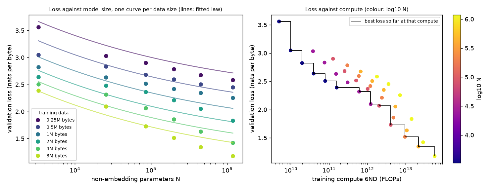

This series covers how language-model performance is improved: first the principles, in six parts, then what companies publish about their recipes, then what research is still trying. This part starts with the map of levers and the two papers that put numbers on three of them, and then reruns the experiment at small scale. The small-scale result is mixed, and the post reports it that way.

## The levers

Performance can come from seven places, and each later part of the series takes one:

1. **Model size and training compute** (this part).
2. **Training data**: quantity, quality, mixture (Part 2).
3. **Post-training** with supervised examples and preference signals (Part 3).
4. **Reinforcement learning against checkable answers** for reasoning (Part 4).
5. **Compute spent at inference**: sampling, voting, search, longer reasoning (Part 5).
6. **Architecture and engineering**: sparse experts, attention kernels, decoding tricks (Part 6).
7. **Everything the first six look like in practice**: company reports (Part 7) and open research problems (Part 8).

Levers 1 and 2 set what the model can know; 3 and 4 shape how it behaves; 5 trades latency and cost for accuracy at the moment of use; 6 changes what a given budget buys.

## Two papers that put numbers on size, data and compute

[Kaplan et al. (2020)](https://arxiv.org/abs/2001.08361) study empirical scaling laws for cross-entropy loss. They report that the loss scales as a power law with model size, dataset size and training compute, with some trends spanning more than seven orders of magnitude, and that architectural details such as width or depth have minimal effect within a wide range. They also report that larger models are significantly more sample-efficient, so that compute-optimal training uses very large models on a relatively modest amount of data and stops significantly before convergence.

[Hoffmann et al. (2022)](https://arxiv.org/abs/2203.15556), the Chinchilla paper, revisit the question by training over 400 models from 70 million to over 16 billion parameters on 5 to 500 billion tokens. They conclude that current large models were significantly undertrained and that, for compute-optimal training, model size and training tokens should be scaled equally: for every doubling of model size the number of training tokens should also be doubled. They test the claim with Chinchilla, a 70B model trained on 4 times more data than Gopher (280B) with the same compute, which they report outperforms Gopher, GPT-3, Jurassic-1 and Megatron-Turing NLG on a large range of downstream tasks, with 67.5% average accuracy on MMLU, more than 7 points above Gopher.

One of the paper's three estimation approaches fits a parametric loss

$$\hat L(N,D)=E+\frac{A}{N^{\alpha}}+\frac{B}{D^{\beta}}$$

to the runs, with $N$ the parameter count and $D$ the number of training tokens. $E$ is the loss of an ideal model, the first term is the penalty for a finite model and the second the penalty for finite data. With training compute approximated as $C\approx 6ND$, minimising the fitted loss at fixed $C$ gives $N_{opt}\propto C^{a}$ and $D_{opt}\propto C^{b}$ with $a=\beta/(\alpha+\beta)$ and $b=\alpha/(\alpha+\beta)$. The paper reports $a=0.46$ and $b=0.54$ for this approach.

## The same experiment at small scale

The experiment below trains 36 small decoder-only Transformers on byte-level Python source code from the standard library: six sizes (3,312 to 1.19 million non-embedding parameters) crossed with six data sizes (250 thousand to 8 million training bytes). Each run makes a single pass over its data with a cosine schedule, and the validation loss is measured in nats per byte on separate files. The fit is the Chinchilla form above, fitted in log space.

`scale.py`:

```python
import glob, json, math, os, sys, time
import numpy as np, torch, torch.nn as nn, torch.nn.functional as F
torch.set_num_threads(8); torch.manual_seed(0); np.random.seed(0)
import sysconfig; STD = sysconfig.get_paths()['stdlib']
files = sorted(glob.glob(STD + '/**/*.py', recursive=True)); rng = np.random.default_rng(0); rng.shuffle(files)
def load(fs, cap):
    out = []; n = 0
    for f in fs:
        try: b = open(f, 'rb').read()
        except Exception: continue
        b = bytes(x for x in b if x < 128)       # ASCII only: vocabulary of 128 byte values
        out.append(np.frombuffer(b, np.uint8)); n += len(b)
        if n >= cap: break
    return np.concatenate(out)[:cap].astype(np.int64)
val = load(files[:200], 600_000); train = load(files[200:], 9_000_000)
print(f'train bytes {len(train)}, validation bytes {len(val)}, files {len(files)}', flush=True)
CTX, BATCH = 128, 32
class Block(nn.Module):
    def __init__(s, d, h):
        super().__init__(); s.l1 = nn.LayerNorm(d); s.att = nn.MultiheadAttention(d, h, batch_first=True); s.l2 = nn.LayerNorm(d); s.mlp = nn.Sequential(nn.Linear(d, 4 * d), nn.GELU(), nn.Linear(4 * d, d))
    def forward(s, x, mask):
        y = s.l1(x); x = x + s.att(y, y, y, attn_mask=mask, need_weights=False)[0]; return x + s.mlp(s.l2(x))
class GPT(nn.Module):
    def __init__(s, d, L, h):
        super().__init__(); s.emb = nn.Embedding(128, d); s.pos = nn.Embedding(CTX, d); s.blocks = nn.ModuleList([Block(d, h) for _ in range(L)]); s.ln = nn.LayerNorm(d); s.head = nn.Linear(d, 128, bias=False)
        s.register_buffer('mask', torch.triu(torch.ones(CTX, CTX, dtype=torch.bool), 1))
    def forward(s, x):
        h = s.emb(x) + s.pos(torch.arange(x.shape[1])); [None for b in s.blocks if (h := b(h, s.mask)) is not None]; return s.head(s.ln(h))
def nonembed(m): return sum(p.numel() for n, p in m.named_parameters() if not n.startswith(('emb', 'pos', 'head')))
def batch(data, g):
    ix = torch.randint(0, len(data) - CTX - 1, (BATCH,), generator=g); a = torch.stack([torch.from_numpy(data[i:i + CTX]) for i in ix]); b = torch.stack([torch.from_numpy(data[i + 1:i + CTX + 1]) for i in ix]); return a, b
def run(d, L, h, tokens):
    torch.manual_seed(1); m = GPT(d, L, h); steps = tokens // (BATCH * CTX); opt = torch.optim.AdamW(m.parameters(), 3e-3, weight_decay=0.0); g = torch.Generator().manual_seed(2)
    # single pass over `tokens` training positions: batches are drawn from a prefix of the training bytes of that length (so data amount, not step count alone, differs)
    sub = train[:tokens + CTX + 1]; t0 = time.time()
    for s in range(steps):
        lr = 3e-3 * min(1, (s + 1) / 20) * (0.1 + 0.9 * 0.5 * (1 + math.cos(math.pi * s / steps)))
        for gp in opt.param_groups: gp['lr'] = lr
        a, b = batch(sub, g); loss = F.cross_entropy(m(a).reshape(-1, 128), b.reshape(-1)); opt.zero_grad(); loss.backward(); nn.utils.clip_grad_norm_(m.parameters(), 1.0); opt.step()
    m.eval(); gv = torch.Generator().manual_seed(3); vl = []
    with torch.no_grad():
        for _ in range(60): a, b = batch(val, gv); vl.append(F.cross_entropy(m(a).reshape(-1, 128), b.reshape(-1)).item())
    return nonembed(m), float(np.mean(vl)), time.time() - t0
SIZES = [(16, 1, 2), (32, 2, 2), (48, 3, 4), (64, 4, 4), (96, 4, 4), (128, 6, 4)]       # (d_model, layers, heads)
TOK = [250_000, 500_000, 1_000_000, 2_000_000, 4_000_000, 8_000_000]
out = open('runs.jsonl', 'a'); done = {(r['d'], r['tokens']) for r in map(json.loads, open('runs.jsonl'))} if os.path.getsize('runs.jsonl') else set()
for tokens in TOK:
    for d, L, h in SIZES:
        if (d, tokens) in done: continue
        n, v, sec = run(d, L, h, tokens); out.write(json.dumps(dict(d=d, L=L, N=n, tokens=tokens, val=v, sec=sec)) + '\n'); out.flush()
        print(f'd={d:>3} layers={L} N={n:>8} D={tokens:>8} val loss {v:.4f}  ({sec:.0f}s)', flush=True); open(os.path.expanduser('~/.blog-improve-heartbeat'), 'a').close(); os.utime(os.path.expanduser('~/.blog-improve-heartbeat'))
```

Output of the runs and the fit (`fit.py`):

```
36 training runs: [3312, 25472, 84912, 200064, 447552, 1189888] non-embedding parameters x [250000, 500000, 1000000, 2000000, 4000000, 8000000] training bytes
validation loss (nats per byte), rows = parameters, columns = training bytes
        N     250k     500k    1000k    2000k    4000k    8000k
     3312    3.560    3.048    2.824    2.637    2.507    2.390
    25472    3.033    2.832    2.633    2.481    2.318    2.098
    84912    2.900    2.682    2.515    2.366    2.068    1.730
   200064    2.784    2.595    2.417    2.210    1.858    1.518
   447552    2.674    2.505    2.348    2.053    1.632    1.345
  1189888    2.585    2.452    2.255    1.834    1.421    1.177

fit  L(N,D) = E + A/N^alpha + B/D^beta :  E=0.000 A=6.0 B=54.4 alpha=0.172 beta=0.259   rms log-error 0.0709
compute-optimal exponents (C = 6ND): N_opt ~ C^0.60, D_opt ~ C^0.40   (Chinchilla paper, approach 3: 0.46 and 0.54)
hold-out: fit without the 8M-byte runs predicts them with mean abs error 0.183 nats (observed range 1.177 to 2.390)

for each compute level, the best observed run:
  C in [3e+09, 1e+10) FLOPs: 2 runs; best N=3312 D=500000 loss 3.048; worst 3.560
  C in [3e+10, 1e+11) FLOPs: 4 runs; best N=3312 D=4000000 loss 2.507; worst 3.033
  C in [1e+11, 3e+11) FLOPs: 4 runs; best N=3312 D=8000000 loss 2.390; worst 2.900
  C in [3e+11, 1e+12) FLOPs: 6 runs; best N=25472 D=4000000 loss 2.318; worst 2.784
  C in [1e+12, 3e+12) FLOPs: 8 runs; best N=84912 D=4000000 loss 2.068; worst 2.585
  C in [3e+12, 1e+13) FLOPs: 6 runs; best N=200064 D=8000000 loss 1.518; worst 2.452
```


*Left: measured points and the fitted additive law. The lines miss the points. Right: the compute frontier is set by small models at low compute and by larger models at high compute.*

## What the numbers say

- **Both levers work, and neither saturates here.** Along every row of the table loss falls as data grows (for the largest model from 2.585 to 1.177 nats), and along every column it falls as parameters grow. At the largest data size the loss falls from 2.390 for 3,312 parameters to 1.177 for 1.19 million.
- **The levers interact.** The gain from a larger model grows with the amount of data: at 250 thousand bytes the largest model is 0.98 nats better than the smallest, at 8 million bytes it is 1.21 nats better. An additive law cannot represent that, and the left panel shows the consequence: the fitted lines miss the points by a wide margin. The fit parameters tell the same story, with $E$ pinned at 0 (the lower bound of the search) and a hold-out test that is poor: a fit without the 8-million-byte runs predicts them with a mean error of 0.183 nats, against an observed range of 1.177 to 2.390.
- **The compute frontier moves to larger models as compute grows.** The best observed run in each compute band is the 3,312-parameter model in the three lowest compute bands, then 25,472, 84,912 and 200,064 parameters in the next three. This is the observation behind compute-optimal training: at a fixed budget the best model is neither the smallest nor the largest. The data side confirms it: the 1.19-million-parameter model trained on 250 thousand bytes (loss 2.585) is beaten by the 3,312-parameter model trained on 4 million bytes (loss 2.507), which used about 20 times less compute.
- **The fitted exponents do not transfer.** The fit gives $N_{opt}\propto C^{0.60}$ and $D_{opt}\propto C^{0.40}$, against 0.46 and 0.54 in the Chinchilla paper. With $E$ at its bound and the hold-out error above, these values should not be read as a measurement of the compute-optimal split for this setup, and they say nothing about large models.

Part 2 turns to the data lever: what is removed from the training text, and why that raises quality at the same size.

## Limits

- The models are tiny, the data is one source (Python code, byte level, 8 million bytes at most), each run is a single seed, and the learning rate (3e-3) was not tuned per size. All runs are still far from convergence, which is the regime in which an additive law with a fixed floor fits worst.
- The grid caps the data at 8 million bytes, so "best run at a compute level" is partly a statement about the grid; larger models were never given more than 8 million bytes.
- The published results (power laws over seven orders of magnitude, equal scaling of size and tokens, Chinchilla's MMLU score, $a=0.46$ and $b=0.54$) are quoted from the abstracts and the paper and were not reproduced. The experiment demonstrates the shape of the trade-off, not the constants.
