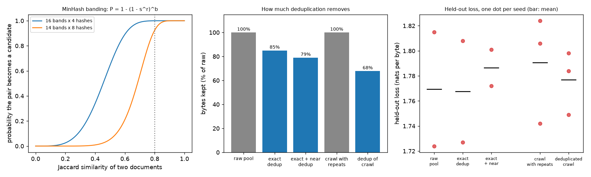

[Part 1](/posts/improve-1-levers-and-scaling-laws/) treated data as a number, the count of training tokens $D$. This part looks at what is inside that number. It has four sections: what the literature reports for deduplication, filtering, mixtures and synthetic data; how MinHash deduplication works, with the one formula that governs it; two runs on a real corpus of duplicated files; and what those runs did and did not show.

## What the literature reports

**Deduplication.** [Lee et al. (2021)](https://arxiv.org/abs/2107.06499) find that existing language-modelling datasets contain many near-duplicate examples and long repetitive substrings, so that over 1% of the unprompted output of models trained on them is copied verbatim from the training data. They remove from C4 a single 61-word sentence that is repeated over 60,000 times. Deduplication gives models that emit memorised text ten times less often and need fewer training steps for the same or better accuracy. It also reduces train-test overlap, which affects over 4% of the validation sets of standard datasets.

**Deduplication is not monotone.** The [FineWeb report](https://arxiv.org/abs/2406.17557) (Penedo et al., 2024) documents the choice in detail. Its MinHash setup takes each document's word 5-grams and computes 112 hashes split into 14 buckets of 8, targeting documents that are at least 75% similar. Applied globally across all 96 Common Crawl snapshots, this removed as much as 90% of the oldest snapshots and gave only a modest improvement. The retained data of the oldest snapshots performed worse than the data the procedure had removed, which the authors attribute to global deduplication upsampling lower-quality data. Deduplicating each snapshot independently matched RefinedWeb. One hypothesis in the report is that most of the gain comes from removing very large clusters of duplicates, with hundreds of thousands of documents.

**Filtering.** FineWeb adds URL blocklists, language identification, and quality and repetition heuristics. Its derived subset FineWeb-Edu keeps the pages that a classifier rates as educational. The classifier was trained on annotations that Llama-3-70B-Instruct produced for 460,000 sampled pages on a 0 to 5 scale, and the resulting 1.3-trillion-token subset is reported to give much better results on knowledge and reasoning benchmarks such as MMLU and ARC. [Longpre et al. (2023)](https://arxiv.org/abs/2305.13169) pretrain 28 models of 1.5B parameters and report that no filtering choice is universal: quality and toxicity filters trade benchmark performance against the risk of toxic generations, and the effect of a filter is not predictable from the domain it is applied to.

**Mixtures.** [DoReMi](https://arxiv.org/abs/2305.10429) (Xie et al., 2023) trains a 280M-parameter proxy model with group distributionally robust optimisation to set domain weights, then trains an 8B model with them. It reports 6.5 points higher average few-shot accuracy than The Pile's default weights and the baseline accuracy reached with 2.6 times fewer steps.

**Synthetic data.** [phi-1](https://arxiv.org/abs/2306.11644) (Gunasekar et al., 2023) is a 1.3B-parameter code model trained on 6B tokens of web data selected for "textbook quality" plus 1B tokens of textbooks and exercises generated by GPT-3.5. It reports 50.6% pass@1 on HumanEval and 55.5% on MBPP, with a 350M-parameter variant reaching 45% on HumanEval.

## How MinHash deduplication works

Exact duplicates are found by hashing the whole document. Near duplicates (the same file with a changed header, another version of a library) need a similarity measure. The measure is the Jaccard similarity of the two documents' shingle sets, here every run of 8 consecutive whitespace-separated tokens:

$$J(X,Y)=\frac{|X\cap Y|}{|X\cup Y|}$$

Comparing all pairs is quadratic. MinHash replaces each document by $k$ numbers: for each of $k$ random hash functions, the minimum hash over the document's shingles. The probability that two documents agree on one such number equals $J$, so the fraction of agreeing numbers estimates it. To avoid comparing all pairs, the $k$ numbers are cut into $b$ bands of $r$ rows, and two documents become a candidate pair if they agree on all rows of at least one band. The chance of that for similarity $s$ is

$$P(s)=1-\left(1-s^{r}\right)^{b}$$

which is an S-curve (left panel). The band layout moves the curve: with 16 bands of 4 rows (this experiment) a pair at $s=0.5$ is a candidate with probability 0.64, with 14 bands of 8 rows (FineWeb) with probability 0.05, and at $s=0.8$ the two give 1.00 and 0.92. Candidate pairs are then confirmed by the estimated Jaccard similarity (here at least 0.8) and merged into clusters, and one document is kept per cluster.

## Two runs on a corpus that is duplicated in practice

The corpus is the Python source files in several virtual environments on one machine. The same packages are installed several times, so exact and near duplicates occur naturally. Paths are resolved to real paths first: the first version of this experiment listed every file twice through a `lib64` symlink, which inflated the duplicate counts until the double listing was noticed.

The MinHash code (the experiment's model and training loop are the ones from Part 1):

```python
# ---------------- deduplication ----------------
def toks(b): return b.split()
def shingles(b, n=8):
    t = toks(b)
    if len(t) < n: return np.array([hash(b) & 0xFFFFFFFF], np.uint64)
    return np.unique(np.array([hash(tuple(t[i:i + n])) & 0xFFFFFFFF for i in range(len(t) - n + 1)], np.uint64))
P = (1 << 31) - 1; NP = 64; A = rng.integers(1, P, NP, dtype=np.uint64); Bc = rng.integers(0, P, NP, dtype=np.uint64)
def minhash(b):
    s = shingles(b); return ((s[:, None] * A[None, :] + Bc[None, :]) % P).min(0)
def signatures(ds): return np.stack([minhash(d) for d in ds])
sig_pool = signatures(pool); sig_val = signatures(val_raw)
def near_dup_groups(sig, thr=0.8, bands=16):
    r = NP // bands; parent = list(range(len(sig)))
    def find(i):
        while parent[i] != i: parent[i] = parent[parent[i]]; i = parent[i]
        return i
    for b in range(bands):
        buckets = {}
        for i, row in enumerate(sig):
            buckets.setdefault(row[b * r:(b + 1) * r].tobytes(), []).append(i)
        for ids in buckets.values():
            for j in ids[1:]:
                if (sig[ids[0]] == sig[j]).mean() >= thr: parent[find(j)] = find(ids[0])
    return [find(i) for i in range(len(sig))]
```

**Run A: a large pool.** A pool of 7,500 documents (153.4 MB) is deduplicated, and a model with 447,552 non-embedding parameters is trained on 4 million bytes drawn from each version of the pool. The validation documents are 500 files held out of the pool; the "clean" set removes the ones that have an exact or near copy in the pool.

**Run B: a small crawl with repeats.** Each of 356 distinct documents (4.0 MB) is included as many times as it exists on the machine, capped at 40, which models boilerplate and popular files recurring on the web. This gives 5.9 MB, 1.46 times the distinct bytes, and 39% of the documents have more than one copy. The same model is trained on 4 million bytes from the crawl or from its deduplicated version (which is about 4 million bytes, so the deduplicated run is about one pass), with 3 seeds each.

Output of run B (`dedup2.py`):

```
distinct documents 356 (4.0 MB); crawl with repeats 5.9 MB (x1.46); documents with more than one copy: 39%
crawl with repeats   held-out loss 1.791 (runs 1.806, 1.742, 1.824)  loss on its own training text 1.703  gap 0.087  distinct 64-byte blocks 100%
deduplicated         held-out loss 1.777 (runs 1.798, 1.749, 1.784)  loss on its own training text 1.712  gap 0.065  distinct 64-byte blocks 100%
```

Output of run A (`dedup.py`):

```
documents: 7500 in the training pool (153.4 MB), 500 validation documents
minhash signatures in 8s
pool: 153.4 MB | after exact dedup 129.7 MB (85%) | after exact + near dedup (MinHash, Jaccard >= 0.8) 120.9 MB (79%)
validation documents with an exact copy in the pool: 36%; with an exact or near copy: 43%
raw pool             naive validation 1.794 (runs 1.831, 1.756)   clean validation 1.769 (runs 1.815, 1.724)
exact dedup          naive validation 1.791 (runs 1.827, 1.756)   clean validation 1.767 (runs 1.808, 1.727)
exact + near dedup   naive validation 1.808 (runs 1.824, 1.793)   clean validation 1.787 (runs 1.801, 1.772)
raw pool: 0% of the first 4M training bytes are exact copies of an earlier document in the same run
```

The last column of run B (distinct 64-byte blocks) is meaningless: it compares blocks at fixed offsets in a concatenation of documents of different lengths, so repeated documents never align, and it reads 100% in both rows. Ignore it.


*Left: the S-curve of the banding scheme. Middle: deduplication removes 15% and 21% of the pool, and 32% of the crawl with repeats. Right: the held-out losses of the variants overlap.*

## What the runs show

- **Deduplication finds a lot.** Exact copies are 15% of the pool's bytes and near copies another 6%, so 21% of the pool goes. In the small crawl a third of the bytes are repeats. Between 36% and 43% of the held-out documents have a copy in the pool, which is the train-test overlap problem Lee et al. describe.
- **The effect on held-out loss is not measurable here.** In run A the three variants differ by 0.02 nats or less on the clean validation set, while the two seeds of each variant differ from each other by 0.03 to 0.09. In run B the deduplicated version is 0.014 nats better on average (1.777 against 1.791), and the seed-to-seed range of each variant is 0.05 to 0.08. That is within noise, and 3 seeds are not enough to call it.
- **The memorisation signature points the expected way, weakly.** In run B the gap between held-out loss and the loss on the model's own training text is 0.087 nats for the crawl with repeats and 0.065 for the deduplicated one. This is the direction Lee et al. predict (more repetition, more memorisation), and it is also a single measurement of three runs.
- **Run A explains itself.** Training consumed 4 million of 153 million bytes, so the run measured 0% (rounded) of the training bytes as exact repeats of an earlier document in the same run. Deduplication matters when training sees the same content repeatedly, which at web scale means pools much smaller than the training run's token count or clusters of hundreds of thousands of copies, as in the FineWeb report. It does not matter much when the sample is a small slice of a large pool.

The practical reading is the same as the FineWeb report's: the value of deduplication sits in the very large duplicate clusters, and removing more is not automatically better. [Part 3](/posts/improve-3-post-training/) moves from what the model reads to how it is taught to behave: supervised fine-tuning and preference optimisation.

## Limits

- Python source is a poor stand-in for web text. Its duplicates are whole files and version variants, not boilerplate inside pages, and the quality-filter question (which pages are good) is not tested at all; filtering, mixtures and synthetic data appear here only as published results quoted from the abstracts and, for FineWeb, the paper text, none of them reproduced.
- Both runs use one small model, 4 million training bytes, 2 or 3 seeds, and a learning rate that was not tuned. Differences below about 0.08 nats are not distinguishable from seed noise in these runs.
- The MinHash parameters (16 bands, 4 rows, threshold 0.8) differ from the FineWeb setup (14 bands, 8 rows); the left panel shows how much that moves the candidate curve.
