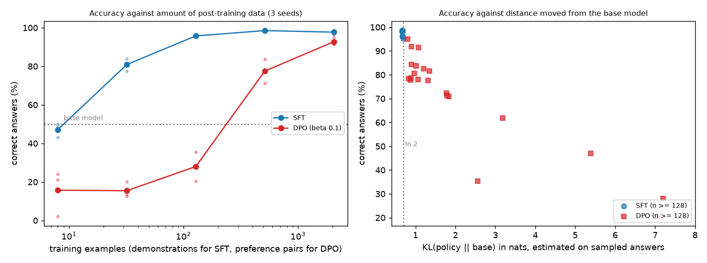

[Part 2](/posts/improve-2-pretraining-data/) was about what the model reads. This part is about what happens after pretraining: the model is shown examples of the behaviour wanted and then pushed toward the outputs people prefer. It covers the published recipe, the three losses involved, and a small experiment in which SFT and DPO are run against the same base model so that their data requirements and their distance from the base model can be measured.

## The recipe in the literature

[InstructGPT (Ouyang et al., 2022)](https://arxiv.org/abs/2203.02155) states the motivation directly: making language models bigger does not inherently make them better at following a user's intent. Its pipeline has two stages. Labeler-written and API-submitted prompts with labeler demonstrations are used to fine-tune GPT-3 with supervised learning; then a dataset of rankings of model outputs is collected and used to fine-tune that model further with reinforcement learning from human feedback. In human evaluations on the authors' prompt distribution, outputs of the 1.3B-parameter InstructGPT model are preferred to those of the 175B GPT-3, with 100 times fewer parameters, and truthfulness improves and toxic output falls with minimal regressions on public NLP datasets.

[LIMA (Zhou et al., 2023)](https://arxiv.org/abs/2305.11206) tests how much of this is needed. A 65B LLaMa model fine-tuned with the standard supervised loss on only 1,000 curated prompts and responses, with no reinforcement learning and no preference model, is reported equivalent or preferred to GPT-4 in 43% of cases in a controlled human study. The authors conclude that almost all knowledge in a language model is learned during pretraining and that only limited instruction-tuning data is needed.

[DPO (Rafailov et al., 2023)](https://arxiv.org/abs/2305.18290) replaces the reinforcement-learning stage. The paper describes RLHF as first fitting a reward model and then fine-tuning the model to maximise that reward without drifting too far from the original model. DPO uses a new parameterisation of the reward that allows the optimal policy to be extracted in closed form, so the same problem is solved with a simple classification loss and no sampling from the model during fine-tuning.

## The three losses

**SFT** is the pretraining loss restricted to demonstrations: for a prompt $x$ and a demonstrated answer $y$, minimise $-\log \pi_\theta(y\mid x)$.

**RLHF** (the paper's Equation 3) maximises a learned reward $r_\phi$ under a penalty for leaving the reference policy $\pi_{ref}$, which is the SFT model:

$$\max_{\pi_\theta}\ \mathbb{E}_{x,\,y\sim\pi_\theta}\big[r_\phi(x,y)\big]-\beta\,D_{KL}\big[\pi_\theta(y\mid x)\,\|\,\pi_{ref}(y\mid x)\big]$$

where $\beta$ sets how far the policy may deviate. The paper notes that the constraint keeps the policy where the reward model is accurate and preserves diversity.

**DPO** (Equation 7) turns a pair of a preferred answer $y_w$ and a dispreferred answer $y_l$ into a logistic loss on the difference of log-probability ratios:

$$\mathcal{L}_{DPO}=-\mathbb{E}\left[\log\sigma\!\left(\beta\log\frac{\pi_\theta(y_w\mid x)}{\pi_{ref}(y_w\mid x)}-\beta\log\frac{\pi_\theta(y_l\mid x)}{\pi_{ref}(y_l\mid x)}\right)\right]$$

The quantity $\beta\log(\pi_\theta/\pi_{ref})$ plays the role of the reward, and the same $\beta$ appears as the strength of the pull toward the reference.

## A controlled toy: arithmetic from a corpus that is half wrong

The base model is a 3-layer, 96-wide Transformer pretrained on 300,000 lines of the form `37+45=082`, in which half of the sums are correct and half are off by 1 to 10. Sampling from it gives a correct answer 50% of the time, and it has no way to know which mode a given prompt is in. This mimics a pretraining corpus that contains both good and bad answers; everything the model needs is already inside it, which is the LIMA picture. Post-training then has to select the right mode.

- **SFT** trains on $n$ ground-truth lines.
- **DPO** trains on $n$ preference pairs built from the base model's own samples: two samples per prompt, kept if exactly one is correct, so the pair is (correct, wrong). The reference model is the base model.
- Both use 200 steps of AdamW at learning rate 3e-4 with batches of at most 32, and 3 seeds. Evaluation samples 4 answers for each of 1,000 held-out prompts and reports the share correct and the KL divergence from the base model, estimated on the sampled answers.

`post_training.py`:

```python
import json, math, os, sys, time
import numpy as np, torch, torch.nn as nn, torch.nn.functional as F
torch.set_num_threads(12)
VOC = '0123456789+=\n'; ix = {c: i for i, c in enumerate(VOC)}; T = 10          # "ab+cd=sss\n": 6 prompt tokens, 4 answer tokens
def enc(s): return [ix[c] for c in s]
def line(a, b, c): return f'{a:02d}+{b:02d}={c:03d}\n'
class Block(nn.Module):
    def __init__(s, d, h):
        super().__init__(); s.l1 = nn.LayerNorm(d); s.att = nn.MultiheadAttention(d, h, batch_first=True); s.l2 = nn.LayerNorm(d); s.mlp = nn.Sequential(nn.Linear(d, 4 * d), nn.GELU(), nn.Linear(4 * d, d))
    def forward(s, x, mask):
        y = s.l1(x); x = x + s.att(y, y, y, attn_mask=mask, need_weights=False)[0]; return x + s.mlp(s.l2(x))
class GPT(nn.Module):
    def __init__(s, d=96, L=3, h=4):
        super().__init__(); s.emb = nn.Embedding(len(VOC), d); s.pos = nn.Embedding(T, d); s.blocks = nn.ModuleList([Block(d, h) for _ in range(L)]); s.ln = nn.LayerNorm(d); s.head = nn.Linear(d, len(VOC), bias=False)
        s.register_buffer('mask', torch.triu(torch.ones(T, T, dtype=torch.bool), 1))
    def forward(s, x):
        h = s.emb(x) + s.pos(torch.arange(x.shape[1]))
        for b in s.blocks: h = b(h, s.mask[:x.shape[1], :x.shape[1]])
        return s.head(s.ln(h))
def answer_logp(m, seq):                      # log-probability of the 4 answer tokens given the 6 prompt tokens, per sequence
    lp = F.log_softmax(m(seq[:, :-1]), -1).gather(-1, seq[:, 1:, None])[..., 0]; return lp[:, 5:].sum(1)
@torch.no_grad()
def sample(m, prompts, g):                     # prompts: (n, 6) tensor
    x = prompts.clone()
    for _ in range(4): p = F.softmax(m(x)[:, -1], -1); x = torch.cat([x, torch.multinomial(p, 1, generator=g)], 1)
    return x
def is_correct(seq):                           # seq (n, 10) -> bool array
    s = seq.numpy(); out = []
    for r in s:
        t = ''.join(VOC[i] for i in r); a, b = int(t[0:2]), int(t[3:5]); out.append(t[6:10] == f'{a + b:03d}\n')
    return np.array(out)
rng = np.random.default_rng(0); torch.manual_seed(0)
combos = [(a, b) for a in range(100) for b in range(100)]; perm = rng.permutation(len(combos)); post_prompts = [combos[i] for i in perm[:3000]]; eval_prompts = [combos[i] for i in perm[3000:4000]]
def prompt_tensor(ps): return torch.tensor([enc(f'{a:02d}+{b:02d}=') for a, b in ps])
def wrong_answer(a, b, r):
    while True:
        c = a + b + int(r.choice([-1, 1])) * int(r.integers(1, 11))
        if 0 <= c <= 198: return c
# ---------------- pretraining: a corpus in which half of all sums are wrong ----------------
def pretrain(steps=3000):
    r = np.random.default_rng(1); N = 300_000; A = r.integers(0, 100, N); B = r.integers(0, 100, N); ok = r.random(N) < 0.5
    rows = [enc(line(int(a), int(b), int(a + b) if o else wrong_answer(int(a), int(b), r))) for a, b, o in zip(A, B, ok)]; data = torch.tensor(rows)
    m = GPT(); opt = torch.optim.AdamW(m.parameters(), 2e-3, weight_decay=0.0); g = torch.Generator().manual_seed(1)
    for s in range(steps):
        for gp in opt.param_groups: gp['lr'] = 2e-3 * min(1, (s + 1) / 50) * (0.1 + 0.9 * 0.5 * (1 + math.cos(math.pi * s / steps)))
        b = data[torch.randint(0, N, (128,), generator=g)]; loss = F.cross_entropy(m(b[:, :-1]).reshape(-1, len(VOC)), b[:, 1:].reshape(-1)); opt.zero_grad(); loss.backward(); opt.step()
    return m
if os.path.exists('base.pt'): base = GPT(); base.load_state_dict(torch.load('base.pt'))
else: base = pretrain(); torch.save(base.state_dict(), 'base.pt')
base.eval(); EP = prompt_tensor(eval_prompts)
def evaluate(m, ref, seed=123):
    g = torch.Generator().manual_seed(seed); reps = 4; P = EP.repeat(reps, 1); x = sample(m, P, g)
    with torch.no_grad(): kl = (answer_logp(m, x) - answer_logp(ref, x)).mean().item()
    return float(is_correct(x).mean()), kl
acc0, _ = evaluate(base, base); print(f'base model: {100 * acc0:.1f}% of sampled answers correct on held-out prompts (the corpus is 50% correct)', flush=True)
# ---------------- post-training data ----------------
def sft_data(n, r):
    ps = [post_prompts[i] for i in r.permutation(len(post_prompts))[:n]]; return torch.tensor([enc(line(a, b, a + b)) for a, b in ps])
def pref_data(n, r, g):                        # preference pairs built from the base model's own samples: keep prompts where one of two samples is correct
    chosen, rejected = [], []
    while len(chosen) < n:
        ps = [post_prompts[i] for i in r.integers(0, len(post_prompts), 400)]; P = prompt_tensor(ps); x1 = sample(base, P, g); x2 = sample(base, P, g); c1, c2 = is_correct(x1), is_correct(x2)
        for i in range(len(ps)):
            if c1[i] != c2[i] and len(chosen) < n: chosen.append(x1[i] if c1[i] else x2[i]); rejected.append(x2[i] if c1[i] else x1[i])
    return torch.stack(chosen), torch.stack(rejected)
def clone(m): c = GPT(); c.load_state_dict(m.state_dict()); return c
def train_sft(data, seed, steps=200, lr=3e-4):
    m = clone(base); opt = torch.optim.AdamW(m.parameters(), lr, weight_decay=0.0); g = torch.Generator().manual_seed(seed)
    for _ in range(steps):
        b = data[torch.randint(0, len(data), (min(32, len(data)),), generator=g)]; loss = -answer_logp(m, b).mean(); opt.zero_grad(); loss.backward(); opt.step()
    return m
def train_dpo(w, l, beta, seed, steps=200, lr=3e-4, init=None):
    ref = clone(init or base); m = clone(init or base); opt = torch.optim.AdamW(m.parameters(), lr, weight_decay=0.0); g = torch.Generator().manual_seed(seed)
    with torch.no_grad(): rw, rl = answer_logp(ref, w), answer_logp(ref, l)
    for _ in range(steps):
        i = torch.randint(0, len(w), (min(32, len(w)),), generator=g); mw, ml = answer_logp(m, w[i]), answer_logp(m, l[i])
        loss = -F.logsigmoid(beta * ((mw - rw[i]) - (ml - rl[i]))).mean(); opt.zero_grad(); loss.backward(); opt.step()
    return m
res = []; t0 = time.time()
def log(kind, n, beta, seed, m, extra=''):
    acc, kl = evaluate(m, base); res.append(dict(kind=kind, n=n, beta=beta, seed=seed, acc=acc, kl=kl)); print(f'{kind:<5} n={n:<5} beta={beta if beta else "-":<5} seed={seed}  correct {100 * acc:5.1f}%  KL(policy||base) {kl:6.2f} nats{extra}', flush=True); os.utime(os.path.expanduser('~/.blog-improve-heartbeat'))
for seed in (1, 2, 3):
    r = np.random.default_rng(seed); g = torch.Generator().manual_seed(seed)
    for n in (8, 32, 128, 512, 2048):
        log('SFT', n, None, seed, train_sft(sft_data(n, r), seed))
        w, l = pref_data(n, r, g)
        for beta in ((0.01, 0.03, 0.1, 0.3, 1.0) if n == 512 else (0.1,)):
            m = train_dpo(w, l, beta, seed)
            with torch.no_grad(): d = (answer_logp(m, w) - answer_logp(base, w)).mean().item()
            log('DPO', n, beta, seed, m, f'  change in log P(chosen) {d:+.2f}')
json.dump(res, open('res.json', 'w')); print(f'done in {time.time() - t0:.0f}s')
```

Output:

```
base model: 50.0% of sampled answers correct on held-out prompts (the corpus is 50% correct)
SFT   n=8     beta=-     seed=1  correct  49.9%  KL(policy||base)   1.03 nats
DPO   n=8     beta=0.1   seed=1  correct   2.1%  KL(policy||base)  12.67 nats  change in log P(chosen) -3.66
SFT   n=32    beta=-     seed=1  correct  81.5%  KL(policy||base)   0.70 nats
DPO   n=32    beta=0.1   seed=1  correct  13.7%  KL(policy||base)   3.87 nats  change in log P(chosen) -2.31
SFT   n=128   beta=-     seed=1  correct  96.1%  KL(policy||base)   0.68 nats
DPO   n=128   beta=0.1   seed=1  correct  28.0%  KL(policy||base)   7.20 nats  change in log P(chosen) -1.48
SFT   n=512   beta=-     seed=1  correct  98.7%  KL(policy||base)   0.67 nats
DPO   n=512   beta=0.01  seed=1  correct  70.8%  KL(policy||base)   1.84 nats  change in log P(chosen) -0.10
DPO   n=512   beta=0.03  seed=1  correct  72.3%  KL(policy||base)   1.77 nats  change in log P(chosen) +0.05
DPO   n=512   beta=0.1   seed=1  correct  77.5%  KL(policy||base)   1.32 nats  change in log P(chosen) +0.38
DPO   n=512   beta=0.3   seed=1  correct  80.5%  KL(policy||base)   0.97 nats  change in log P(chosen) +0.48
DPO   n=512   beta=1.0   seed=1  correct  78.7%  KL(policy||base)   0.89 nats  change in log P(chosen) +0.48
SFT   n=2048  beta=-     seed=1  correct  98.5%  KL(policy||base)   0.67 nats
DPO   n=2048  beta=0.1   seed=1  correct  91.4%  KL(policy||base)   1.08 nats  change in log P(chosen) +0.56
SFT   n=8     beta=-     seed=2  correct  43.0%  KL(policy||base)   1.23 nats
DPO   n=8     beta=0.1   seed=2  correct  21.1%  KL(policy||base)   2.94 nats  change in log P(chosen) -0.11
SFT   n=32    beta=-     seed=2  correct  83.9%  KL(policy||base)   0.74 nats
DPO   n=32    beta=0.1   seed=2  correct  20.2%  KL(policy||base)   4.15 nats  change in log P(chosen) -1.49
SFT   n=128   beta=-     seed=2  correct  95.3%  KL(policy||base)   0.69 nats
DPO   n=128   beta=0.1   seed=2  correct  20.5%  KL(policy||base)   7.03 nats  change in log P(chosen) -1.66
SFT   n=512   beta=-     seed=2  correct  98.7%  KL(policy||base)   0.67 nats
DPO   n=512   beta=0.01  seed=2  correct  81.5%  KL(policy||base)   1.34 nats  change in log P(chosen) +0.13
DPO   n=512   beta=0.03  seed=2  correct  82.6%  KL(policy||base)   1.21 nats  change in log P(chosen) +0.22
DPO   n=512   beta=0.1   seed=2  correct  83.7%  KL(policy||base)   1.02 nats  change in log P(chosen) +0.38
DPO   n=512   beta=0.3   seed=2  correct  84.3%  KL(policy||base)   0.90 nats  change in log P(chosen) +0.50
DPO   n=512   beta=1.0   seed=2  correct  77.8%  KL(policy||base)   0.88 nats  change in log P(chosen) +0.39
SFT   n=2048  beta=-     seed=2  correct  96.5%  KL(policy||base)   0.67 nats
DPO   n=2048  beta=0.1   seed=2  correct  95.0%  KL(policy||base)   0.80 nats  change in log P(chosen) +0.64
SFT   n=8     beta=-     seed=3  correct  48.4%  KL(policy||base)   1.15 nats
DPO   n=8     beta=0.1   seed=3  correct  24.0%  KL(policy||base)   2.41 nats  change in log P(chosen) -2.31
SFT   n=32    beta=-     seed=3  correct  77.4%  KL(policy||base)   0.78 nats
DPO   n=32    beta=0.1   seed=3  correct  12.5%  KL(policy||base)   8.19 nats  change in log P(chosen) -1.02
SFT   n=128   beta=-     seed=3  correct  95.9%  KL(policy||base)   0.67 nats
DPO   n=128   beta=0.1   seed=3  correct  35.4%  KL(policy||base)   2.55 nats  change in log P(chosen) -1.14
SFT   n=512   beta=-     seed=3  correct  98.2%  KL(policy||base)   0.67 nats
DPO   n=512   beta=0.01  seed=3  correct  46.9%  KL(policy||base)   5.39 nats  change in log P(chosen) -1.70
DPO   n=512   beta=0.03  seed=3  correct  61.9%  KL(policy||base)   3.19 nats  change in log P(chosen) -0.79
DPO   n=512   beta=0.1   seed=3  correct  71.3%  KL(policy||base)   1.79 nats  change in log P(chosen) -0.13
DPO   n=512   beta=0.3   seed=3  correct  78.0%  KL(policy||base)   1.06 nats  change in log P(chosen) +0.36
DPO   n=512   beta=1.0   seed=3  correct  78.5%  KL(policy||base)   0.83 nats  change in log P(chosen) +0.44
SFT   n=2048  beta=-     seed=3  correct  98.2%  KL(policy||base)   0.68 nats
DPO   n=2048  beta=0.1   seed=3  correct  91.8%  KL(policy||base)   0.89 nats  change in log P(chosen) +0.57
done in 160s
```


*Left: SFT reaches 96% with 128 demonstrations; DPO is below the base model until it has hundreds of pairs. Right: SFT sits at the minimum possible KL, ln 2.*

Means over the 3 seeds (DPO with $\beta=0.1$):

- 8 examples: SFT 47.1% correct at KL 1.14; DPO 15.7% at KL 6.01.
- 32: SFT 80.9% at 0.74; DPO 15.4% at 5.40.
- 128: SFT 95.8% at 0.68; DPO 28.0% at 5.59.
- 512: SFT 98.5% at 0.67; DPO 77.5% at 1.38.
- 2,048: SFT 97.7% at 0.67; DPO 92.7% at 0.93.

For DPO with 512 pairs, $\beta$ moves the result along a curve: 66.4% correct at KL 2.85 for $\beta=0.01$, 72.3% at 2.06 for 0.03, 77.5% at 1.38 for 0.1, 80.9% at 0.98 for 0.3, and 78.3% at 0.86 for 1.0.

## What the runs show

- **Post-training selects, it does not teach, when the knowledge is already there.** Thirty-two demonstrations take the base model from 50% to 81% and 128 to 96%, on prompts the post-training never used. The base model already assigned the right answer half the probability.
- **SFT lands on the information-theoretic floor.** A base model that is right half the time has to put its mass on the correct mode to reach 100%, which costs $\ln(1/0.5)=0.693$ nats of KL. With 128 or more demonstrations SFT ends at 0.67 to 0.68 nats at 96% to 98% accuracy, so it moved the policy as little as that behaviour allows. DPO at 512 and 2,048 pairs ($\beta=0.1$) lands at 0.9 to 1.4 nats at 78% to 93%.
- **DPO is data-hungry in this setup and can make things worse.** With 128 or fewer pairs it ends below the 50% starting point, at 15% to 28%, and far from the base model (KL 5 to 6 nats). The change in the log-probability of the chosen answer is negative in all nine of those runs, so the loss is met by pushing the rejected answer down rather than by raising the chosen one. The loss only constrains the difference of the two log-ratios, and the DPO gradient has one term that raises the likelihood of the chosen answer and one that lowers the likelihood of the rejected one; nothing requires the first to win in absolute terms. From 512 pairs the log-probability of the chosen answer mostly rises (up to +0.6 at 2,048 pairs) and accuracy climbs.
- **$\beta$ is a dial between movement and gain.** Small $\beta$ lets the policy travel (KL 2.85) and gives lower accuracy at this data size; the best accuracy sits at $\beta=0.3$. This is the same trade-off as the KL penalty in the RLHF objective above.
- **The comparison is not like for like.** SFT used ground-truth answers. DPO used only a binary judgement between two model samples, which is the cheaper signal to collect from people (the author's reading of why InstructGPT collected rankings), but it carries less information per example. The toy says what each signal buys, not which method is better.

Part 4 takes the idea one step further: when the preference signal is a checkable answer instead of a human ranking, reinforcement learning with a verifiable reward becomes the main lever for reasoning models.

## Limits

- The base model is a 3-layer, 96-wide Transformer on a synthetic corpus with a single error mode. Real preference data has many dimensions (helpfulness, style, safety) and noisy labels, and the pretrained model is billions of times larger.
- Hyperparameters were not tuned: 200 steps at 3e-4 for every setting. DPO with few pairs may behave better with fewer steps or a smaller learning rate, and the large DPO deficit at small $n$ is partly a fixed-step overfitting effect. The results show the behaviour at these settings, not a ceiling for DPO.
- There is no reward model and no PPO run, so RLHF itself is described from the papers and not measured. The published results (InstructGPT's 1.3B against 175B, LIMA's 43%) are quoted from the abstracts and were not reproduced.
- Three seeds, 1,000 evaluation prompts and four samples each; differences of a few points between settings are within the seed spread.
