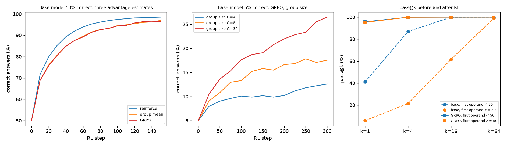

[Part 3](/posts/improve-3-post-training/) ended with a preference signal that comes from people. This part uses a signal that comes from a checker: the answer to a maths problem matches or it does not, the program passes its tests or it does not. This part covers the published recipe, the algorithm and its advantage formula, and a toy run that varies the estimator, the base model's success rate and the group size, and measures what training changes in pass@k.

## The recipe in the literature

[DeepSeek-R1 (DeepSeek-AI, 2025)](https://arxiv.org/abs/2501.12948) reports that the reasoning abilities of language models can be incentivised through pure reinforcement learning, without human-labelled reasoning trajectories. For its R1-Zero model the reward is rule-based and has two parts: accuracy rewards, which check whether the response is correct (for a maths problem with a deterministic result, the final answer in a specified format, so that correctness can be verified by rule; for code, a compiler and test cases), and format rewards. The paper reports the average pass@1 on AIME 2024 rising from 15.6% to 77.9% over the course of RL training.

The algorithm is Group Relative Policy Optimization, introduced in [DeepSeekMath (Shao et al., 2024)](https://arxiv.org/abs/2402.03300). GRPO drops PPO's critic model and estimates the baseline from group scores. For each question $q$ it samples a group of $G$ outputs from the current policy, scores them with the reward to get $r_1,\dots,r_G$, and (for outcome supervision) gives every token of output $i$ the advantage

$$\hat A_i=\frac{r_i-\operatorname{mean}(r)}{\operatorname{std}(r)}$$

The policy then maximises a PPO-style clipped objective with these advantages, with a KL penalty to the reference policy added to the loss. In that paper GRPO lifts DeepSeekMath-Instruct 7B from 82.9% to 88.2% on GSM8K and from 46.8% to 51.7% on MATH.

A caution comes from [Yue et al. (2025)](https://arxiv.org/abs/2504.13837). Evaluating with pass@k at large $k$, they find that RLVR-trained models beat their base models at small $k$, but the base models reach a higher pass@k when $k$ is large, and they conclude the reasoning ability observed originates from and is bounded by the base model; distillation, by contrast, can introduce new reasoning patterns.

## A toy with a checker

The base models are the arithmetic Transformers of Part 3: 3 layers, 96 wide, trained on lines such as `37+45=082`, in which some of the sums are wrong. The reward is exact match against the true sum. Each step samples $B=32$ prompts and $G$ answers per prompt, scores them, and takes one policy-gradient step with a per-answer advantage, loss $-\hat A_i \log\pi_\theta(y_i\mid x)$. The model and sampling code are the Part 3 code with the corpus parameterised; this is `rl.py`:

```python
import json, sys
exec(open('common.py').read())
def clone(m): c = GPT(); c.load_state_dict(m.state_dict()); return c
def pass_at_k(c, n, k): return 1.0 if n - c < k else 1.0 - math.comb(n - c, k) / math.comb(n, k)
def pass_curve(m, ps, n=64, ks=(1, 4, 16, 64), seed=7):
    g = torch.Generator().manual_seed(seed); P = prompt_tensor(ps).repeat_interleave(n, 0); x = sample(m, P, g); ok = is_correct(x).reshape(len(ps), n).sum(1)
    return {k: float(np.mean([pass_at_k(int(c), n, k) for c in ok])) for k in ks}
def train_rl(method, seed, steps=150, B=32, G=8, lr=3e-4, eval_every=10, prompts=None):
    m = clone(base); opt = torch.optim.AdamW(m.parameters(), lr, weight_decay=0.0); g = torch.Generator().manual_seed(seed); r = np.random.default_rng(seed); curve = []; signal = []
    pool = prompts or post_prompts
    for step in range(steps + 1):
        if step % eval_every == 0: acc, kl = evaluate(m, base); curve.append((step, acc, kl)); os.utime(os.path.expanduser('~/.blog-improve-heartbeat'))
        if step == steps: break
        ps = [pool[i] for i in r.integers(0, len(pool), B)]; P = prompt_tensor(ps).repeat_interleave(G, 0); x = sample(m, P, g)
        rew = torch.tensor(is_correct(x), dtype=torch.float32).reshape(B, G); mean, std = rew.mean(1, keepdim=True), rew.std(1, keepdim=True)
        adv = {'reinforce': rew, 'group mean': rew - mean, 'GRPO': (rew - mean) / (std + 1e-4)}[method].reshape(-1); signal.append(float((std > 0).float().mean()))
        loss = -(adv.detach() * answer_logp(m, x)).mean(); opt.zero_grad(); loss.backward(); torch.nn.utils.clip_grad_norm_(m.parameters(), 1.0); opt.step()
    return m, curve, float(np.mean(signal[:10]))
mode = sys.argv[1]; res = {}
if mode == 'a':          # base 50% correct: three advantage estimators
    for method in ('reinforce', 'group mean', 'GRPO'):
        cs = []
        for seed in (1, 2, 3): m, c, sg = train_rl(method, seed); cs.append(c)
        res[method] = cs; fin = [c[-1] for c in cs]; print(f'{method:<11} accuracy at steps 0/30/60/150: ' + ' / '.join(f'{100 * np.mean([c[i][1] for c in cs]):.1f}%' for i in (0, 3, 6, 15)) + f'   final KL {np.mean([f[2] for f in fin]):.2f} nats', flush=True)
elif mode == 'b':        # base 5% correct: group size
    for G in (4, 8, 32):
        cs = []; sgs = []
        for seed in (1, 2, 3): m, c, sg = train_rl('GRPO', seed, steps=300, G=G, eval_every=25); cs.append(c); sgs.append(sg)
        res[G] = cs; print(f'G={G:<3} share of groups with a learning signal at the start {100 * np.mean(sgs):.0f}%   accuracy at steps 0/100/200/300: ' + ' / '.join(f'{100 * np.mean([c[i][1] for c in cs]):.1f}%' for i in (0, 4, 8, 12)), flush=True)
else:                    # heterogeneous base: operands >= 50 never correct in the corpus
    ins = [p for p in eval_prompts if p[0] < 50][:200]; outs = [p for p in eval_prompts if p[0] >= 50][:200]
    print('base       in-support', {k: round(v, 3) for k, v in pass_curve(base, ins).items()}, ' out-of-support', {k: round(v, 3) for k, v in pass_curve(base, outs).items()}, flush=True)
    for seed in (1, 2):
        m, c, sg = train_rl('GRPO', seed, steps=300, eval_every=50)
        print(f'GRPO seed {seed} in-support', {k: round(v, 3) for k, v in pass_curve(m, ins).items()}, ' out-of-support', {k: round(v, 3) for k, v in pass_curve(m, outs).items()}, flush=True)
json.dump(res, open(f'res_{mode}.json', 'w'))
```

Three experiments, each with 3 seeds unless noted:

- **A: the advantage estimate.** The base model is 50% correct. Compare the raw 0/1 reward, the reward minus the group mean, and the GRPO normalisation.
- **B: a weak base model.** The base model is 5% correct, and the group size is $G=4$, 8 or 32.
- **C: pass@k.** A base model whose corpus never contains a correct sum when the first operand is 50 or more (and is 50% correct below 50), trained with GRPO on prompts from both ranges, 2 seeds. Pass@k uses 64 samples per prompt and the unbiased estimator $1-\binom{n-c}{k}/\binom{n}{k}$ over 200 prompts per range.

Output of A, B and C:

```
reinforce   accuracy at steps 0/30/60/150: 50.0% / 85.3% / 93.9% / 98.5%   final KL 0.67 nats
group mean  accuracy at steps 0/30/60/150: 50.0% / 80.7% / 89.5% / 96.9%   final KL 0.63 nats
GRPO        accuracy at steps 0/30/60/150: 50.0% / 80.6% / 89.2% / 96.4%   final KL 0.64 nats
G=4   share of groups with a learning signal at the start 19%   accuracy at steps 0/100/200/300: 5.0% / 10.1% / 10.2% / 12.6%
G=8   share of groups with a learning signal at the start 36%   accuracy at steps 0/100/200/300: 5.0% / 13.3% / 16.6% / 17.6%
G=32  share of groups with a learning signal at the start 84%   accuracy at steps 0/100/200/300: 5.0% / 17.6% / 22.0% / 26.5%
base       in-support {1: 0.411, 4: 0.869, 16: 0.999, 64: 1.0}  out-of-support {1: 0.059, 4: 0.214, 16: 0.616, 64: 0.99}
GRPO seed 1 in-support {1: 0.965, 4: 1.0, 16: 1.0, 64: 1.0}  out-of-support {1: 0.95, 4: 0.999, 16: 1.0, 64: 1.0}
GRPO seed 2 in-support {1: 0.95, 4: 0.998, 16: 1.0, 64: 1.0}  out-of-support {1: 0.955, 4: 0.999, 16: 1.0, 64: 1.0}
```


*Left: the three estimates reach 96% to 98.5% within 150 steps. Middle: a larger group learns faster from a weak base. Right: GRPO moves pass@1 to about 95% while pass@64 was already near 100% for the base model.*

## What the runs show

- **With a 50% base, the baseline is not what matters.** The three estimates reach 98.5% (raw reward), 96.9% (group mean) and 96.4% (GRPO) after 150 steps, and the raw reward is the fastest early (85.3% at step 30, against 80.6% for GRPO). With half the answers correct, a positive-only reward behaves like fine-tuning on the model's own correct samples. Baselines exist to reduce variance, and the author's reading is that they pay off when rewards are sparse or vary in scale, which this experiment does not probe.
- **Sparse success starves the signal.** A group gives a learning signal only if its rewards are not all equal. For a base success rate $p$ the share of such groups is $1-(1-p)^G-p^G$, which for $p=0.05$ is 19% at $G=4$, 34% at $G=8$ and 81% at $G=32$. The runs measured 19%, 36% and 84%. Accuracy after 300 steps was 12.6%, 17.6% and 26.5% for the three group sizes. The larger groups also use more samples per step (8 times as many for $G=32$ as for $G=4$), so this is a statement about learning per step, not per sample. It illustrates the practical condition behind the R1 recipe: the base model has to succeed sometimes.
- **RL turns coverage into reliability.** Before training, the base model's pass@1 was 41% for first operands below 50 and 5.9% for first operands of 50 or more; its pass@64 was already 100% and 99%. After GRPO, pass@1 is 95% to 97% in both ranges and pass@64 stays at 100%. The gain sits at small $k$ and the large-$k$ end does not move, which matches the direction of Yue et al.'s finding that RL sharpens what the base model can already do.
- **This toy cannot test whether RL goes beyond the base.** The out-of-range prompts turned out not to be out of reach: the base model, trained only on wrong sums there, still got 5.9% right and 99% at pass@64, because it had learnt the addition procedure from the other range. Without a real capability gap there is nothing for RL to fail to cross, so the toy says nothing for or against the claim in Yue et al.

Part 5 moves the compute from training to the moment of use: sampling several answers, voting among them, and searching, which is where the pass@k numbers above become a lever of their own.

## Limits

- Answers here are four tokens with an exact-match reward. There is no chain of thought, no format reward, no variable length, and none of the dynamics (growing response length, self-correction) that the R1 paper describes.
- Each step is one on-policy gradient step, so the PPO ratio is 1 and clipping never acts, and no KL penalty to the reference was used. This is a simplified policy gradient with GRPO's advantage, not the full algorithm.
- Hyperparameters (learning rate 3e-4, $B=32$) were not tuned, the seeds are few (3, and 2 for experiment C), and group sizes in B differ in samples per step.
- The published numbers (AIME 15.6% to 77.9%; GSM8K 82.9% to 88.2%; the pass@k claims) are quoted from the papers and were not reproduced.
