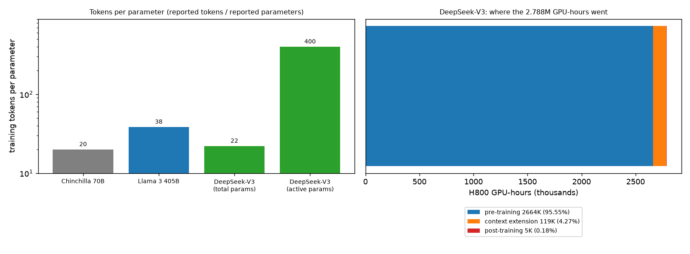

Parts 1 to 6 took the levers one at a time. This part looks at how published recipes combine them. It uses only what four technical reports state, namely [Llama 3](https://arxiv.org/abs/2407.21783), [DeepSeek-V3](https://arxiv.org/abs/2412.19437), [Tülu 3](https://arxiv.org/abs/2411.15124) and [phi-4](https://arxiv.org/abs/2412.08905), and recomputes the numbers that can be checked by arithmetic. No unpublished information is used, and the reports' own claims are marked as theirs.

## Four recipes, as stated

```
Llama 3 (405B dense)   pre-train 15.6T tokens (8K context) -> long-context stage, about 800B tokens, to 128K -> anneal on high-quality data
                       -> 6 rounds of: preference data + reward model -> rejection sampling + SFT -> DPO
DeepSeek-V3 (MoE)      pre-train 14.8T tokens -> context extension 32K -> 128K -> SFT + RL (GRPO), reasoning distilled from the R1 series
Tulu 3 (on Llama 3.1)  SFT -> DPO -> RLVR (reinforcement learning with verifiable rewards), with decontaminated evaluation sets
phi-4 (14B)            synthetic data throughout training, a modified phi-3 architecture, an improved post-training scheme
```

What each report says about its own choices:

- **Llama 3** reports a flagship dense Transformer of 405B parameters trained on 15.6T tokens with 3.8e25 FLOPs, almost 50 times the largest Llama 2. It states that its scaling laws suggest the flagship is approximately a compute-optimal size for the budget, while the smaller models are trained for much longer than compute-optimal, and that the flagship is used to improve the smaller models in post-training. It chose a standard dense Transformer over a mixture of experts for training stability, and a relatively simple post-training procedure (SFT, rejection sampling, DPO) over more complex reinforcement learning algorithms that tend to be less stable and harder to scale.
- **DeepSeek-V3** is a mixture of experts with 671B total and 37B active parameters per token, using multi-head latent attention, an auxiliary-loss-free load-balancing strategy and a multi-token prediction objective. Post-training is SFT and RL, and it distills reasoning capability from the DeepSeek-R1 series. It reports 2.788M H800 GPU-hours for the full training and no irrecoverable loss spikes.
- **Tülu 3** is a fully open post-training recipe on Llama 3.1 base models (SFT, DPO and a method it names RLVR), released with data and code, with a multi-task evaluation scheme that separates development from unseen evaluations and decontaminates existing datasets, and with a discussion of methods that did not reliably improve performance.
- **phi-4** is a 14B model whose recipe centres on data quality, with synthetic data used throughout training. It reports surpassing its teacher model on STEM-focused question answering, taking this as evidence that its data-generation and post-training techniques go beyond distillation.

## The numbers, recomputed

Tokens per parameter, the 6ND training-compute estimate, and the GPU-hour split come from figures the reports give (parameters, tokens, GPU-hours). The Chinchilla row, 70B parameters on 1.4T tokens, is from [Hoffmann et al.](https://arxiv.org/abs/2203.15556) (Part 1).

```python
# Numbers quoted from the reports; everything else is arithmetic on them.
llama = dict(params=405e9, tokens=15.6e12, flops_reported=3.8e25)                      # Llama 3 report: 405B parameters, 15.6T tokens, 3.8e25 FLOPs
v3 = dict(total=671e9, active=37e9, tokens=14.8e12, gpu_hours=dict(pretraining=2664e3, context_extension=119e3, post_training=5e3))   # DeepSeek-V3 report
chin = dict(params=70e9, tokens=1.4e12)                                                   # Chinchilla: 70B parameters on 1.4T tokens
print(f'Chinchilla 70B:           {chin["tokens"] / chin["params"]:7.1f} tokens per parameter')
print(f'Llama 3 405B:             {llama["tokens"] / llama["params"]:7.1f} tokens per parameter;  6ND = {6 * llama["params"] * llama["tokens"]:.2e} FLOPs (report: {llama["flops_reported"]:.1e})')
print(f'DeepSeek-V3 (active 37B): {v3["tokens"] / v3["active"]:7.1f} tokens per active parameter, {v3["tokens"] / v3["total"]:.1f} per total parameter;  6ND with active parameters = {6 * v3["active"] * v3["tokens"]:.2e} FLOPs')
tot = sum(v3['gpu_hours'].values())
for k, h in v3['gpu_hours'].items(): print(f'  DeepSeek-V3 {k:<18} {h / 1e3:6.0f}K H800 GPU-hours  {100 * h / tot:5.2f}% of {tot / 1e6:.3f}M')
print(f'Llama 3 flagship / DeepSeek-V3 compute (6ND): {6 * llama["params"] * llama["tokens"] / (6 * v3["active"] * v3["tokens"]):.1f}x')
print(f'implied sustained throughput DeepSeek-V3: {6 * v3["active"] * v3["tokens"] / (v3["gpu_hours"]["pretraining"] * 3600) / 1e12:.0f} TFLOP/s per GPU during pre-training (6ND over pre-training GPU-seconds; ignores attention)')
```

```
Chinchilla 70B:              20.0 tokens per parameter
Llama 3 405B:                38.5 tokens per parameter;  6ND = 3.79e+25 FLOPs (report: 3.8e+25)
DeepSeek-V3 (active 37B):   400.0 tokens per active parameter, 22.1 per total parameter;  6ND with active parameters = 3.29e+24 FLOPs
  DeepSeek-V3 pretraining          2664K H800 GPU-hours  95.55% of 2.788M
  DeepSeek-V3 context_extension     119K H800 GPU-hours   4.27% of 2.788M
  DeepSeek-V3 post_training           5K H800 GPU-hours   0.18% of 2.788M
Llama 3 flagship / DeepSeek-V3 compute (6ND): 11.5x
implied sustained throughput DeepSeek-V3: 343 TFLOP/s per GPU during pre-training (6ND over pre-training GPU-seconds; ignores attention)
```


*Left: tokens per parameter span a factor of 20 across the reported models, depending on whether a mixture-of-experts model is counted by total or active parameters. Right: post-training is 0.18% of the reported GPU-hours.*

## What the comparison shows

- **The same lever is pulled in opposite directions.** Llama 3 buys stability with a dense model and a simple post-training pipeline; DeepSeek-V3 buys per-token compute with sparsity (37B active of 671B) and trains with RL. By 6ND, the Llama 3 flagship used about 11.5 times the training compute of DeepSeek-V3's active parameters. This compares two different models with different data and is not a controlled experiment.
- **Over-training small models is a stated choice.** The Llama 3 report says the flagship is about compute-optimal, while smaller models are trained far beyond it because they then perform better at the same inference budget. That is Part 1's scaling law applied with the inference bill included, a trade that the Chinchilla-style compute-optimal rule does not include.
- **Post-training is cheap in GPU-hours and large in design.** DeepSeek-V3's reported post-training is 5K of 2,788K GPU-hours. The GPU-hour count says nothing about the effort in data and evaluation, which Tülu 3's emphasis on data, decontamination and negative results shows to be where the work sits (the author's reading).
- **Data quality appears in every report.** Llama 3 anneals on upsampled high-quality sources, phi-4 builds its recipe around synthetic data, Tülu 3 releases its post-training data. This is the lever of Part 2 and Part 3 at production scale.
- **The levers of the earlier parts all appear.** Scaling and data (Parts 1 and 2), SFT, DPO and RL with verifiable rewards (Parts 3 and 4), distillation and long context, mixture of experts and latent attention (Part 6). Inference-time compute (Part 5) is not part of these reports' training recipes.

[Part 8](/posts/improve-8-research-frontier/) closes the series with the research frontier.

## Limits

- The reports are the developers' own and omit parts of their data and recipes, so what they state cannot be separated from what they leave out. None reports ablations that would show which lever contributed how much.
- The 6ND figure is an approximation that ignores attention cost and, for DeepSeek-V3, the multi-token prediction module; it reproduces Llama 3's reported 3.8e25 FLOPs (3.79e25), which is a check on the method and not on the DeepSeek figure.
- The implied throughput is arithmetic on reported GPU-hours and is not a reported measurement.
- For phi-4 only the abstract was used; for Tülu 3 only the abstract and the pipeline it names.
- Benchmark scores are not compared here because the reports use different benchmarks and settings.
