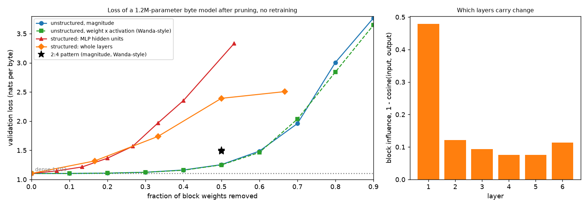

Pruning removes parts of a trained network. This post covers the removal step only: what can be removed, how published methods choose, and what each choice costs. A 1.2M-parameter model is pruned in several ways on a CPU and the loss is measured with no retraining. How a pruned model is repaired, and how that relates to post-training, is the subject of the second post.

## What can be removed

The sources define three granularities.

- **Individual weights (unstructured).** [Han et al. (2015)](https://arxiv.org/abs/1506.02626) train a network, prune the unimportant connections, then retrain, and report cutting AlexNet's parameters from 61 million to 6.7 million without accuracy loss. The result is a sparse matrix of the same shape.
- **Patterns (semi-structured).** [SparseGPT](https://arxiv.org/abs/2301.00774) prunes GPT-family models in one shot without retraining, reports 60% unstructured sparsity with negligible perplexity increase on OPT-175B and BLOOM-176B, and generalises to the 2:4 and 4:8 patterns, where in every group of 4 (or 8) weights a fixed number are zero.
- **Whole structures (structured).** [LLM-Pruner](https://arxiv.org/abs/2305.11627) removes non-critical coupled structures chosen by gradient information and recovers the model with LoRA tuning on 50K samples in about 3 hours. [ShortGPT](https://arxiv.org/abs/2403.03853) observes that many layers have high similarity, defines a Block Influence score, and deletes the layers with the lowest scores.

Unstructured pruning keeps the most accuracy per removed weight but leaves irregular zeros, so any speed-up depends on kernels that exploit them. Structured pruning shrinks the matrices themselves. Whether a speed-up materialises is not measured here.

## How methods choose

- **Magnitude:** drop the weights with the smallest absolute value.
- **Weight times activation:** [Wanda](https://arxiv.org/abs/2306.11695) prunes the weights with the smallest magnitude multiplied by the corresponding input activation, compared per output row, with no retraining or weight update. It reports significantly better results than magnitude pruning on LLaMA and LLaMA-2, and competitive results against methods that update weights.
- **Second-order reconstruction:** SparseGPT solves a weight-reconstruction problem and updates the surviving weights.
- **Block influence:** 1 minus the cosine similarity between a layer's input and output, averaged over tokens.

## The experiment

A 6-layer byte-level Transformer (128 wide, 4 heads, 1,189,888 non-embedding parameters) is trained for 3,000 steps on 9 MB of Python source and pruned in six ways. Activation statistics come from 20 training batches. Magnitude pruning uses one threshold per matrix; the Wanda-style score ranks weights within each output row; the 2:4 variants keep the 2 largest scores in each group of 4 inputs; unit pruning removes the MLP hidden units with the smallest product of their input-weight norm and output-weight norm; layer removal deletes the layers with the lowest block influence. The attention output projection is left dense in all runs.

```python
score = W.abs() if method == 'magnitude' else W.abs() * stats[name].sqrt()[None, :]   # stats: summed squared input activations
k = int(sparsity * W.shape[1]); idx = score.argsort(1)[:, :k]; W.scatter_(1, idx, 0.0)   # Wanda-style: per output row
s = b.mlp[0].weight.norm(dim=1) * b.mlp[2].weight.norm(dim=0)                           # structured: importance of each MLP hidden unit
bi = 1 - F.cosine_similarity(h, b(h, dense.mask), dim=-1).mean()                          # block influence of one layer
```

```
dense validation loss 1.1029
unstructured sparsity 0.1: magnitude 1.1035   Wanda-style 1.1035
unstructured sparsity 0.2: magnitude 1.1085   Wanda-style 1.1084
unstructured sparsity 0.3: magnitude 1.1237   Wanda-style 1.1229
unstructured sparsity 0.4: magnitude 1.1624   Wanda-style 1.1587
unstructured sparsity 0.5: magnitude 1.2546   Wanda-style 1.2502
unstructured sparsity 0.6: magnitude 1.4863   Wanda-style 1.4630
unstructured sparsity 0.7: magnitude 1.9585   Wanda-style 2.0340
unstructured sparsity 0.8: magnitude 3.0063   Wanda-style 2.8429
unstructured sparsity 0.9: magnitude 3.7672   Wanda-style 3.6462
2:4 sparsity (50%): magnitude 1.5018   Wanda-style 1.4805
MLP hidden units removed 0.1 (= 0.07 of block parameters): 1.1473
MLP hidden units removed 0.2 (= 0.13 of block parameters): 1.2142
MLP hidden units removed 0.3 (= 0.20 of block parameters): 1.3644
MLP hidden units removed 0.4 (= 0.27 of block parameters): 1.5687
MLP hidden units removed 0.5 (= 0.33 of block parameters): 1.9699
MLP hidden units removed 0.6 (= 0.40 of block parameters): 2.3522
MLP hidden units removed 0.8 (= 0.53 of block parameters): 3.3304
block influence per layer [0.479, 0.121, 0.093, 0.076, 0.075, 0.113]
layers removed 1 of 6 (lowest influence first): 1.3178
layers removed 2 of 6 (lowest influence first): 1.7386
layers removed 3 of 6 (lowest influence first): 2.3912
layers removed 4 of 6 (lowest influence first): 2.5065
```


*Left: at equal fractions removed, unstructured pruning is cheapest, structured pruning is far costlier. Right: the first layer changes its input much more than the others.*

## What the numbers show

- **A large share of weights is nearly free to remove.** The dense loss is 1.103; removing 30% of weights unstructured costs 0.02, 40% costs 0.06, 50% costs 0.15. Beyond 60% the loss rises steeply (1.49 at 60%, 1.96 to 2.03 at 70%, near 3 at 80%).
- **The scoring rule matters little here.** The Wanda-style score is slightly better than magnitude at 30% to 60% (by 0.001 to 0.023), worse at 70% (2.034 against 1.959), and better again at 80% and 90%. The paper reports a significant gain on LLaMA models; this toy does not reproduce a large one, and the two methods also differ in how they compare weights (per row against per matrix), so the comparison mixes two choices.
- **The 2:4 constraint costs extra.** At 50% sparsity, the 2:4 pattern gives 1.50 (magnitude) and 1.48 (Wanda-style), against 1.25 for unconstrained pruning at the same fraction, a cost of about 0.23 to 0.25 nats for regularity.
- **Structure costs much more than sparsity at equal size.** Removing 13% of block weights as MLP units gives 1.21 and removing one layer of six (17%) gives 1.32; unstructured removal of 20% gives 1.11. Removing three layers of six gives 2.39, against 1.25 for removing half the weights one by one.
- **Layers are not equal.** Block influence is 0.48 for the first layer and 0.075 to 0.12 for the rest, so the first layer is the least removable and the middle layers (4 and 5 lowest), whose output is closest to their input, are removed first.

## Limits

- One 1.2M-parameter model, one seed, one dataset. Validation loss is the only metric: nothing here measures instruction following, reasoning or safety, which a loss average can hide.
- The unstructured fractions are of the three prunable matrices (attention input projection, two MLP matrices, 92% of the block weights); the structured fractions are of all block weights. The curves are therefore offset by up to 8%.
- The Wanda-style score is an implementation of the idea in the abstract, not the authors' code. SparseGPT and LLM-Pruner were not run, and the reported figures for them are the abstracts' claims.
- No retraining was done, by design. The loss values here are the damage before repair, which the second post takes up.
- Speed and memory were not measured.
