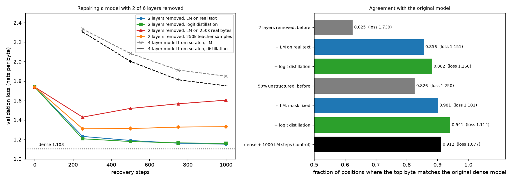

[The previous post](/posts/pruning-1-what-to-remove/) measured the damage pruning does. This one measures the repair and places it among the stages of [Part 3](/posts/improve-3-post-training/). The distinction used throughout: pruning changes the structure of a model, training changes what the structure computes, and distillation is one training method among several, not a stage.

## Where the pieces sit

```
pre-training ──► pruning (structure changes) ──► recovery training ──► [post-training: SFT, preference optimisation, RL]
                                                     │
                                                     ├─ language modelling on text (the pre-training objective)
                                                     └─ distillation: match the original model's outputs
                                                          ├─ logit level (Hinton et al.)
                                                          └─ sequence level (Kim and Rush)
```

- **Pruning** removes weights, units or layers; it is not training and not quantisation (which lowers the precision of the weights that remain).
- **Distillation** trains a student to match a teacher. [Hinton et al.](https://arxiv.org/abs/1503.02531) compress the knowledge of an ensemble into a single model; [Kim and Rush](https://arxiv.org/abs/1606.07947) apply it to translation at the word level and introduce two sequence-level versions, and report that pruning on top of distillation gave a student with 13 times fewer parameters than the teacher at a loss of 0.4 BLEU.
- **Post-training** is the stage of [Part 3](/posts/improve-3-post-training/) and [Part 4](/posts/improve-4-rl-verifiable-rewards/), and distillation can be part of it: [DeepSeek-V3's report](https://arxiv.org/abs/2412.19437) describes distilling reasoning capability from the R1 series into its post-training ([Part 7](/posts/improve-7-technical-reports/)).
- **The order in published work** is prune, then retrain. [Han et al.](https://arxiv.org/abs/1506.02626) retrain after pruning; [LLM-Pruner](https://arxiv.org/abs/2305.11627) recovers with LoRA; the [layer-pruning study](https://arxiv.org/abs/2403.17887) heals with a small amount of QLoRA fine-tuning and finds minimal degradation on question-answering benchmarks until up to half of the layers are removed for some open-weight models; [Sheared-LLaMA](https://arxiv.org/abs/2310.06694) prunes LLaMA2-7B to 1.3B and 2.7B and reports needing 3% of the compute of training such models from scratch; [Minitron](https://arxiv.org/abs/2407.14679) combines pruning with distillation-based retraining on under 3% of the original data and reports up to 40 times fewer training tokens per derived model than training from scratch.

## The experiment

The dense model of the previous post (6 layers, 1.19M non-embedding parameters, validation loss 1.103) serves as the teacher and the reference. Two pruned versions are repaired with 1,000 steps at a peak learning rate of 1e-3:

- **2 of 6 layers removed** (the two with the lowest block influence), the case where structure, not sparsity, was lost.
- **50% unstructured sparsity** (Wanda-style), with the zero mask held fixed during training.

Each is repaired two ways: language modelling on real text (cross-entropy on the next byte), and logit distillation on the same text (KL divergence to the dense model's next-byte distribution). Beyond loss, two numbers compare the student with the original model: the KL divergence from the original's output distribution (nats per byte) and the share of positions where both predict the same most likely byte.

```python
if mode == 'kd':
    with torch.no_grad(): pt = F.softmax(dense(a), -1)                 # teacher distribution on the same text
    loss = F.kl_div(F.log_softmax(lo, -1).reshape(-1, 128), pt.reshape(-1, 128), reduction='batchmean')
else: loss = F.cross_entropy(lo.reshape(-1, 128), b.reshape(-1))      # next byte of the real text
```

Three further runs probe what the repair depends on. The layer-pruned model is repaired on only 250k real bytes, and on 250k bytes sampled from the dense model (sequence-level distillation in the sense of Kim and Rush, at temperature 1); and a 4-layer model of the same shape as the pruned one is trained from random initialisation with the same 1,000 steps. A control continues training the dense model for 1,000 steps, since any repaired model also benefits from extra training.

```
dense                                              loss 1.1029  KL to original 0.0000  top-byte agreement 1.000
layers removed                                     loss 1.7386  KL to original 0.6659  top-byte agreement 0.625
unstructured 50%                                   loss 1.2502  KL to original 0.1572  top-byte agreement 0.826
layers: language modelling on real text            loss 1.1511  KL to original 0.1186  top-byte agreement 0.856
layers: logit distillation (real text)             loss 1.1599  KL to original 0.0796  top-byte agreement 0.882
layers: language modelling on 250k real bytes      loss 1.5844  KL to original 0.5660  top-byte agreement 0.737
layers: sequence-level on 250k teacher samples     loss 1.3315  KL to original 0.2422  top-byte agreement 0.798
scratch 4 layers: language modelling               loss 1.8550  KL to original 0.8031  top-byte agreement 0.588
scratch 4 layers: logit distillation               loss 1.7556  KL to original 0.6913  top-byte agreement 0.626
unstructured: language modelling                   loss 1.1006  KL to original 0.0515  top-byte agreement 0.901
unstructured: logit distillation                   loss 1.1138  KL to original 0.0183  top-byte agreement 0.941
control: dense, 1000 more LM steps                 loss 1.0769  KL to original 0.0415  top-byte agreement 0.912
```


*Left: recovery from the pruned model takes about 250 steps to reach 1.2; the same-shaped model from scratch is still at 1.75 to 1.86 after 1,000. Right: distillation matches the original model more closely than language modelling at similar loss.*

## What the numbers show

- **Recovery is fast and nearly complete.** Removing 2 layers raises the loss from 1.103 to 1.739; 250 steps of language modelling bring it to 1.231 and 1,000 steps to 1.151. The original's top prediction is matched at 62.5% of positions before repair and 85.6% after. The 50%-sparse model goes from 1.250 to 1.101 with the mask fixed.
- **The unstructured result needs the control.** The repaired sparse model (1.101) is better than the dense model before extra training (1.103), but the dense model trained for the same 1,000 steps reaches 1.077. The gain is the extra training, not the pruning, and the sparse model is 0.024 behind the fairly trained dense one.
- **Pruning beats starting over in this setting.** The 4-layer model trained from scratch reaches 1.855 (language modelling) and 1.756 (distillation) in the same 1,000 steps, against 1.151 and 1.160 for the pruned one. The pruned model starts from the dense model's learned features. This is a short budget; the published comparisons, Sheared-LLaMA and Minitron, use longer budgets and larger models and are not reproduced here.
- **Distillation and language modelling optimise different things.** On the layer-pruned model, distillation ends with a slightly higher loss on real text (1.160 against 1.151) but a smaller KL to the original (0.080 against 0.119) and higher agreement (88.2% against 85.6%). On the sparse model, distillation reaches KL 0.018 and 94.1% agreement against 0.052 and 90.1%, and it is closer to the original than the fairly trained dense control (91.2%), which has moved away from it. Whether the goal is the lowest loss or the same behaviour as before pruning decides which objective to use.
- **Distillation is the choice that reaches the same behaviour, and loss alone cannot show it.** [LLM-KICK](https://arxiv.org/abs/2310.01382) argues that perplexity fails to capture subtle changes in compressed models' capabilities, and reports that pruned models degrade significantly on knowledge-intensive tasks at sparsity as low as 25% to 30%. The agreement and KL columns here are one cheap way of measuring more than loss, and are not a substitute for task evaluations.
- **Limited data hurts, and the teacher's samples help here.** Repairing on 250k real bytes overfits: the loss is best after 250 steps (1.430) and rises to 1.604 as the data is repeated 16 times. Repairing on 250k bytes sampled from the teacher stays flat at 1.31 to 1.33. The cause of this difference was not isolated; the teacher's samples are one candidate reason, since they are drawn from a distribution the student can fit.

## Limits

- One 1.2M-parameter model, one seed per run, 1,000 recovery steps. Differences of a few hundredths of a nat, such as 1.151 against 1.160, are within what a different seed could change.
- The recovery here is pre-training-style: next-byte prediction on text. No instruction following, preference data or reinforcement learning was applied, so the interaction of pruning with the post-training stages of Parts 3 and 4, including whether alignment or reasoning degrades more than loss does, was not measured. LLM-KICK suggests that capabilities can degrade more than perplexity shows.
- The layer-pruned model keeps 4 of 6 layers chosen by block influence, and the scratch baseline has the same 4-layer shape but a different starting point and no pruning history; the comparison does not separate how much of the gap is the inherited weights and how much is the shorter budget.
- The distillation teacher is the original model on the same corpus; distillation from a different, stronger teacher was not tested.
- Speed and memory were not measured, and the unstructured model is stored dense.
