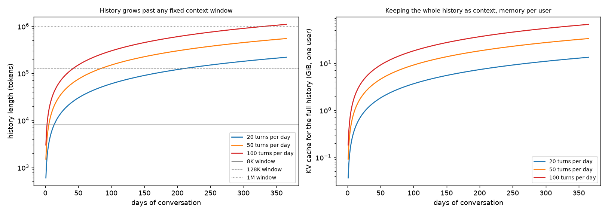

This series is about the language-model side of companion applications and companion robots: what the model has to do, where published work shows it failing, and what can be done about each failure. This first part sets out the requirements and pairs each with a failure and a source. It also puts numbers on the one requirement that follows from arithmetic alone: a companion talks for months, and no fixed context window holds that.

## Requirements and failures

Each row gives a requirement, a documented way it fails, and the work that measured it. The claims are those of the cited papers.

- **A stable persona.** [Zhang et al. (PersonaChat)](https://arxiv.org/abs/1801.07243) note that chit-chat models lack specificity and do not display a consistent personality, and train models conditioned on a profile. The failure persists in instructed chatbots: [Li et al.](https://arxiv.org/abs/2402.10962) measure self-chats between two instructed chatbots and report significant instruction drift within eight rounds for LLaMA2-chat-70B and GPT-3.5, which they trace partly to attention decay over long exchanges. Part 2.
- **Memory across sessions.** [LoCoMo](https://arxiv.org/abs/2402.17753) collects conversations of up to 35 sessions, 300 turns and 9K tokens on average, and finds that models struggle to understand lengthy conversations and long-range temporal and causal dynamics. [LongMemEval](https://arxiv.org/abs/2410.10813) tests information extraction, multi-session reasoning, temporal reasoning, knowledge updates and abstention, and reports a 30% accuracy drop for commercial chat assistants and long-context models memorising information across sustained interactions. [MemGPT](https://arxiv.org/abs/2310.08560) manages tiers of memory to provide extended context within a limited window. Part 3.
- **Recognising and answering feelings.** [EmpatheticDialogues](https://arxiv.org/abs/1811.00207) provides 25k conversations grounded in emotional situations; models trained on it were perceived by human raters as more empathetic. That is a judgement by raters, which is the only measurement it offers. Part 4.
- **Not telling users only what they want to hear.** [Sharma et al.](https://arxiv.org/abs/2310.13548) show that five state-of-the-art assistants consistently exhibit sycophancy, that responses matching a user's views are more likely to be preferred in human preference data, and that optimising against preference models sometimes sacrifices truthfulness. [Perez et al.](https://arxiv.org/abs/2212.09251) find that larger models repeat back a dialogue user's preferred answer. Part 5.
- **Not fostering harmful dependence.** [A four-week randomised controlled trial](https://arxiv.org/abs/2503.17473) (n=981, more than 300k messages) found no significant effect of the assigned interaction mode or conversation type on loneliness, social interaction, emotional dependence or problematic use, but participants who used the chatbot more by their own choice had consistently worse outcomes. [A study of ChatGPT use](https://arxiv.org/abs/2504.03888) (over 3 million conversations analysed, an RCT of close to 1,000 participants over 28 days) reports that very high usage correlates with indicators of dependence and that a small number of users account for a disproportionate share of the most affective cues. Both are correlational on the usage question. Part 6.
- **Responding at conversational speed, by voice.** A latency budget, not a published failure rate. Part 7.
- **Doing so inside a body.** Perception, expressive motion and limited on-board compute. Part 8.

## Why memory is arithmetic before it is a research problem

A companion's history grows with every turn. The sketch below fixes the one measured quantity it needs, tokens per turn from the LoCoMo averages (9K tokens over 300 turns), and treats turns per day and the model shape as stated assumptions.

```python
# What a long-running companion has to carry. Assumptions are stated, not measured.
TOK_PER_TURN = 9000 / 300            # LoCoMo averages: 9K tokens over 300 turns -> 30 tokens per turn (one speaker's utterance)
KV_PER_TOKEN = 2 * 32 * 8 * 64 * 2   # assumed shape: 32 layers, 8 key-value heads of width 64, fp16: keys and values for every past token
for turns in (20, 50, 100):          # assumed turns per day (both sides counted)
    row = []
    for days, name in ((7, 'week'), (30, 'month'), (365, 'year')):
        t = turns * days * TOK_PER_TURN; row.append(f'{name}: {t/1e3:,.0f}K tokens, KV {t*KV_PER_TOKEN/2**30:.1f} GiB')
    print(f'{turns:>3} turns/day  ' + '   '.join(row))
t = 50 * 365 * TOK_PER_TURN; print(f'reading the whole year of history once per turn at 50 turns/day: {sum(50 * d * TOK_PER_TURN for d in range(365)) * 50 / 1e9:.1f} billion token-reads over the year (history grows linearly, every turn re-reads it)')
for w in (8_192, 128_000, 1_000_000): print(f'context window {w:>9,}: filled after {w / (50 * TOK_PER_TURN):.0f} days at 50 turns/day')
```

```
 20 turns/day  week: 4K tokens, KV 0.3 GiB   month: 18K tokens, KV 1.1 GiB   year: 219K tokens, KV 13.4 GiB
 50 turns/day  week: 10K tokens, KV 0.6 GiB   month: 45K tokens, KV 2.7 GiB   year: 548K tokens, KV 33.4 GiB
100 turns/day  week: 21K tokens, KV 1.3 GiB   month: 90K tokens, KV 5.5 GiB   year: 1,095K tokens, KV 66.8 GiB
reading the whole year of history once per turn at 50 turns/day: 5.0 billion token-reads over the year (history grows linearly, every turn re-reads it)
context window     8,192: filled after 5 days at 50 turns/day
context window   128,000: filled after 85 days at 50 turns/day
context window 1,000,000: filled after 667 days at 50 turns/day
```


*Left: at 50 turns a day the history passes an 8K window in 5 days and a 128K window in 85. Right: keeping a year of history as context costs 13 to 67 GiB of cache per user under the assumed shape.*

- **A fixed window is exhausted quickly.** At 50 turns per day, 8K tokens fill in 5 days, 128K in 85, and 1M in about 22 months.
- **Keeping everything as context is expensive per user.** A year of history is about 548K tokens at 50 turns per day and, for the assumed shape, a 33 GiB cache for one user, which multiplies by the number of simultaneous users.
- **Re-reading is quadratic.** Reading the full history on every turn amounts to 5 billion token reads over a year for one user at 50 turns per day.
- **Hence selection.** The memory problem in Part 3 is deciding what to keep and retrieve, and it exists because storing and re-reading everything fails on cost before it fails on quality.

## What the series covers

The eight parts follow the list above: persona drift, memory, empathy and its measurement, sycophancy, dependence and safety, latency and voice, and embodiment. Each draws on published work and, where a CPU can show something, a small measured experiment.

## Limits

- The list of requirements is a selection by the author, and the failure modes cited are the ones with published measurements. Failures without measurements may matter as much.
- The studies cited use specific models and settings and may not describe any given product. The 30% drop and the eight-round drift are those studies' figures.
- The arithmetic assumes the turn rate and the model shape stated in the code. Tokens per turn is taken from one dataset, whose conversations were generated by a pipeline and edited by human annotators, so real chat lengths may differ.
- Attention cost is not part of the memory figures, and quantised or compressed caches would lower them.
