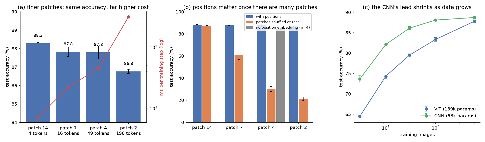

## From pixels to tokens

A Transformer consumes a sequence of vectors. An image is a grid of pixels. Everything in this series about image models starts with the same question: how does the grid become a sequence?

The direct answer, one token per pixel, fails on cost. Self-attention compares every token with every other token, so a 224 x 224 image would produce 50,176 tokens and about 2.5 billion pairs per attention head per layer. The [Vision Transformer](https://arxiv.org/abs/2010.11929) (ViT) states the problem in these words: "Naive application of self-attention to images would require that each pixel attends to every other pixel. With quadratic cost in the number of pixels, this does not scale to realistic input sizes." Its answer is to cut the image into 16 x 16 patches, which turns the same image into 196 tokens and 38,416 pairs, a reduction of 65,536 times.


_Measured on Fashion-MNIST, 3 seeds, error bars are one standard deviation. (a) Patch size against accuracy and cost; the vertical axis starts at 84. (b) Test accuracy when patches are moved to the wrong positions. (c) Accuracy against training-set size for a ViT and a CNN._

## What the sources say

- **The mechanism.** The ViT paper summarises it in one caption: "We split an image into fixed-size patches, linearly embed each of them, add position embeddings, and feed the resulting sequence of vectors to a standard Transformer encoder." For classification it prepends "an extra learnable 'classification token'" whose output state is the image representation. With image size (H, W), patch size P and C channels, each patch is flattened to P^2 x C values, and "N = HW/P^2 is the resulting number of patches, which also serves as the effective input sequence length". The encoder is the unchanged [Transformer](https://arxiv.org/abs/1706.03762), a design its authors describe as "dispensing with recurrence and convolutions entirely".
- **Patch size is a cost setting.** "The Transformer's sequence length is inversely proportional to the square of the patch size, thus models with smaller patch size are computationally more expensive."
- **Positions are learned, and 1D is enough.** ViT uses "standard learnable 1D position embeddings, since we have not observed significant performance gains from using more advanced 2D-aware position embeddings". At initialisation, "the position embeddings ... carry no information about the 2D positions of the patches and all spatial relations between the patches have to be learned from scratch."
- **Less built-in structure than a CNN.** "We note that Vision Transformer has much less image-specific inductive bias than CNNs." The paper's explanation of the consequence: on mid-sized datasets such models "yield modest accuracies of a few percentage points below ResNets of comparable size", because "Transformers lack some of the inductive biases inherent to CNNs, such as translation equivariance and locality, and therefore do not generalize well when trained on insufficient amounts of data." The same paragraph reports the reversal: "if the models are trained on larger datasets (14M-300M images) ... large scale training trumps inductive bias."
- **Scale of the published models.** ViT-Base has 12 layers, hidden size 768 and 86M parameters; ViT-Large has 24 layers and 307M; ViT-Huge has 32 layers and 632M. Pre-trained on ImageNet-21k or the in-house JFT-300M, "the best model reaches the accuracy of 88.55% on ImageNet".
- **Other tasks use the same ingredients or compete with them.** [ResNet](https://arxiv.org/abs/1512.03385) reports 3.57% error on the ImageNet test set for an ensemble. [DETR](https://arxiv.org/abs/2005.12872) casts detection as set prediction with a Transformer, "removing the need for many hand-designed components like a non-maximum suppression procedure or anchor generation". [Segment Anything](https://arxiv.org/abs/2304.02643) builds a segmentation dataset of "over 1 billion masks on 11M licensed and privacy respecting images" and a model that is "promptable, so it can transfer zero-shot to new image distributions and tasks". Later parts of this series cover generation and image-text models.

## Experiment: what do patch size, position and data size do?

**Question.** The paper's claims concern models with tens of millions of parameters and datasets of millions of images. Three of them can be probed at small scale: patch size trades cost against accuracy, position embeddings carry the layout, and a ViT needs more data than a CNN to reach the same accuracy.

**Data.** [Fashion-MNIST](https://arxiv.org/abs/1708.07747): 28 x 28 grayscale images, 10 clothing categories, 60,000 training and 10,000 test images. Pixels are normalised; there is no augmentation.

**Models.** The ViT follows the paper's recipe in miniature: patch embedding by a linear layer, a class token, learnable 1D position embeddings, 4 pre-norm Transformer layers with 4 heads, width 64, MLP width 128. The CNN has three 3 x 3 convolution layers (32, 64, 128 channels), two max-pools, a pool to 2 x 2 and a linear layer: 97,802 parameters. Both train with AdamW (learning rate 1e-3, weight decay 0.05), 200 warm-up steps and cosine decay, batch size 128, exactly 3,000 steps (6.4 passes over the full training set), 3 seeds. Hardware: 32 CPU cores, no GPU.

**(a) Patch size.** Four patch sizes on the full training set:

| Patch | Tokens (with class token) | Parameters | Forward multiply-adds per image | Time per training step | Test accuracy |
|---|---|---|---|---|---|
| 14 x 14 | 5 | 147,658 | 0.72 M | 7.1 ms | 88.29 +/- 0.05 |
| 7 x 7 | 17 | 139,018 | 2.43 M | 22.0 ms | 87.82 +/- 0.26 |
| 4 x 4 | 50 | 139,018 | 7.88 M | 45.1 ms | 87.80 +/- 0.35 |
| 2 x 2 | 197 | 147,658 | 45.74 M | 313.3 ms | 86.77 +/- 0.11 |

Going from patch 14 to patch 2 multiplied the arithmetic by 63 and the step time by 44, and accuracy fell by 1.5 points. Patch 4 against patch 14 cost 11 times the arithmetic and 6.4 times the step time for no accuracy gain. For comparison, the CNN takes 25.2 ms per step.

**(b) Positions.** If position embeddings carry the layout, putting patches at the wrong positions should destroy accuracy. At test time, the patch contents were permuted over positions (5 fixed random permutations, applied to all 10,000 test images) while the position embeddings stayed in place:

| Patch | With positions | Patches shuffled at test |
|---|---|---|
| 14 x 14 | 88.29 +/- 0.05 | 87.37 +/- 0.19 |
| 7 x 7 | 87.82 +/- 0.26 | 61.24 +/- 4.28 |
| 4 x 4 | 87.80 +/- 0.35 | 30.23 +/- 2.27 |
| 2 x 2 | 86.77 +/- 0.11 | 21.17 +/- 1.68 |

A ViT trained without position embeddings (patch 4) reaches 84.39 +/- 0.39, and shuffling leaves it unchanged at 84.39, because without positions the encoder treats the patches as an unordered set. Position embeddings are therefore worth 3.4 points at patch 4, and a model with many small patches depends on them heavily: at patch 4, moving the patches takes accuracy from 87.8 to 30.2 (chance is 10).

**(c) Data size.** The same ViT (patch 4) and CNN were trained for the same 3,000 steps on random subsets of the training set:

| Training images | ViT | CNN | CNN lead |
|---|---|---|---|
| 300 | 64.46 | 73.62 | 9.2 points |
| 1,000 | 74.34 | 82.12 | 7.8 |
| 3,000 | 79.51 | 86.12 | 6.6 |
| 10,000 | 83.36 | 88.10 | 4.7 |
| 60,000 | 87.80 | 88.71 | 0.9 |

The CNN leads at every size, and the lead shrinks monotonically as data grows. Both models fit the smallest subsets completely (final training loss near zero), so the gap at 300 images is a generalisation gap.

## Engineering reading

1. **Patch size is the first compute decision.** Attention cost grows with the square of the token count, and the token count grows with the square of the inverse patch size, so halving the patch edge multiplies attention cost by 16. On this dataset the extra cost bought no accuracy. Whether finer patches pay off on detailed natural images is not tested here; the published models use 14 or 16 pixel patches on 224-pixel inputs.
2. **A trained ViT depends on patch position.** Patch contents alone carry most of the signal (84.4% with no positions at all), and positions add the rest. The sensitivity to a wrong layout grows with the token count. For tasks where layout matters, such as detection and segmentation, position handling is part of the design, not a detail.
3. **Inductive bias and data trade against each other.** The CNN's convolutions encode locality and translation equivariance, and that is worth 9 points at 300 images and 0.9 at 60,000. The measured trend points the same way as the paper's claim, and it does not reach the point where the ViT wins.
4. **Pretrained checkpoints are the practical route.** The advantage the paper reports appears after pre-training on 14M to 300M images. Training a ViT from scratch on a few thousand images is the weakest setting for it.

## What a small team can reproduce

The 42 training runs finished in under three hours on a 32-core CPU, with no GPU. That covers the whole comparison above, because Fashion-MNIST images are 28 x 28 and the models have 100,000 to 150,000 parameters. It does not cover the published setting: ViT-Base has 86M parameters and the paper's reversal needs pre-training on millions of images. A small team should treat the experiment as a way to see the mechanisms, then fine-tune a released checkpoint for real work.

## Limits

- One dataset, 28 x 28 grayscale, 10 classes. Natural images are larger and harder, and these numbers should not be read as ImageNet behaviour.
- A fixed budget of 3,000 steps for every model. The patch-2 model ended with a higher training loss (0.299) than patch 14 (0.175), so a longer schedule might narrow or reverse the patch-size ranking. That was not tested.
- One optimiser recipe, no tuning for either model and no augmentation. The ViT has more parameters (139,018 against 97,802) and still trails the CNN.
- The 60,000-image ViT entry is the patch-4 run from table (a); both use the same configuration and seeds.
- No crossover appears. The paper's reversal is stated for 14M to 300M images, far beyond this setup.
- At patch 14 (4 patches) the shuffle test changes little (87.37 against 88.29). The cause is not tested here; the 4 large patches may each carry enough evidence to classify.
- Three seeds give rough standard deviations. Step times were measured separately on an idle machine (8 threads, 200 steps after a warm-up); the training runs themselves ran 8 at a time, so their wall-clock times are not comparable.

Next part: image tokenizers, where a learned codebook turns patches into discrete tokens.

## Code and output

Model and training code (`vitlib.py`). The job runner repeats this code for each configuration, seed and subset.

```python
import gzip, os, time, json, math, sys, numpy as np, torch, torch.nn as nn, torch.nn.functional as F
D_DIR = os.path.dirname(os.path.abspath(__file__))
def _idx(name):
    b = gzip.open(os.path.join(D_DIR, name + ".gz")).read()
    return np.frombuffer(b, np.uint8, offset=16 if "images" in name else 8)
def load():
    xs = _idx("train-images-idx3-ubyte").reshape(-1, 28, 28); ys = _idx("train-labels-idx1-ubyte"); xt = _idx("t10k-images-idx3-ubyte").reshape(-1, 28, 28); yt = _idx("t10k-labels-idx1-ubyte")
    f = lambda a: ((torch.tensor(a, dtype=torch.float32) / 255 - 0.286) / 0.353)[:, None]
    return f(xs), torch.tensor(ys, dtype=torch.long), f(xt), torch.tensor(yt, dtype=torch.long)
def patchify(x, p):  # (B,1,28,28) -> (B, N, p*p), row-major patch order
    B = x.shape[0]; n = 28 // p
    return x.reshape(B, n, p, n, p).permute(0, 1, 3, 2, 4).reshape(B, n * n, p * p)
class ViT(nn.Module):
    def __init__(s, p=4, dim=64, depth=4, heads=4, pos=True, ncls=10):
        super().__init__(); s.p = p; s.N = (28 // p) ** 2; s.proj = nn.Linear(p * p, dim); s.cls = nn.Parameter(torch.zeros(1, 1, dim)); s.pos = nn.Parameter(torch.randn(1, s.N + 1, dim) * 0.02) if pos else None
        s.tr = nn.TransformerEncoder(nn.TransformerEncoderLayer(dim, heads, 2 * dim, 0.0, "gelu", batch_first=True, norm_first=True), depth, enable_nested_tensor=False); s.ln = nn.LayerNorm(dim); s.head = nn.Linear(dim, ncls)
    def forward(s, x, perm=None):
        t = s.proj(patchify(x, s.p))
        if perm is not None: t = t[:, perm]                          # shuffle which patch sits at which position (test-time control)
        t = torch.cat([s.cls.expand(len(t), -1, -1), t], 1)
        if s.pos is not None: t = t + s.pos
        return s.head(s.ln(s.tr(t)[:, 0]))
class CNN(nn.Module):
    def __init__(s, ncls=10):
        super().__init__(); s.net = nn.Sequential(nn.Conv2d(1, 32, 3, padding=1), nn.ReLU(), nn.MaxPool2d(2), nn.Conv2d(32, 64, 3, padding=1), nn.ReLU(), nn.MaxPool2d(2), nn.Conv2d(64, 128, 3, padding=1), nn.ReLU(), nn.AdaptiveAvgPool2d(2), nn.Flatten(), nn.Linear(512, ncls))
    def forward(s, x): return s.net(x)
def nparams(m): return sum(p.numel() for p in m.parameters() if p.requires_grad)
@torch.no_grad()
def acc(m, x, y, perm=None):
    m.eval(); c = 0
    for i in range(0, len(x), 1000): o = m(x[i:i + 1000], perm) if perm is not None else m(x[i:i + 1000]); c += (o.argmax(1) == y[i:i + 1000]).sum().item()
    return 100 * c / len(x)
def train(m, xs, ys, steps, seed, bs=128, lr=1e-3):
    g = torch.Generator().manual_seed(seed); opt = torch.optim.AdamW(m.parameters(), lr, weight_decay=0.05); t0 = time.time()
    sched = torch.optim.lr_scheduler.LambdaLR(opt, lambda t: min(1, (t + 1) / 200) * 0.5 * (1 + math.cos(math.pi * t / steps)))
    for st in range(steps):
        m.train(); i = torch.randint(len(xs), (bs,), generator=g); loss = F.cross_entropy(m(xs[i]), ys[i]); opt.zero_grad(); loss.backward(); nn.utils.clip_grad_norm_(m.parameters(), 1.0); opt.step(); sched.step()
    return time.time() - t0, loss.item()
```

Aggregated results from `agg.py` (3 seeds per row), and solo step timings in milliseconds from `solo_timing.py`:

```text
42
('nopos', 4): n=3 acc 84.39 ± 0.39 | shuffled 84.39 ± 0.39 | params 135818 tokens 50 MMACs 7.88 | train_s median 2067 | train loss 0.339
('patch', 14): n=3 acc 88.29 ± 0.05 | shuffled 87.37 ± 0.19 | params 147658 tokens 5 MMACs 0.72 | train_s median 267 | train loss 0.175
('patch', 2): n=3 acc 86.77 ± 0.11 | shuffled 21.17 ± 1.68 | params 147658 tokens 197 MMACs 45.74 | train_s median 7201 | train loss 0.299
('patch', 4): n=3 acc 87.80 ± 0.35 | shuffled 30.23 ± 2.27 | params 139018 tokens 50 MMACs 7.88 | train_s median 1847 | train loss 0.238
('patch', 7): n=3 acc 87.82 ± 0.26 | shuffled 61.24 ± 4.28 | params 139018 tokens 17 MMACs 2.43 | train_s median 612 | train loss 0.173
('scale', 'cnn', 1000): n=3 acc 82.12 ± 0.19 | params 97802 | train_s median 601 | train loss 0.015
('scale', 'cnn', 10000): n=3 acc 88.10 ± 0.28 | params 97802 | train_s median 600 | train loss 0.236
('scale', 'cnn', 300): n=3 acc 73.62 ± 0.93 | params 97802 | train_s median 780 | train loss 0.000
('scale', 'cnn', 3000): n=3 acc 86.12 ± 0.41 | params 97802 | train_s median 771 | train loss 0.147
('scale', 'cnn', 60000): n=3 acc 88.71 ± 0.19 | params 97802 | train_s median 369 | train loss 0.219
('scale', 'vit', 1000): n=3 acc 74.34 ± 0.52 | params 139018 | train_s median 1781 | train loss 0.000
('scale', 'vit', 10000): n=3 acc 83.36 ± 0.50 | params 139018 | train_s median 1393 | train loss 0.004
('scale', 'vit', 300): n=3 acc 64.46 ± 0.22 | params 139018 | train_s median 318 | train loss 0.000
('scale', 'vit', 3000): n=3 acc 79.51 ± 0.29 | params 139018 | train_s median 202 | train loss 0.000

solo ms/step (batch 128, 8 threads, idle machine): {"p14": 7.1, "p7": 22.0, "p4": 45.1, "p2": 313.3, "cnn": 25.2}
```
